# AgentEmulator

<p align="right"><a href="README_zh.md">中文</a> | <b>English</b></p>

## Overview

AgentEmulator is an **emulation and experimentation platform for trustworthy AI agent infrastructure**. The platform was initiated by [**HuangLab**](http://www.xintelligence.pro/), led by Professor Huawei Huang at the School of Software Engineering, Sun Yat-sen University. AgentEmulator uses blockchain as the foundation for trusted records and settlement. **It aims to help researchers and students** investigate agent identity, behavioral auditing, payment settlement, incentives, and governance, and to grow into a **research tool** that supports trustworthy interaction and collaboration among AI agents.

AgentEmulator is an **experimental tool** for scenarios that combine AI agent behavior with blockchain, built on [**BlockEmulator-X**](https://github.com/HuangLab-SYSU/block-emulator-x) (i.e., BlockEmulator v2.0). BlockEmulator-X (BlockEmulator v2.0) is a blockchain emulation tool **open-sourced by HuangLab in May 2026**, as the upgraded successor to the original BlockEmulator v1.0; its GitHub repository is available at https://github.com/HuangLab-SYSU/block-emulator-x.

### Demo Video

[**AgentEmulator Demo Video**](https://www.bilibili.com/video/BV1d54g6oEST/) (on Bilibili)

### Paper

[**AgentEmulator: A Blockchain-Empowered Testbed for Trustworthy AI Agent Infrastructure（HAL）**](https://hal.science/hal-05774794)

[**AgentEmulator: A Blockchain-Empowered Testbed for Trustworthy AI Agent Infrastructure（ResearchGate）**](https://www.researchgate.net/publication/415363728_AgentEmulator_A_Blockchain-Empowered_Testbed_for_Trustworthy_AI_Agent_Infrastructure)

Jian Zheng, Jianbo Xiong, Feihong Hu, and Huawei Huang (corresponding author). October 2026. Preprint.

The paper formalizes the trace–transaction mapping, the three execution orders (logical trace order, backend execution order, visualization order), the reproducibility requirements, and an evaluation methodology for payment completion and execution overhead.

If you use AgentEmulator in your research, please cite this paper (see [CITATION.cff](CITATION.cff)):

```Plaintext
@misc{zheng2026agentemulator,
  author = {Zheng, Jian and Xiong, Jianbo and Hu, Feihong and Huang, Huawei},
  title = {{AgentEmulator}: A Blockchain-Empowered Testbed for Trustworthy {AI} Agent Infrastructure},
  year = {2026},
  month = oct,
  doi = {10.13140/RG.2.2.23825.60000},
  url = {https://hal.science/hal-05774794}
}
```

### Why trustworthy AI agent infrastructure

AI agents are moving out of chat windows and into real workflows: they call APIs, hold identities, pay for services, and act on behalf of people and organizations. When agents transact with each other, three trust gaps appear that better models cannot close:

|Trust gap|What it means in practice|
|---|---|
|Behavior is not auditable|There is no neutral, tamper-resistant record of what an agent did and why.|
|Accountability is not traceable|When an agent errs, exceeds its authority, or causes a loss, you cannot locate which agent, authorized by whom, at which step.|
|Settlement is not trustworthy|Value exchange between agents — and between agents and API services — lacks a neutral ledger.|

Closing these gaps requires a dedicated layer of infrastructure: an auditing and settlement layer that is independent of the models themselves. AgentEmulator is the experimental platform for building and evaluating that layer. In it, the blockchain plays a specific role — a neutral substrate for trusted records and settlement — not a universal solution.

### What AgentEmulator is and is not

AgentEmulator measures the infrastructure layer, not agent capability. Capability benchmarks (AgentBench, WebArena, OSWorld, SWE-bench) ask: can the agent finish the task? AgentEmulator asks: when agents join, pay, and leave, are identity, payments, records, and settlement working correctly, at what cost, and under what mechanisms? The two questions are complementary: a completed payment proves a payment happened, not that the task was done well. AgentEmulator supplies the transaction records and account views that make the infrastructure question answerable and reproducible.

**What AgentEmulator does:**

AgentEmulator currently supports two run modes.

**Agent behavior replay mode:** this mode covers trace-driven behavior replay, records of identity registration and revocation, direct payments, experimental data collection, and visualization. Researchers describe agent actions in a JSONL trace file. The `agentSupervisor` module compiles the trace into a transaction dataset. The module then starts a BlockEmulator-X blockchain and submits the transactions for on-chain execution and recording. After the experiment, AgentEmulator records transaction and account data and generates balance plots. AgentEmulator also creates an HTML gallery with Chinese and English interface options. The launch script opens the gallery in the default browser.

In Agent behavior replay mode, agents' behavior is predefined in the trace. Transactions follow the **User-specified Original Sequence** policy. No additional transaction orchestration or scheduling algorithm is included. Researchers can extend the default policy with mechanisms such as transaction reordering, priority rules, or agent weights.

**LLM API integration mode:** in this mode, one identity from the Trace file is handed to a model API for online control, while all other identities still act as described in the Trace file. The model reads global data from on-chain block snapshots, reasons over it, and makes concrete decisions to pay, wait, or leave; accepted decisions are converted into on-chain transactions. Each run records the decision log of every round and supports exporting timeline figures and cross-model comparison figures. This mode supports only the `static_relay` consensus. One reminder: calling the model may consume your API quota.

Future releases will expand the supported protocols, scenarios, and evaluation capabilities. Contributions and research-specific extensions are welcome.

**What AgentEmulator deliberately does not do:**

it introduces no transaction scheduling algorithm — it follows the User-specified Original Sequence policy, leaving orchestration, priority rules, and agent weights as research extensions.

### The five-layer stack

AgentEmulator maps onto a five-layer taxonomy of trustworthy agent infrastructure. The layers define the research agenda; the tooling lands incrementally.

|Layer|Question|AgentEmulator status|
|---|---|---|
|L1 Identity|Who is this agent, and who authorizes it?|`did-simple` derives deterministic identifiers; DID registry contracts are roadmap|
|L2 Auditing|What did it do, and can it be verified later?|Verifiable-log structures (e.g., Merkle accumulators) are roadmap; AgentEmulator currently records the action stream and per-round decision logs|
|L3 Settlement|How do agents pay each other at high frequency?|`direct-pay` today; payment channels and batch settlement are roadmap|
|L4 Incentives|How is good behavior rewarded on-chain?|Roadmap (reputation, points, prediction markets)|
|L5 Governance|Who arbitrates disputes, and how do regulators plug in?|Roadmap|

### A demonstrated workflow

The paper demonstrates the workflow with 100 agents and 10,000 payment transactions on a 4-shard × 4-node blockchain (single host, Mac mini / Apple M4 Pro / 24 GB, Go 1.25.7, seed 20260903), producing 23 figures across four balance views.

This demonstration establishes the workflow — trace in, ledgers and views out. It does not establish performance or scalability; throughput, latency, and resource overhead require separate timing measurements, which are part of the evaluation methodology in the paper.

<p align="center">
  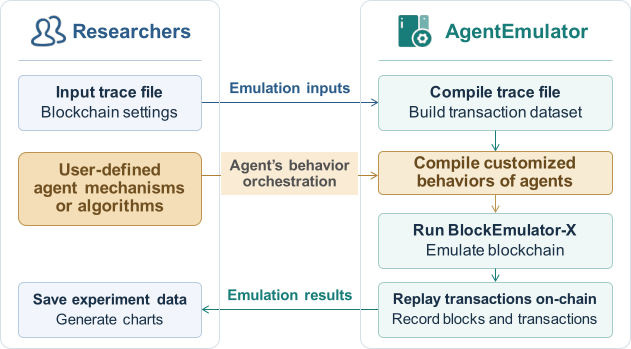
  <br>
  Figure 1: AgentEmulator's general workflow
</p>

This diagram illustrates the platform's broader purpose. The user-defined mechanisms and algorithms provide scope for extensions and original research.

### Reproducibility

Repeatable experiments require fixed inputs: the same trace bytes, the same seed, the same configuration, the same source revisions, and a clean initial registry. AgentEmulator automates consistent preparation, and the paper's Appendix A specifies the records, checks, and figure-regeneration commands that make a run verifiable.

In Agent behavior replay mode, the same seed, Trace file, and code version produce byte-for-byte identical transaction datasets. In LLM API integration mode, model responses and concurrent block production advance in real time, so repeated runs with the same seed may produce different decisions and confirmation times; users can replay the experiment workflow from the captured actions.

### The HuangLab family

AgentEmulator is part of HuangLab's blockchain experimentation stack at Sun Yat-sen University:

|Project|Role|Link|
|---|---|---|
|BlockEmulator|Emulator for blockchain sharding protocols (IEEE TSC 2025). BlockEmulator v1.0, open-sourced in 2023|https://github.com/HuangLab-SYSU/block-emulator|
|BlockEmulator-X|Successor with EVM execution; the backend of AgentEmulator. BlockEmulator v2.0, open-sourced in May 2026|https://github.com/HuangLab-SYSU/block-emulator-x|
|AgentEmulator|This project — agent behavior on a sharded blockchain. BlockEmulator v3.0, open-sourced in September 2026|https://github.com/HuangLab-SYSU/agent-emulator|
|BrokerChain|Sharded blockchain testnet — academic edition (~400 external nodes), originating from "BrokerChain: A Cross-Shard Blockchain Protocol for Account/Balance-based State Sharding" (INFOCOM 2022)|https://github.com/HuangLab-SYSU/BrokerChain|
|brokerchain-mcp|MCP server (`register_agent` / `append_log` / `open_channel` / `pay`) with dual backends: AgentEmulator simulation and BrokerChain testnet|in development|

### What does AgentEmulator support?

**The AgentEmulator platform is designed to simplify experiment setup, mechanism validation, and data analysis**, enabling **researchers** to configure the underlying blockchain, observe agent behavior, and evaluate how different mechanisms affect experimental outcomes.

The following diagram shows the AgentEmulator workflow from a user's perspective.

### Roadmap

Development will focus on five areas: **identity, settlement, auditing, incentives, and governance**. The roadmap below is provisional and may evolve with research and development progress.

|Stage|Focus|
|---|---|
|**v1.0: Basic behavior emulation (released)**|Trace-driven replay of `join`, `pay`, and `leave` actions, with transaction execution, action-to-transaction mapping, account records, and visualization.|
|**v2.0: LLM API integration mode (current release)**|On top of the Trace replay mode, one identity from the Trace file is handed to a model API. The model periodically observes on-chain data, reasons, and makes decisions; validated decisions become on-chain transactions, with decision logs, a timeline, and cross-model comparison figures.|
|**Near term: Identity and auditing**|Smart contract state management for DID registration and revocation, permission declarations, verifiable behavior logs, and traceability.|
|**Medium term: Payments and interactions**|Micropayments, payment channels, batch settlement, experiments with feedback across multiple rounds, and richer agent service interactions.|
|**Later: Incentives and collaborative governance**|Task allocation, behavior coordination, and accountability in multi-agent collaboration, with emulation and evaluation of different collaboration strategies.|
|**Long term: Benchmarking**|Standardized scenarios, datasets, and metrics for comparing trustworthy infrastructure approaches through reproducible experiments.|

### Repository

The source code is available on [GitHub](https://github.com/HuangLab-SYSU/agent-emulator).

### Terminology

This section describes the main terms in AgentEmulator, helping researchers understand how the system components, input files, and configuration files relate. The basic workflow of AgentEmulator is: **researchers describe agent behavior in a Trace file and configure the LLM API and task goal for the selected agent; agentSupervisor reads the Trace and starts the blockchain environment with BlockEmulator-X; during the experiment, the system calls the LLM API with on-chain state to generate decisions, validates the returned actions, and updates the effective actions that need to go on-chain into the actually executed Trace (Agent behavior replay mode does not include LLM API calls or dynamic Trace updates — all agents follow the original Trace); the system converts pending actions into transactions and submits them to the blockchain, then records experimental data and presents the results.**

|Term|Description|
|---|---|
|AgentEmulator|An agent behavior emulator built on BlockEmulator-X. AgentEmulator converts agent actions into blockchain transactions, records experimental data, and presents the results.|
|Agent|An experimental participant whose `join`, `pay`, and `leave` actions are defined in a trace.|
|BlockEmulator-X|The underlying blockchain emulator, responsible for node operation, consensus, block production, transaction execution, and on-chain records. See the [BlockEmulator-X repository](https://github.com/HuangLab-SYSU/block-emulator-x).|
|Trace file|A JSONL input file describing a sequence of agent actions. Each line contains one action or one plain transfer.|
|`agentEmuConfig.yaml`|The agent-level experiment configuration: trace path, identity derivation seed, output directory, and blockchain execution settings.|
|`config.yaml`|The BlockEmulator-X configuration template: shard count, node count, block interval, and other blockchain parameters.|
|`agentSupervisor`|The experiment coordinator. `agentSupervisor` reads configurations and traces, then compiles actions into transactions. The module also manages blockchain execution and produces experiment outputs.|
|`agent_id`|A unique identifier assigned to an agent in the trace, such as `agent-alice`. The identifier distinguishes agents and links each agent's behavior records.|
|`seed`|The identity derivation seed in `agentEmuConfig.yaml`. The same seed and `agent_id` produce the same DID.|
|DID|A Decentralized Identifier derived automatically from `seed` and `agent_id`. DIDs do not need to be entered in the trace.|
|LLM API|The interface through which AgentEmulator calls an external large language model (LLM). Services compatible with Chat Completions are currently supported; researchers configure the endpoint, model name, and authentication in agentEmuConfig.yaml.|
|API Agent|An Agent controlled by the LLM API. Selected through `agent_api.agent_id` from an existing identity in the Trace. The system keeps the identity's first join action; subsequent behavior is taken over by model decisions.|

### System architecture

The following diagram shows AgentEmulator's modules and their relationships.

<p align="center">
  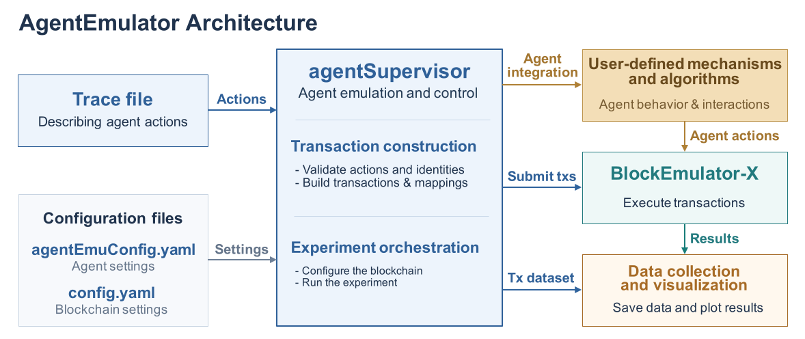
  <br>
  Figure 2: AgentEmulator system architecture
</p>

The LLM API integration mode adds a model-decision hop to this architecture: the on-chain supervisor collects snapshots from all shards and hands them to AgentSupervisor, which calls the external model API, validates the decisions, and submits the accepted ones. See `docs/hybrid-agent-api.md`.

---

# Getting Started with AgentEmulator

## Prerequisites

AgentEmulator runs on MacOS, Linux, and Windows.

| Dependency | Required version | Verification command | Purpose |
| --- | --- | --- | --- |
| Go | ≥ 1.25.7 | `go version` | Build and run the emulator |
| Python 3 | ≥ 3.8 | `python3 --version` (Windows: `python --version` or `py -3 --version`) | Generate plots after each experiment |
| matplotlib / numpy / pandas | — | `python3 -c "import matplotlib, numpy, pandas"` | Plotting and data analysis |

Install the Python dependencies if needed (use `pip` on Windows):

```bash
pip3 install matplotlib numpy pandas
```

Clone and build the project:

```bash
git clone https://github.com/HuangLab-SYSU/agent-emulator.git
cd agent-emulator
go build ./...      # Verify the build environment
```

## Five-minute quick start

On **Windows**, run the batch script from Command Prompt or double-click `run_agentemu.bat` in File Explorer:

```text
run_agentemu.bat
```

To use a custom configuration:

```text
run_agentemu.bat my-config.yaml
```

The Windows and Bash scripts follow the same workflow:

Build → clear previous results → run the experiment → generate plots → open the HTML gallery.

If `python` is unavailable, the Windows script falls back to `py -3`.

Press `Ctrl-C` to stop an experiment safely. Consensus node subprocesses started by BlockEmulator-X will also be cleaned up.

> **Note:** Plotting is skipped if the experiment fails. Also, at the end of each experiment and before plotting, the script clears previous plots in `figs/figs_results/`, so the gallery always reflects **the most recent successful run**.

On **MacOS and Linux**, run:

```bash
bash run_agentemu.sh
```

The launch script performs these steps automatically:

1. **Build** the project with `go build ./...`.
2. **Clear previous experiment data** by deleting `./exp`.
3. **Run the experiment:**
   - **Agent behavior replay mode:** read `agentEmuConfig.yaml` → compile the trace into a transaction dataset → automatically start the BlockEmulator-X blockchain (4 shards, 4 nodes per shard by default) → commit all transactions on chain → experiment complete, the blockchain stops automatically.
   - **LLM API integration mode:** read `agentEmuConfig.yaml` and select the API Agent → automatically start the BlockEmulator-X blockchain → other agents inject preset actions following the Trace while the API Agent calls the model with on-chain snapshots to make decisions → agentSupervisor validates the decisions and submits accepted transactions on chain → when the time limit is reached, stop injecting new actions, wait for committed transactions to settle, record results, and shut down the blockchain.
4. **Generate plots** from the latest round's agent ledgers and save PNG files to `figs/figs_results/`.
5. **Build and open the HTML gallery** containing the plots.

To use a custom configuration:

```bash
bash run_agentemu.sh my-config.yaml
```

## Trace File Setup

A trace file provides the input for an experiment. The file uses JSONL format, with one agent action or one plain blockchain transfer per line. In agent action records, `agent_id` identifies the agent performing the action, and `ts` defines the logical order. The `action` field specifies `join`, `pay`, or `leave`. AgentEmulator generates the emulation results from this file in a deterministic order:

```text
Trace file (experiment intent)
    │  Compile intent into blockchain transactions
    │  (DID derivation, nonces, and data fields)
    ▼
Transaction dataset → Emulation replay → Agent ledgers / On-chain metrics → Plots
```

<p align="center">
  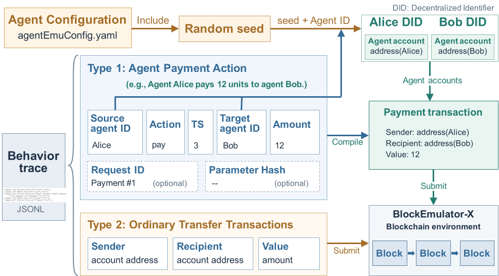
  <br>
  Illustration of the fields in a behavior trace. An agent action is compiled into a payment transaction that the blockchain can process.
</p>

### Trace Basics

1. **Actions and transactions.** Describe actions in the trace. Blockchain transactions do not need to be constructed manually. AgentEmulator deterministically generates DIDs, transaction nonces, and data fields from the action records and `seed`.
2. **Reproducibility and ordering in Agent behavior replay mode.** The same trace, seed, and code version produce the same transaction plan (see FAQ Q10). Records are ordered by `ts`, with ties resolved by file order. `ts` defines the logical order rather than an on-chain timestamp. Changing the gaps between `ts` values does not control transaction commit times.
3. **Trace timing in LLM API integration mode.** `agentSupervisor` uses the first retained Trace action as the time baseline and divides the difference between each action's `ts` and the baseline by `trace_time_scale`, yielding the planned injection time relative to the experiment start, in milliseconds. Records with the same time are processed in file order. Due to the injection rate and on-chain snapshot collection, actions may be injected later than planned; delayed actions keep their original order. The API Agent's subsequent actions are decided in real time by the model from on-chain observations and submitted after validation. `ts` gives the planned injection time of a Trace action; the actual confirmation time depends on transaction execution and block progress.
4. **Agent lifecycle.** `join` and `leave` update each agent's `active` status in `agent_registry.json`. Both parties must be active when a `pay` action is processed.
5. **Record linkage and versioning.** `request_id` links payment actions, on-chain transactions, and ledger records. Globally unique `request_id` values are recommended. `params_hash` identifies the version of action parameters. AgentEmulator copies `params_hash` unchanged into the mapping file to support data management across rounds.
6. **Plain transfers.** Records with `sender`, `recipient`, and `value` can be mixed with agent actions to create workloads containing different transaction types.

The repository includes the following basic sample traces: `traces/minimal.jsonl` (a minimal example with two agents joining and making a payment) and `traces/agent=100_txs=10000.jsonl` (the trace used by the v1.0 basic example, with 100 agents and 10,000 transactions). Example trace:

```json
{"agent_id":"agent-alice","action":"join","params_hash":"doc-alice-v1","ts":1}
{"agent_id":"agent-bob","action":"join","params_hash":"doc-bob-v1","ts":2}
{"agent_id":"agent-alice","action":"pay","target":"agent-bob","amount":12,"request_id":"payment-1","ts":3}
{"agent_id":"agent-bob","action":"leave","params_hash":"exit-bob","ts":5}
```

### Action Types

| Type | Meaning | Compiled transaction |
| --- | --- | --- |
| `join` | Register an agent as active | DID `register` contract call |
| `pay` | Pay another agent | Plain transfer |
| `leave` | Deregister an agent | DID `revoke` contract call |
| Plain transfer | Transfer between blockchain accounts, without an agent action | Plain transfer |

Plain transfer records have no `action` field. AgentEmulator identifies plain transfers by three fields: `sender`, `recipient`, and `value`. The `sender` field contains an account address. Plain transfers follow the record order in the trace:

```json
{"sender":"0xabc...","recipient":"0xdef...","value":"12345"}
```

**LLM API response rules.** Each model call should return one JSON object with an `action` field set to `pay`, `wait`, or `leave`. `pay` pays a designated agent and requires the payee identifier `target` and the amount `amount`. `wait` means waiting for this round: no payee or amount is provided and no on-chain transaction is produced. `leave` means leaving the experiment: no payee or amount is provided, and after validation `agentSupervisor` converts it into a leave transaction.

Model responses and the original Trace use different input formats. The model returns one decision object per round; the runtime determines which agent executes the action. The original Trace uses JSONL format, with one preset action or one plain transfer per line. For payments, the `amount` in a model response must be a positive decimal integer string within `uint64`, such as `"160"`. The same field in an agent payment record of the Trace uses a JSON integer, such as `160`. Example LLM API response:

```json
{"action":"pay","target":"agent-gold-supplier","amount":"160","summary":"Pay 160 wei for gold."}
```

### Input Requirements

1. Both `agent_id` and `target` in a `pay` action must be **active** (joined and not yet left). A violation aborts the experiment.
2. Only an active agent can `leave`. An agent that rejoins after leaving must register again.
3. `amount` must be a positive integer. New on-chain accounts receive an initial balance of 10^36 wei, which is sufficient for typical experiments.
4. **Do not enter DIDs in the trace.** AgentEmulator derives DIDs deterministically from `seed` and `agent_id`.
5. Use globally unique `request_id` values to simplify payment-intent lookup and analysis.

### Validation Rules for LLM API Responses

**LLM API validation and invalid actions.** In LLM API integration mode, `agentSupervisor` validates the format and action type of each model response. For `pay`, it also checks against the latest state whether the payee is active, whether the payment is a self-transfer, and whether the available balance is sufficient. `wait` and `leave` should not carry a payee or amount; `wait` produces no on-chain transaction. Model decisions with format errors or failed validation are recorded in the decision log; no transaction is submitted for that round and the experiment keeps running.

For agents not connected to the LLM API, an action that violates runtime rules — such as an inactive payer or payee, a duplicate leave, or a zero-amount agent payment — is skipped by `agentSupervisor`, which records the original line number, request identifier, failure time, and reason in `trace_failures.jsonl`. Skipped actions do not change agent state, do not consume transaction nonces, and do not produce on-chain transactions; subsequent actions keep their original order.

Malformed Trace files, plain transfers that try to spend directly from the API Agent's account, and errors in transaction compilation, result writing, on-chain snapshot collection, or blockchain execution still abort the experiment. Agent behavior replay mode keeps the strict validation rules and aborts with an error when an invalid background action is encountered.

### The Trace File in LLM API Integration Mode

The original Trace file is the experiment input that defines agent identities and preset behavior. When LLM API integration mode is enabled, the Supervisor of BlockEmulator-X keeps the API Agent's first `join` in the original Trace; the agent's subsequent actions are decided by the model from on-chain observations. Preset actions of all other agents are still scheduled at the original Trace times and order.

Actions actually adopted during the experiment are written, in processing order, to `round_001/input_actions.jsonl` in the results directory. The file contains the actions defined in the original Trace plus the actions produced by validated and submitted API Agent decisions. The original Trace file itself remains unchanged. `wait` produces no on-chain transaction and is not written to the actions file. Skipped invalid actions are recorded separately in `round_001/trace_failures.jsonl`.

The following excerpt from the metals trading scenario omits intermediate records. The first two lines are join actions from the original Trace, the third line is a preset funding action, and the last line is a gold payment generated by the API Agent and accepted by validation. Each line is an independent JSON object.

```json
{"agent_id":"agent-metal-buyer","action":"join","ts":1794363490779,"request_id":"metals-join-agent-metal-buyer","params_hash":""}
{"agent_id":"agent-gold-supplier","action":"join","ts":1794363490779,"request_id":"metals-join-agent-gold-supplier","params_hash":""}
{"agent_id":"agent-funder-a","action":"pay","target":"agent-metal-buyer","amount":55,"ts":1794363610783,"request_id":"metals-funding-03","params_hash":""}
{"agent_id":"agent-metal-buyer","action":"pay","target":"agent-gold-supplier","amount":160,"ts":1794363625783,"request_id":"api-agent-metal-buyer-1794363490779374000-000009","params_hash":""}
```

The payment amount in a model response is a string, such as `"160"`; when written to the actions file it becomes the JSON integer `160`. The `ts` of the original Trace is used to compute the planned injection time, while the `ts` in the actions file is the Unix millisecond timestamp recorded when the action was processed. To check whether a transaction was finally committed, look up the transaction hash by `request_id` in `agent_action_txs.jsonl`, then query the final confirmation time in the on-chain transaction records.

## Configuration

AgentEmulator has two configuration layers. `agentEmuConfig.yaml` controls the agent experiment. `config.yaml` configures the underlying BlockEmulator-X blockchain.

### Agent configuration: `agentEmuConfig.yaml`

```yaml
base:
  blockemulator_config: ./config.yaml   # BlockEmulator-X template: shards, nodes, and consensus type
  result_dir: ./exp/metals-savings-22000-deepseek   # Results directory. Use a new empty directory for each run
  module_root: "."                      # Repository root containing go.mod and cmd/, used to build the blockchain
experiment:
  seed: 20260903                        # Deterministic seed for agent identities
  trace: ./traces/metals_savings_22000.jsonl   # Metals scenario: background payments, buyer funding, and gold supplier churn
chain:
  enabled: true                         # Start BlockEmulator-X to execute transactions
  run_timeout_seconds: 900              # Timeout for the whole experiment, including startup, run, and teardown
  node_exit_grace_seconds: 15           # Time nodes wait to exit after the supervisor
loop:
  max_rounds: 1                         # Round limit for Agent behavior replay mode. LLM API integration mode ends at the run time limit
protocols:
  pay:
    plugin: direct-pay                  # Direct per-payment settlement
  identity:
    plugin: did-simple                  # Basic DID identity plugin
    contract_address: "0x0000000000000000000000000000000000000030"
agent_api:
  enabled: true                         # true: LLM API integration mode; false: Agent behavior replay mode
  agent_id: agent-metal-buyer           # This identity must have a join record in the Trace
  initial_balance: "15"                 # API Agent's initial balance in wei, as a string
  adapter: chat-completions             # Endpoint prefix; the adapter appends /chat/completions
  base_url: https://api.deepseek.com
  model: deepseek-flash                 # Model identifier provided by the provider
  api_key_file: ./.secrets/deepseek_api_key   # The file contains only the LLM API Key. Relative to this YAML
  # To use an environment variable instead, remove api_key_file above and enable the line below
  # api_key_env: DEEPSEEK_API_KEY
  # The task goal is sent to the model together with the on-chain observation
  goal: >-
    The goal provided to the LLM API.
  max_blocks_during_decision: 5         # Block quota shared by all shards while the model thinks; 0 pauses new proposals
  decision_timeout_seconds: 60          # Timeout for one model decision
  decision_interval_seconds: 10         # Interval counted from the end of the previous round
  run_duration_seconds: 600             # Active run time; new actions stop being injected when it elapses
  drain_timeout_seconds: 120            # Upper bound for waiting submitted transactions to settle after the active period
  trace_time_scale: 1                   # 1 injects at the original intervals, 2 at twice the speed
```

### LLM API integration

1. **Chat Completions calling rules.** Set `agent_api.enabled` to `true` and `adapter` to `chat-completions`. `base_url` takes the provider's LLM API prefix; the adapter appends `/chat/completions`. If the provider's prefix contains `/v1`, keep that part. Each request sends the task goal together with the current on-chain observation to the selected model. Related documentation: https://developers.openai.com/api/reference/chat-completions/overview/ .
2. **Model response rules.** The model should return one JSON object whose `action` is `pay`, `wait`, or `leave`. `pay` requires the payee `target` and the amount `amount`. The amount is a positive decimal integer string, such as `"160"`. `wait` and `leave` carry no payee or amount, and `wait` produces no on-chain transaction.
3. **Integrating an LLM API.** Any LLM API compatible with the Chat Completions calling convention that can return decision JSON following the rules above can be integrated. Configure the provider's endpoint prefix, the model identifiers available to your account, and the API Key. Two examples follow.
   - **DeepSeek:** in `agent_api`, set `base_url` to `https://api.deepseek.com` and fill in a model identifier available to your account. The DeepSeek run in the metals experiment used `deepseek-flash`, with the API Key given by `api_key_file` pointing to a local key file.
   - **Qwen:** set `base_url` to the Chat Completions compatible endpoint prefix of your Qwen service and `model` to the model identifier provided by that service, and configure the corresponding API key. The Qwen run in the metals comparison experiment used the identifier `qwen3.8-max`. Available identifiers depend on the service.
4. **Switching models and API Keys.** To switch models within one provider, change `model`. When changing providers, check `base_url`, `model`, and the API Key together. The API Key can be given by `api_key_file` as a local file or by `api_key_env` as an environment variable name; choose one.

### Storing LLM API credentials

**Option A: local file**

Run the following commands on MacOS or Linux to create the key files.

```bash
umask 077
mkdir -p .secrets
touch .secrets/deepseek_api_key .secrets/dashscope_api_key
chmod 600 .secrets/deepseek_api_key .secrets/dashscope_api_key
```

Open the corresponding file in an editor, paste only the LLM API Key itself, and save it as plain text. Windows users can create files with the same names, making sure no `.txt` suffix is appended. Specify the file path through `api_key_file` under `agent_api`. Relative paths are resolved against the directory of the configuration YAML. The repository ignores `.secrets/` in the root through `.gitignore`.

**Option B: environment variable**

Remove `api_key_file` from `agent_api`, use `api_key_env` instead, and set the actual LLM API Key in the environment of the process running AgentEmulator. Example for DeepSeek:

```yaml
api_key_env: DEEPSEEK_API_KEY
```

For Alibaba Cloud Bailian, change the value to `DASHSCOPE_API_KEY`. `api_key_env` holds the environment variable name; the actual key is stored in that environment variable.

### Blockchain configuration: `config.yaml`

By default, AgentEmulator uses BlockEmulator-X's native configuration. `agentSupervisor` treats `config.yaml` as a template and generates a separate blockchain configuration for each experiment. The module adjusts storage and log paths and sets the transaction source to `trace_source_JSONL`. The module also sets `tx_number` to the number of transactions compiled from the trace.

Common settings include:

- `system.shard_num` / `system.node_num`: number of shards and consensus nodes per shard.
- `consensus_node.block_interval`: block interval in milliseconds.
- `system.log.log_level`: `debug`, `info`, `warn`, or `error`.

```yaml
system:
  shard_num: 4                        # Number of shards
  node_num: 4                         # Nodes per shard
  limit: 2000                         # Per-block capacity limit; unit depends on the tx pool type
  consensus_type: "static_relay"      # Static sharding with relay transfers; required by LLM API integration mode
  log:
    log_dir: "./exp/"                 # Log output directory
    log_level: "info"                 # Log level: debug, info, warn, or error
consensus_node:
  block_interval: 2000                # Block interval in milliseconds
  blockchain:
    bloom_filter:
      bitset_len: 4096                # Bit array length of the Bloom filter
      filter_hash_func: [sha256, sha512, sha1]   # Hash functions used by the Bloom filter
    storage:
      block_storage_type: "bolt"      # Store blocks with BoltDB
      trie_storage_type: "eth_level_db"   # Store the state trie with the Ethereum LevelDB backend
  bolt:
    file_path_dir: "./exp/boltdb/"    # Block database directory
  eth_storage:
    is_memory_db: false               # false means a disk database
    level_file_path_dir: "./exp/trie_db/"   # State database directory
    old_state_root: ""                # Previous state root; empty means unspecified
tx_pool:
  type: "number"                      # Counted by transactions; set to byte to count by size
  block_record_dir: "./exp/block_record/"   # Block record output directory
supervisor:
  tx_number: 100000                   # Total transactions configured in the template
  tx_injection_speed: 20000           # Transaction injection limit per second
  result_output_dir: "./exp/results/"   # On-chain statistics output directory
  epoch_duration: 50.0                # Length of each statistics period, in seconds
tx_source:
  tx_source_type: "random_source"     # The template uses the random transaction source by default
  tx_source_file: ""                  # Path of a CSV or JSONL transaction source
  exclude_contract_txs: true          # Exclude contract-related transactions when reading CSV
broker_module:
  broker_file_path: "./pkg/broker/broker"   # Broker list file
  broker_num: 50                      # Number of brokers
network:
  bandwidth: 1000000                  # Simulated network bandwidth limit
  latency: 0                          # Additional simulated network delay
  communication_mode: "direct"        # Direct connections; can also be libp2p
  libp2p:
    bootstrap_key_fp: "./pkg/network/connlibp2p/bootstrap.key"   # Bootstrap node key file
    bootstrap_peer: "12D3KooWR6siPMZ2sMFKbgwaJFwQfnKczuPZnxHfyy1dHTzZSAUY"   # Bootstrap node ID
    bootstrap_ip: "127.0.0.1"         # Bootstrap node IP address
    bootstrap_port: 12345             # Bootstrap node listening port
```

LLM API integration mode requires the consensus type in config.yaml to be `static_relay`. The whole experiment starts a single BlockEmulator-X chain, and both preset Trace actions and actions generated in real time by the API Agent are submitted to this chain. agentEmuConfig.yaml is the input configuration edited by researchers; it specifies the Trace, the API Agent, the model, and the run parameters. hybrid_config.yaml is generated by AgentEmulator at startup from the input configuration, stored in the results directory of the run, and read by the on-chain side of that run. The temporary endpoint used to coordinate model decisions is also generated at startup, so nothing needs to be filled in manually in the input YAML.

## Running Experiments

Start an experiment as described in the quick start:

```bash
bash run_agentemu.sh            # Or: bash run_agentemu.sh <config-file>
```

- **Blockchain logs stream to the console.** Full logs are also saved to `exp/agentemu-results/round_001/chain/logs/`.
- To preview the compiled transaction dataset without running the blockchain, first set `agent_api.enabled` to `false` and then set `chain.enabled` to `false` in `agentEmuConfig.yaml`. Under that configuration, agentSupervisor only compiles the trace into a transaction dataset without starting BlockEmulator-X.
- At the end of a run, the script prints the output paths for experiment data and generated figures.

## Agent Decision Logs

### Generating decision logs

In LLM API integration mode, the Agent driven by the LLM API makes decisions continuously based on on-chain state and the task goal configured by the user, starting once its registration transaction has settled. Each decision round consists of three steps: observation, reasoning, and decision execution.

1. **Observation: collect on-chain state.** The Supervisor of BlockEmulator-X pauses the issuance of new block proposals, waits for proposals already issued to finish, and then collects snapshots from all shards, obtaining account balances, available balances, the active status of other agents, and similar information. The runtime hands the snapshots to the outer agentSupervisor process as the observation of this round.
2. **Reasoning: call the LLM API.** agentSupervisor sends the on-chain observation and the user-configured task goal to the LLM API, and the model decides whether to pay, wait, or leave. While the model is being called, the Supervisor manages the block quota shared by all shards according to `max_blocks_during_decision`; empty blocks also consume the quota. Once the quota is exhausted, the Supervisor pauses new block proposals until this model call finishes.
3. **Execute the decision: validate actions and submit transactions.** The system validates the actions returned by the model. For a payment decision, the Supervisor collects a new snapshot, checks whether the payee is active and whether the payer's available balance is sufficient, and submits accepted actions that need to go on-chain into the transaction flow. The next decision round starts only when the configured decision interval has elapsed and the previous submitted agent transaction has settled. When `run_duration_seconds` is reached, the Supervisor stops injecting the remaining Trace, cancels model calls in progress, and releases the block limits; it then waits up to `drain_timeout_seconds` for unsettled transactions, collects the final snapshot, and ends the chain run. If transactions do not settle within that time, the experiment reports an error. The outer `chain.run_timeout_seconds` bounds the total duration of startup, the active run, and teardown.

### Viewing decision logs

Researchers can find `agent_thinking.log` in the results directory given by `base.result_dir`. To watch the decision process in real time, open another terminal and run the following command, replacing the example directory with the actual results directory.

```bash
tail -f exp/treasury-stress-22000/agent_thinking.log
```

In the log, `thinking_started` records the observation time of the round, balances, available balance, shard heights, and the block quota; `thinking_finished` records the LLM API call duration and the returned action or call error; `decision_result` records the validation result of the action and the hash of any submitted transaction. Researchers can use these entries to check which state the agent based its decision on, whether the model call succeeded, and whether the action passed validation and was submitted.

## Output Files

### Results directory

```text
exp/agentemu-results/                 # Example directory; the actual path is given by base.result_dir
├── agent_registry.json               # agent_id ↔ DID mapping and active status
├── rounds_summary.json               # Record and transaction counts per round
├── hybrid_config.yaml                # LLM API integration mode: runtime config generated at startup
├── hybrid_summary.json               # LLM API integration mode: per-round observations, decisions, and final state
├── agent_thinking.log                # LLM API integration mode: model call start/end, decision summaries, validation
└── round_001/                        # In LLM API integration mode, holds the transaction results of the whole experiment
    ├── input_actions.jsonl           # Actions actually adopted, including model actions added in LLM API integration mode
    ├── trace_failures.jsonl          # LLM API integration mode: skipped background Trace actions and reasons
    ├── agent_transactions.jsonl      # Transactions: hash, parties, value, nonce, data
    ├── agent_action_txs.jsonl        # ★ Action-to-transaction mapping (request_id ↔ transaction hashes)
    ├── Agent_Events.csv              # Agent action event stream
    ├── agents/                       # ★ One CSV per agent with a ledger, used for plotting
    │   └── agent-metal-buyer.csv     # Payments and balances of the buyer in the metals scenario
    └── chain/                        # Blockchain run outputs
        ├── config.yaml               # Chain configuration actually used in this run
        ├── ip_table.json             # Node address table of this run
        ├── logs/                     # Logs of BlockEmulator-X nodes and the Supervisor
        └── results/
            ├── relay_stats_detail_tx_info.csv   # ★ Per-transaction records, with final confirmation times
            └── relay_stats_brief_info.csv       # TPS/TCL summary by epoch
```

### Agent ledger format: `agents/agent-XXX.csv`

Each row records an agent operation, using the following columns:

```text
block_height, tx_hash, sender, recipient, value, balance, block_time_ms
```

- `balance` is the agent's balance after the transaction. With the default initial balance, values are approximately 10^36 and **exceed the range of `int64`**. **Read balance values as strings**.
- `block_time_ms` is the production time of the block containing the transaction.
- Rows are ordered by block time, with ties resolved by shard, block height, and position within the block.

<p align="center">
  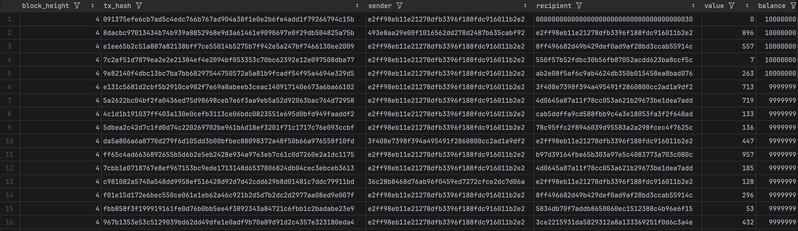
  <br>
  Figure 3: Agent ledger
</p>

The following example shows a record from **`agent_action_txs.jsonl`**. Each action occupies one line in the file.

```json
{"seq":3,"action":"pay","agent_id":"agent-alice","target":"agent-bob","amount":12,"ts":3,"request_id":"payment-1","params_hash":"","tx_hashes":["f58c994e..."]}
```

<p align="center">
  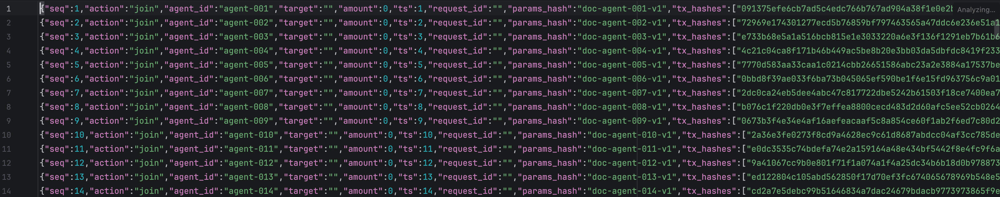
  <br>
  Figure 4: Agent action record
</p>

## Visualizing Results

After a successful experiment run via the launch script, AgentEmulator reads the agent ledger CSV files and generates balance plots styled for academic publications. PNG files are saved to `figs/figs_results/` and assembled into a static HTML gallery at `figs/figs_results/index.html`. The gallery supports Chinese and English interface text and opens automatically in the default browser.

The subsections below describe the automatic plotting workflow, the four generated figures, the HTML gallery, and how to regenerate plots without rerunning the experiment.

### Automatic plotting workflow

After a successful run, `run_agentemu.sh` (or `run_agentemu.bat` on Windows):

1. Locates the `agents/` directory in the highest-numbered round under `exp/agentemu-results/`.
2. Clears previous plots and `index.html` from `figs/figs_results/`.
3. Runs `figs/python_code/plot_agent_balance.py` to generate the PNG figures.
4. Runs `figs/python_code/build_fig_html.py` to build the gallery.
5. Opens the gallery using `open` on MacOS, `xdg-open` on Linux, or `start` on Windows.

### Generated figures

All plots show **changes relative to the initial balance: Δbalance = balance − initial balance**.

| Figure | Content | PNG file |
| --- | --- | --- |
| 1 (see Figure 5) | Final balance changes for all agents, ordered by agent ID. Each bar represents one agent; green bars indicate balance increases, and red bars indicate balance decreases. | `fig1_all_agents_overview.png` |
| 2 (see Figure 6) | Agent balance changes over the global transaction index. Transactions are deduplicated by `tx_hash` and replayed in a deterministic order. The plot shows the minimum–maximum envelope, the P25–P75 interquartile band, and the mean across agents. | `fig2_global_tx_order.png` |
| 3 (see Figure 7) | Agent balance changes aligned by normalized transaction progress. Each agent's transaction index is scaled to 0–1, and each gray line represents an agent. The mean curve falls below zero during intermediate stages and returns to zero at the endpoint. | `fig3_normalized_progress.png` |
| 4 (see Figure 8) | Individual agent balance changes in groups of five, ordered by each agent's related transaction index. | `fig4_agents_001-005.png` … `fig4_agents_096-100.png` |

### Example experiment

The experiment shown below was completed on a Mac mini running MacOS 15.6. The Mac mini had an Apple M4 Pro processor and 24 GB of memory. The processor had 12 cores: 8 performance cores and 4 efficiency cores. The blockchain layer used HuangLab's [BlockEmulator-X](https://github.com/HuangLab-SYSU/block-emulator-x) with Go 1.25.7.

The experiment used multiple processes on a single machine with these settings:

1. **Topology:** 4 shards with 4 consensus nodes each (16 consensus nodes in total), plus one supervisor. Nodes communicated in `direct` mode over `127.0.0.1`. Consensus nodes used ports in the range 32217–32547. The supervisor used port 38800.
2. **Consensus and cross-shard processing:** `static_relay`, with static account placement and relay-based cross-shard transactions. The block interval was 2000 ms. Transactions were packed by count, with up to 5000 transactions per block.
3. **Storage:** BoltDB for blocks, Ethereum-style LevelDB for world state, and a Bloom filter bitmap length of 4096.
4. **Workload:** seed `20260903`, 100 agents, and a trace containing 10,000 transactions, replayed through `trace_source_JSONL`. Each round automatically compiled the transactions and started a fresh BlockEmulator-X emulation run.

<p align="center">
  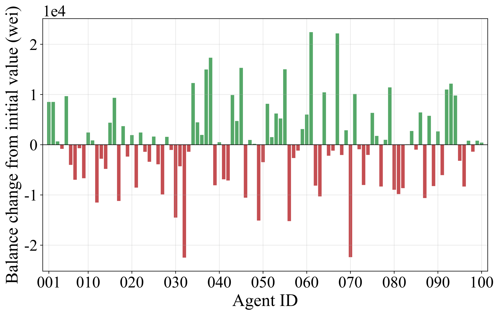
  <br>
  Figure 5: Final balance changes for all 100 Agents relative to their initial balances, ordered by agent ID. Each bar represents one agent. Green indicates balance increases, red indicates decreases.
</p>

<p align="center">
  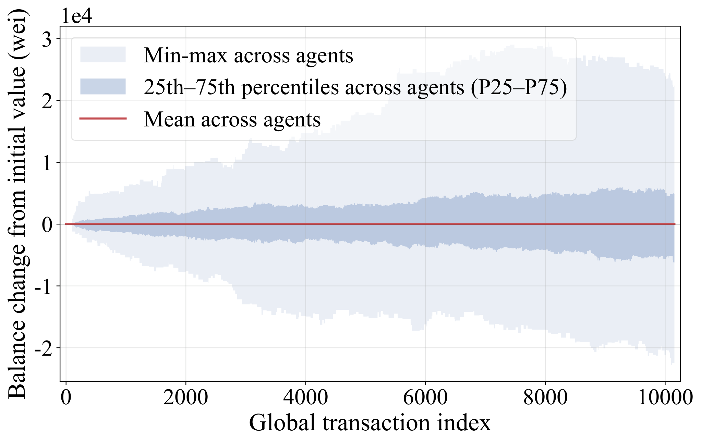
  <br>
  Figure 6: Account balance changes replayed in the global transaction order.
</p>

<p align="center">
  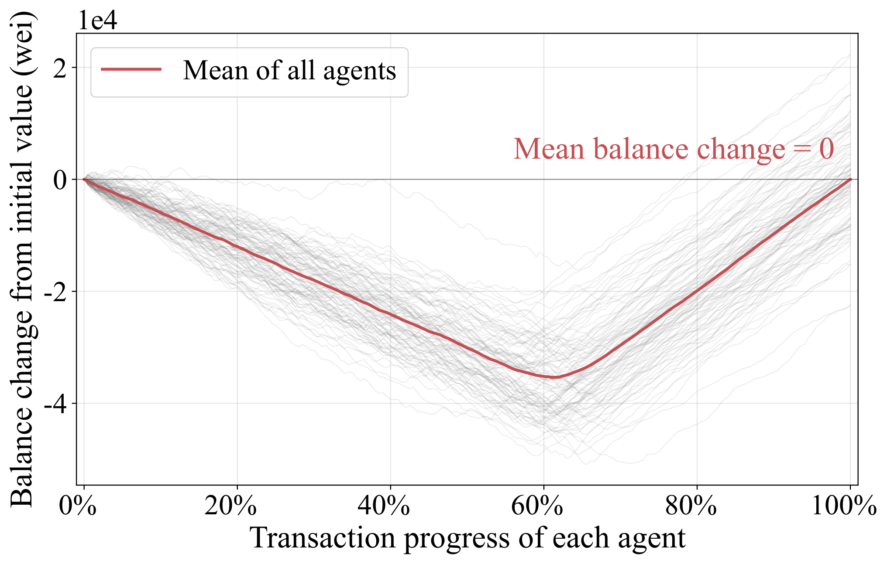
  <br>
  Figure 7: Account balance vs. the normalized confirmation progress of each agent's related transactions. Each gray line represents one agent.
</p>

<p align="center">
  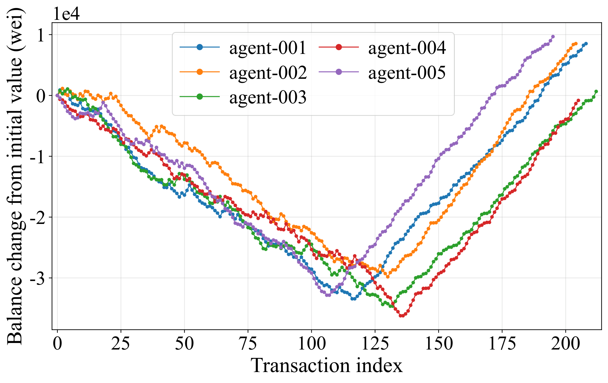
  <br>
  Figure 8: Balance changes of Agents #001–#005 relative to initial balances, ordered by each agent's related transaction index.
</p>

### Using the HTML gallery

- The dark header displays the title, generation time, figure count, source data directory, and agent count.
- Figures 1–3 are displayed in full. Figure 4 is presented in groups of five agents. **Click any image to open the image at full resolution.**
- Use the language button in the upper-right corner (`EN` or `中文`), or press `L`, to switch between Chinese and English. The language setting applies to the page title, section headings, metadata, and footer. The gallery remembers your language preference.
- Text embedded in plots is generated by the plotting script and does not change with the page language.

<p align="center">
  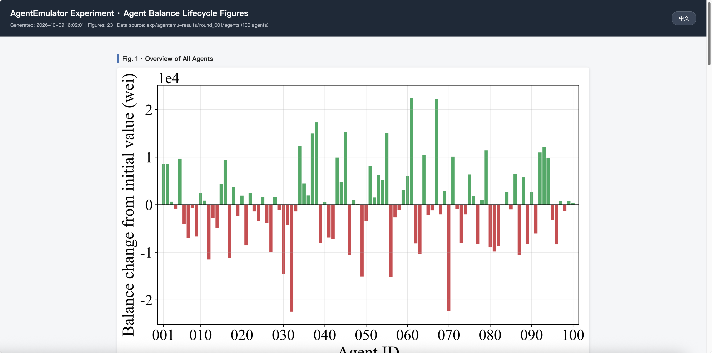
  <br>
  Figure 9: Overview of the HTML results page
</p>

### Regenerating plots manually

You can regenerate plots without rerunning the experiment. Run these commands from the repository root:

```bash
# Use the latest round; save plots to figs/figs_results/
python3 figs/python_code/plot_agent_balance.py
python3 figs/python_code/build_fig_html.py

# Specify data and output directories, for example to plot a saved run
python3 figs/python_code/plot_agent_balance.py \
    --data-dir exp/agentemu-results/round_001/agents \
    --fig-dir figs/figs_results
python3 figs/python_code/build_fig_html.py \
    --data-dir exp/agentemu-results/round_001/agents

# Rebuild only the gallery, using existing plots
python3 figs/python_code/build_fig_html.py

# Open the gallery on MacOS
open figs/figs_results/index.html
```

On **Windows**, use the following commands in Command Prompt. Replace `python` with `py -3` if needed.

```text
python figs\python_code\plot_agent_balance.py
python figs\python_code\build_fig_html.py

python figs\python_code\plot_agent_balance.py --data-dir exp\agentemu-results\round_001\agents --fig-dir figs\figs_results
python figs\python_code\build_fig_html.py --data-dir exp\agentemu-results\round_001\agents

rem Open the gallery
start "" figs\figs_results\index.html
```

| Script | Option | Default | Description |
| --- | --- | --- | --- |
| `plot_agent_balance.py` | `--data-dir` | Latest round's `agents/` directory | Directory containing agent CSV files |
| `plot_agent_balance.py` | `--fig-dir` | `figs/figs_results/` | Output directory for PNG figures |
| `build_fig_html.py` | `--fig-dir` | `figs/figs_results/` | Directory to scan for PNG files and write `index.html` |
| `build_fig_html.py` | `--data-dir` | None | Used only to display the data source and agent count |

### Experimental results in LLM API integration mode

This section presents the experimental results of LLM API integration mode using the metals trading scenario. The scenario contains one buyer Agent controlled by an LLM plus gold and silver suppliers. The buyer starts with 15 wei and later receives 835 wei of funding in batches as arranged in the Trace; the gold and silver prices are 160 wei and 100 wei. Supplier churn and funding are driven by the preset Trace, while the buyer decides whether to purchase based on the account balance and supplier status observed during the run.

As shown in Figure 10, the agent's run consists of three phases — Observation, Reasoning, and Decision — collectively Observation–Reasoning–Decision (ORD). In the observation phase, the agent receives snapshots of the latest blocks and account states, including balances and supplier status. In the reasoning phase, the LLM combines these observations with the purchasing policy configured by the user to judge whether the conditions for payment are met. In the decision phase, the LLM outputs structured actions such as pay, wait, or leave. agentSupervisor validates the actions, converts accepted actions that need to go on-chain into transactions, and merges them into the actually executed action sequence. Subsequent decisions continue from the updated on-chain state, forming a continuous observe–reason–decide process.

<p align="center">
  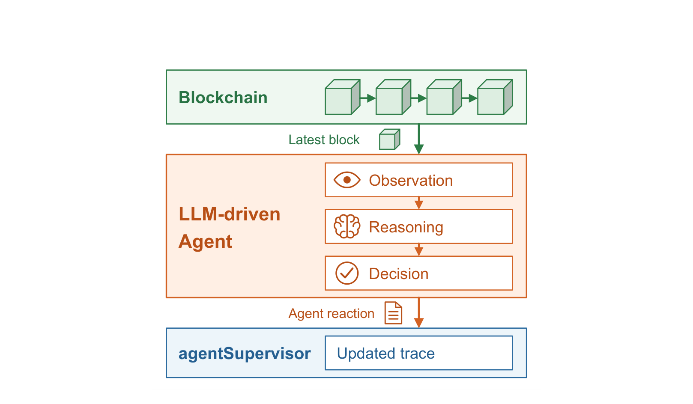
  <br>
  Figure 10: The three steps — Observation, Reasoning, and Decision — by which the Agent in LLM API integration mode makes real-time decisions from block information
</p>

The purchasing policy configured for the LLM is: "Prefer gold. While the gold supplier is online and the available balance is at least 160 wei, pay 160 wei for one unit of gold; while the gold supplier is online but the balance is insufficient, keep waiting for funding and do not switch to silver even if the balance is enough for it. Only when the gold supplier is offline, the silver supplier is online, and the available balance is at least 100 wei, pay 100 wei for one unit of silver. Once the gold supplier is back online, switch back to gold. At most one unit is purchased per round; return wait when the conditions are not met."

Under the given funding and supplier schedule, the scenario expects two gold, two silver, and two gold purchases in order. The rest of this section first describes the experiment configuration, then walks through the single-agent run timeline, the balance changes of different models, and the per-round decision latency, to show how this policy translates into actual payments. The figures in this section are generated by standalone Python plotting code and are not part of the HTML gallery.

#### Experiment configuration

1. **Models and calling interfaces.** DeepSeek used its official API with the model identifier `deepseek-flash`; Qwen used the compatible endpoint of Alibaba Cloud Bailian with the identifier `qwen3.8-max`. Both were called through the Chat Completions interface and each ran once independently under the same emulation configuration.
2. **Reasoning and generation parameters.** Neither request explicitly set the reasoning effort, thinking mode, sampling temperature, top-p threshold, or maximum output tokens. These parameters were handled by each service's defaults at the time, so the reasoning strength of the two models was not unified.
3. **Trace and identity configuration.** The Trace file used was `metals_savings_22000.jsonl`, the identity derivation seed was 20260903, and the agent controlled by the LLM API was `agent-metal-buyer`.
4. **Blockchain and block configuration.** BlockEmulator-X used `static_relay` with 4 shards, 4 nodes per shard, and a 2-second block interval. The block cap during model decisions (`max_blocks_during_decision`) was 5 blocks per round, shared by all shards, with empty blocks counted.
5. **Decision and experiment time limits.** The per-round decision timeout (`decision_timeout_seconds`) was 60 seconds and the decision interval (`decision_interval_seconds`) was 10 seconds. The active run lasted (`run_duration_seconds`) 600 seconds, the post-run settlement limit (`drain_timeout_seconds`) was 120 seconds, and the whole chain run was bounded (`chain.run_timeout_seconds`) at 900 seconds.

#### Single-agent run timeline

Figure 11 shows one DeepSeek single-model run. The upper and lower halves share the same horizontal axis, timed in seconds from the experiment start. The upper half shows the buyer's ledger balance and commodity prices; the lower half shows the timing of on-chain snapshot collection, model reasoning, decision generation, and action injection.

<p align="center">
  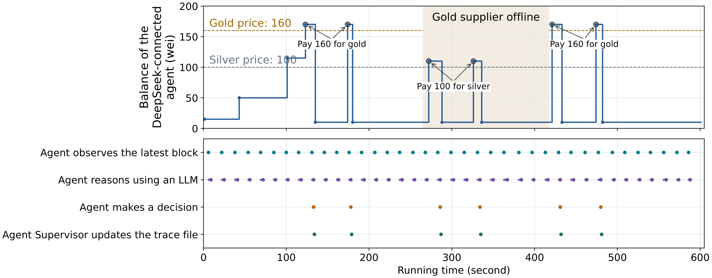
  <br>
  Figure 11: Balance changes and decision timeline of the DeepSeek-controlled buyer in the metals scenario
</p>

**Balance changes and the purchase process.** The vertical axis of the upper half is the buyer's ledger balance in wei. Rising steps mean funding arrived, falling steps mean a payment was debited, and flat segments are the waiting time between balance changes. When the buyer's balance reached 115 wei, silver was already affordable, but the gold supplier was still online, so the buyer kept saving and only initiated the first gold payment at 170 wei. After deducting 160 wei, 10 wei remained, and each later funding added to this balance, so gold purchases often show a 170 wei high point and silver purchases a 110 wei high point.

**Prices, supplier status, and payment markers.** The gold dashed line marks the gold price of 160 wei and the gray dashed line the silver price of 100 wei. The gold dashed line breaks while the gold supplier is offline and resumes when it is back online, indicating gold cannot be bought in that window. Circles mark the balance high points before each purchase, and arrows point the payment annotations at these highs. One annotation spanning two circles means two independent payments of the same amount. The circles show the funds before the purchase; the actual debit corresponds to a later falling step, and the final confirmation of the transaction may come even later.

**Snapshot collection, model decisions, and action injection.** The lower half marks four stages along the same time axis:

- **Agent observes the latest block:** the on-chain snapshot collection before each decision, where the Supervisor of BlockEmulator-X fetches block and account states from all shards and sends them through the LLM API to the corresponding model.
- **Agent reasons using an LLM:** the start and end of each LLM API call. Short intervals can look like single points on the time scale of the whole experiment.
- **Agent makes a decision:** the moment the model returns a submittable action. Waiting decisions produce no new payment marker.
- **agentSupervisor updates the trace file:** the moment a validated model action enters the actually executed action sequence and is submitted to the transaction flow.

Comparing these four tracks with the balance steps separates funding arrival, the model's payment decision, action injection, and the on-chain debit, showing how a purchase progresses through each stage.

#### DeepSeek vs. Qwen balance timeline comparison

Figure 12 compares DeepSeek and Qwen, each run once in the same metals scenario. The two runs are aligned at their own start times. The blue solid line is `deepseek-flash` and the purple dashed line is `qwen3.8-max`. Both step lines use the same time and balance scales and may overlap when balances coincide.

<p align="center">
  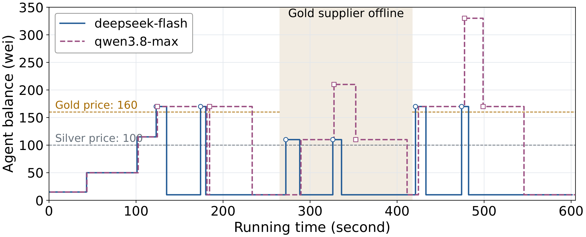
  <br>
  Figure 12: Buyer balance changes of DeepSeek and Qwen in the metals scenario
</p>

**Supplier status and balance markers.** The shaded region marks the gold supplier's offline window, using the confirmation times of the DeepSeek run as the common marker; the actual boundaries of the two runs differ by about 0.4 seconds. The hollow markers on each model's line show the balance before the corresponding payment, and the following falling step is the ledger debit.

**Balance peaks and purchase pacing.** Both runs followed the same funding schedule but debited at different times. DeepSeek usually paid shortly after the funds arrived, returning the balance to 10 wei after each payment. Qwen sometimes completed the previous purchase only after the next funding arrived, so during the silver phase it accumulated 210 wei at one point — the amount of two silver units plus the remaining 10 wei. After gold purchases resumed, the balance reached 330 wei at one point, the amount of two gold units plus 10 wei. Each purchase was still a single unit, so each of these highs is followed by two separate falling steps. A higher peak means the funds stayed in the account longer.

**Final results and confirmation times.** Both runs completed the six purchases in order within their own supplier status windows, spending 640 wei on four gold units and 200 wei on two silver units, both ending at 10 wei. DeepSeek's last gold payment was finally confirmed around second 481, and Qwen's around second 545, a gap of about 64 seconds. That gap includes the wait after funding, model calls, validation, and on-chain settlement, reflecting the difference in purchase progress across the whole experiment.

#### DeepSeek vs. Qwen per-round decision latency comparison

The decision-latency statistics in Figure 13 are taken from the two model-comparison runs above. The horizontal axis lists the two models; the vertical axis is the duration of the Agent reasons using an LLM phase in the single-agent run timeline, in seconds. Timing starts when a model decision is initiated and ends when the response is received or the failure is handled, including the LLM API request wait and response parsing overhead.

<p align="center">
  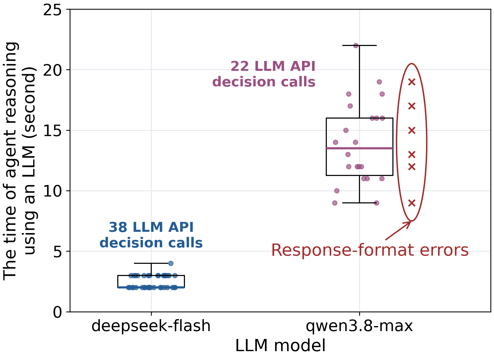
  <br>
  Figure 13: Per-round LLM API decision latency distribution of DeepSeek and Qwen
</p>

**Scatter points and boxes.** Each colored point corresponds to one decision round; horizontal offsets only separate overlapping samples. The bottom and top of each box are the 25th and 75th percentiles, and the line inside the box is the median.

**Decision counts and latency difference.** LLM API decision calls is the number of decision rounds recorded in the experiment, including pay, wait, and error rounds. Within the 600-second active window, DeepSeek initiated 38 decision rounds and Qwen 22. DeepSeek's median decision latency was about 2.0 seconds; Qwen's was about 13.5 seconds. Per-round latency, inter-round waiting, and the settlement progress of the previous transaction all affect how many rounds fit into the same active window.

**Response-format errors.** The crosses inside red ellipses mark Qwen's six response-format errors. The model returned `amount` as a JSON number, while the interface requires a decimal string such as `"160"`. Those rounds failed response parsing, so no payment was submitted, and their durations are still included in the statistics. Qwen completed the six purchases through other valid rounds.

Together, the balance changes and decision latencies show that in these two runs DeepSeek had shorter per-round decision latency and earlier confirmation of all six payments, and both models completed the purchase sequence required by the scenario. Each model ran once; these values describe the observed behavior under this scenario and configuration.

## Analyzing Results

To determine whether and when a payment was confirmed, join the action mapping with the on-chain transaction records:

`agent_action_txs.jsonl` (`request_id` → transaction hashes) → `relay_stats_detail_tx_info.csv` (hash → commit times).

```python
import json, csv

chain = {}
with open('exp/agentemu-results/round_001/chain/results/relay_stats_detail_tx_info.csv') as f:
    for row in csv.DictReader(f):
        chain[row['OriginalHash']] = row

total = confirmed = 0
for line in open('exp/agentemu-results/round_001/agent_action_txs.jsonl'):
    a = json.loads(line)
    if a['action'] != 'pay':
        continue
    total += 1
    if all(h in chain for h in a['tx_hashes']):
        confirmed += 1
        # Example: inspect a payment's confirmation time
        # print(a['request_id'], chain[a['tx_hashes'][0]]['Tx finally commit time'])

print(f'Fully confirmed payment intents: {confirmed}/{total}')
```

Transaction latency is calculated as `Tx finally commit time − Tx create time`. For cross-shard transactions, the CSV output uses the proposal (Relay1) and commit (Relay2) timestamps to break down the processing of cross-shard transactions.

You can also analyze agent ledgers directly with pandas. Read large numeric values as strings to preserve precision:

```python
import pandas as pd
df = pd.read_csv('exp/agentemu-results/round_001/agents/agent-001.csv',
                 dtype={'balance': str, 'value': str})
```

# FAQ

**Q1. Why does a new run fail with `file already exists: .../block_record.csv`?**
Output files from a previous run are still present. AgentEmulator requires new output files and cannot overwrite existing files. Use `run_agentemu.sh` to clear old results automatically. Before starting an experiment manually, remove the previous results. On MacOS or Linux, run `rm -rf exp/agentemu-results`, then `go run cmd/agentemu/main.go`.

**Q2. Why does `join` sometimes produce no registration transaction?**
A registration transaction is generated only when an agent joins for the first time or rejoins after leaving. Check whether the agent is already active in `agent_registry.json`. To regenerate registration transactions for all agents, remove the previous results before running again.

**Q3. Do agent payments use smart contracts?**
No. `agentSupervisor` compiles `pay` actions into **plain transfer transactions**. Only `join` and `leave` are compiled into DID contract calls. In v1.0, the DID contract is not deployed. DID contract calls are recorded at the EVM layer without updating DID contract state. Payment transactions perform actual balance transfers.

**Q4. How can I reduce console output?**
Set `system.log.log_level` to `warn` in `config.yaml`, or redirect output to a file:

```bash
bash run_agentemu.sh > run.log 2>&1
```

**Q5. How can I run a small, single-shard experiment?**
Set `system.shard_num` to `1` in `config.yaml`. Adjust the actions and transaction count in the trace to control the workload size.

**Q6. Why does the HTML gallery not open after an experiment?**
Check the end of the console output for `figures & gallery: ./figs/figs_results/index.html`:

- If the gallery path is missing and `warn: no agent CSVs ...` appears, the experiment produced no agent ledger data. No agent ledger data is expected when `chain.enabled` is `false`. Under that configuration, AgentEmulator compiles the trace without running the blockchain.
- If the line appears but the gallery does not open, open `figs/figs_results/index.html` manually. On MacOS, run `open figs/figs_results/index.html`.

**Q7. How do I resolve `ModuleNotFoundError: matplotlib`?**
Install the plotting dependencies in the Python environment used to run the scripts:

```bash
pip3 install matplotlib numpy pandas
```

Alternatively, run the scripts with a Python interpreter that already has these packages installed.

**Q8. How can I regenerate plots from historical data?**
Set `--data-dir` to the desired `round_XXX/agents/` directory and run the plotting scripts manually. `run_agentemu.sh` clears `exp/` before every experiment run and deletes `figs/figs_results/` after the run ends, before plotting starts. Back up any historical data and figures you wish to keep before running.

**Q9. How can I change which agents appear in Figure 4 or adjust the group size?**
Figure 4 currently groups agents in sets of five. Edit the Figure 4 section in `figs/python_code/plot_agent_balance.py` to filter agents or change the group size. The `5` in `range(0, len(dfs), 5)` specifies the number of agents per group.

**Q10. Are experiments reproducible?**
For Agent behavior replay mode, with the same `seed`, trace, and code version, the generated transaction dataset and agent action CSV are byte-for-byte identical. Agent ledger records also use a deterministic global ordering. On-chain transaction packing and timing remain subject to runtime conditions, as in BlockEmulator-X.

**Q11. On Windows, why is `python` not recognized, or why does `python` open the Microsoft Store?**
Python may not be installed, or the Python installation directory may be missing from `PATH`. Download Python from the [official website](https://www.python.org/downloads/windows/) and select **Add python.exe to PATH** during installation.

If the Python launcher is already installed, use `py -3`. The `run_agentemu.bat` script automatically falls back to `py -3` when `python` is unavailable.

Install dependencies with the interpreter you intend to use:

```text
python -m pip install matplotlib numpy pandas
```

Or, with the Python launcher:

```text
py -3 -m pip install matplotlib numpy pandas
```

**Q12. Why does LLM API integration mode currently support only static_relay?**
This is the implementation scope of AgentEmulator v2.0. During the experiment, LLM API integration mode needs to fetch block and account snapshots from all shards, coordinate block proposals while the model is being called, and determine from the on-chain submission records whether the previous payment has settled. Currently these mechanisms are integrated with the static_relay flow of BlockEmulator-X. For cross-shard payments, the Supervisor decides whether a transaction has settled based on the submission records of the two relay phases before arranging the next decision. Other consensus or cross-shard modes would require adapting their own snapshot collection, block coordination, and transaction confirmation flows. When using LLM API integration mode, set `system.consensus_type` to `static_relay` in config.yaml. To use another supported chain configuration, set `agent_api.enabled` to `false` in agentEmuConfig.yaml and use Agent behavior replay mode.

**Q13. Why did the model return a pay decision but no corresponding payment appears on chain?**
First check `thinking_finished` and `decision_result` of that round in `agent_thinking.log`. After receiving a pay decision, the Supervisor also checks the response format, whether the payee is active, and whether the available balance is sufficient. For example, `amount` in the model response must be the JSON string `"160"`. If the model returns the JSON number 160, the response fails parsing and no payment is submitted. If validation fails, the log records the reason and the experiment continues with subsequent actions.

If the pay decision of that round shows accepted with a transaction hash, the transaction has been submitted. Use the hash to find the record in `relay_stats_detail_tx_info.csv` and check whether the transaction was finally confirmed through `Tx finally commit time`.

# Research Team

This work is led by **HuangLab, Professor Huawei Huang's research group at the School of Software Engineering, Sun Yat-sen University**. The group focuses on blockchain systems and protocols, consensus protocols, blockchain finance, and the intersection of AI and blockchain, and has published papers in IEEE/ACM ToN, TSC, TC, TPDS, TDSC, INFOCOM, WWW, ICDCS, and other journals and conferences.

Representative open-source projects of the group:

**AgentEmulator — agent experimentation platform**

- Website: https://xintelligence.pro/agentemulator
- GitHub repository: https://github.com/HuangLab-SYSU/agent-emulator

**BlockEmulator — blockchain sharding experimentation platform**

- Website: https://www.blockemulator.com
- GitHub repository: https://github.com/HuangLab-SYSU/block-emulator

You are welcome to follow HuangLab's WeChat public account (ID: Huang-Lab) and visit HuangLab's academic homepage: http://xintelligence.pro

## Contributing

Contributions are welcome via the standard GitHub pull-request flow: benchmarks, plugins, traces, and documentation. See [CONTRIBUTING.md](CONTRIBUTING.md).

## License

This project is licensed under the PolyForm Noncommercial License 1.0.0. Commercial use is not permitted. See [LICENSE](LICENSE).
