# AgentEmulator

<p align="right"><a href="README.md">英文</a> | <b>中文</b></p>

## 简介 / Overview

AgentEmulator 是由**中山大学·软件工程学院·黄华威研究组（**[**HuangLab**](http://www.xintelligence.pro/)**）发起的、面向 AI 智能体可信基础设施的仿真与实验平台**。平台以区块链作为可信记录与结算的基础，**旨在帮助研究者和学生**围绕智能体的身份、行为审计、支付结算、激励与治理机制开展实验，逐步形成支持 AI 智能体可信交互与协作的**研究工具**。

AgentEmulator 是面向 AI 智能体行为与区块链相结合的场景、基于 BlockEmulator-X（即 BlockEmulator 2.0 版本） 构建的**实验工具**。其中，BlockEmulator-X（BlockEmulator 2.0 版本） 是 HuangLab **于2026年5月开源的区块链仿真实验工具**，是初代 BlockEmulator 1.0 的升级迭代版本，其 GitHub 代码仓库地址为 https://github.com/HuangLab-SYSU/block-emulator-x 。

### 演示视频

[**AgentEmulator 演示视频**](https://www.bilibili.com/video/BV1d54g6oEST/)（Bilibili）

### 论文

[**AgentEmulator: A Blockchain-Empowered Testbed for Trustworthy AI Agent Infrastructure（HAL）**](https://hal.science/hal-05774794)

[**AgentEmulator: A Blockchain-Empowered Testbed for Trustworthy AI Agent Infrastructure（ResearchGate）**](https://www.researchgate.net/publication/415363728_AgentEmulator_A_Blockchain-Empowered_Testbed_for_Trustworthy_AI_Agent_Infrastructure)

Jian Zheng, Jianbo Xiong, Feihong Hu, and Huawei Huang（通讯作者）。2026 年 10 月。Preprint。

论文形式化了 Trace 到交易的映射、三种执行顺序（逻辑 Trace 顺序、后端执行顺序、可视化顺序）、可复现性要求，以及支付完成度与执行开销的评估方法论。

研究中使用 AgentEmulator 请引用本论文（见 [CITATION.cff](CITATION.cff)）：

```Plaintext
@misc{zheng2026agentemulator,
  author = {Zheng, Jian and Xiong, Jianbo and Hu, Feihong and Huang, Huawei},
  title = {{AgentEmulator}: A Blockchain-Empowered Testbed for Trustworthy {AI} Agent Infrastructure},
  year = {2026},
  month = oct,
  doi = {10.13140/RG.2.2.23825.60000},
  url = {https://hal.science/hal-05774794},
}
```

### 为什么需要可信智能体基础设施

AI 智能体正在走出对话框，进入真实工作流：调用 API、持有身份、为服务付费、代表人和机构行动。当智能体彼此交易时，会出现三个「更好的模型」解决不了的信任缺口：

|信任缺口|实际含义|
|---|---|
|行为不可审计|智能体做了什么、为什么这么做，没有中立、防篡改的记录。|
|权责不可追溯|智能体出错、越权、造成损失时，无法定位「哪个智能体、受谁授权、在哪一步」。|
|结算不可信|智能体之间、智能体与 API 服务之间的价值交换缺少中立账本。|

补上这些缺口需要一层独立的基础设施：与模型本身无关的审计与结算层。AgentEmulator 就是构建和评估这一层的实验平台。在这里，区块链承担一个具体角色——可信记录与结算的中立基座，而不是万能解药。

### AgentEmulator 是什么、不是什么

AgentEmulator 度量的是基础设施层，不是智能体能力。能力基准（AgentBench、WebArena、OSWorld、SWE-bench）问的是：智能体能不能完成任务？AgentEmulator 问的是：智能体加入、支付、离开时，身份、支付、记录、结算是否正确，代价多大，换一种机制会怎样？两个问题是互补的：一笔支付成功只证明支付发生了，不证明任务完成得好。AgentEmulator 提供交易记录与账户视图，让「基础设施」这个问题可回答、可复现。

**AgentEmulator 能做什么：**

AgentEmulator 目前支持两种运行模式。

**回放 Agent 行为的模式**：支持基于 Trace（实验输入数据）的基础行为回放、身份注册与注销留痕、逐笔直接支付，以及实验数据记录和可视化。实验人员使用 JSONL 格式的 Trace 文件描述 Agent 的“**加入**”、“**转账**”和“**退出**”行为；AgentEmulator 中的 agentSupervisor 模块将 Trace 文件编译为交易数据集，并调用 BlockEmulator-X 启动区块链环境、执行交易、并将交易执行结果上链记录。实验完成后，AgentEmulator 系统会记录交易与 Agent 账户的相关数据，自动绘制余额变化图集，并生成支持中英文切换的 HTML 实验结果页面（由启动脚本在默认浏览器中打开展示）。

回放 Agent 行为的模式下，Agent 行为由 Trace 文件预先定义，采用“用户原始指定顺序”（User-specified Original Sequence）策略，按照实验输入中指定的交易顺序执行交易，尚未集成额外的交易编排机制或调度算法。实验人员可在此基础上探索和实现自定义机制，例如调整交易的执行顺序，或根据交易优先级、Agent 权重等规则编排交易。

**接入 LLM API 的模式**：通过大语言模型（Large Language Model，LLM）的 API 驱动单个 Agent 根据链上状态自主决策，其余 agents 按 Trace 文件执行预设动作。具体来说，实验人员从 Trace 文件中选定一个 Agent，接入兼容 Chat Completions 规范的大语言模型 API，并配置任务目标；模型根据运行期间获取的链上区块与账户状态决定“支付”、“等待”或“退出”，系统校验大模型返回的动作，把通过校验且需要上链的动作编译为交易并提交至同一条区块链；同时记录大模型的决策日志，支持结合实验时间线、账户余额和交易确认时间分析“LLM 的决策”与“行为执行”过程。AgentEmulator v2.0 每次实验仅支持由 LLM 控制的 1 个 Agent。该模式仅支持 `static_relay` 共识。需要提醒的一点是，调用大模型可能会消耗用户的 API 额度。

AgentEmulator 后续版本将持续升级迭代，逐步扩展协议、实验场景和评测能力。欢迎实验人员结合具体研究需求扩展示例代码，设计并验证不同机制或算法对实验结果的影响。

**不关心的事：**

不内置任何交易调度算法——遵循 User-specified Original Sequence 策略，把交易重排、优先级规则、智能体权重留给研究者作为扩展点。

### 五层技术栈

AgentEmulator 对应可信智能体基础设施的五层分类法。五层定义研究议程，工具逐层落地。

|层|要回答的问题|AgentEmulator 现状|
|---|---|---|
|L1 身份|这个智能体是谁，谁授权它？|`did-simple` 派生确定性标识；DID 注册合约在路线图中|
|L2 审计|它做了什么，事后能验证吗？|可验证日志结构（如 Merkle 累积器）在路线图中；当前记录动作流与逐轮决策日志|
|L3 结算|智能体之间如何高频支付？|当前为 `direct-pay`；支付通道与批量结算在路线图中|
|L4 激励|好行为如何在链上得到回报？|路线图（声誉、积分、预测市场）|
|L5 治理|谁来仲裁纠纷，监管如何接入？|路线图|

### 一次演示工作流

论文演示了完整工作流：100 个智能体、1 万笔支付交易，跑在 4 分片 × 4 节点的区块链上（单机，Mac mini / Apple M4 Pro / 24 GB，Go 1.25.7，seed 20260903），产出 23 张图、四种余额视图。

这次演示验证的是工作流——Trace 进去，账本和视图出来。它不构成性能或扩展性结论；吞吐量、时延、资源开销需要独立的计时测量，这部分评估方法论在论文中有定义。

<p align="center">
  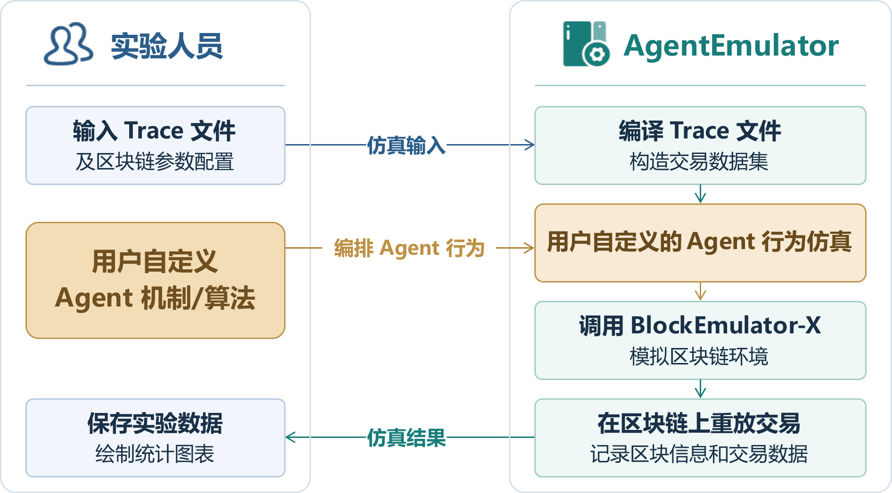
  <br>
  图 1：AgentEmulator 的用途示意图
</p>

图 1 展示了实验人员用户与 AgentEmulator 之间的交互关系。其中，“用户自定义机制/算法”需要实验人员进行二次开发、自行实现。

### 可复现性

可复现实验要求输入固定：同一份 Trace 文件、同一个 seed、同一份配置、同一组源码版本、干净的初始注册表。AgentEmulator 自动化了这些准备步骤；论文附录 A 给出记录清单、核对项与图表重生成命令，让一次运行可被验证。

回放 Agent 行为的模式下，相同的 seed、Trace 文件和代码版本生成逐字节一致的交易数据集。接入 LLM API 的模式中，模型响应与并发出块按实际时间推进，同一 seed 的重复实验可能得到不同的决策和确认时间；不过用户可以根据已捕获的动作进行实验流程的回放。

### HuangLab 项目家族

AgentEmulator 是中山大学 HuangLab 区块链实验技术栈的一部分：

|项目|角色|链接|
|---|---|---|
|BlockEmulator|区块链分片协议仿真器（IEEE TSC 2025） BlockEmulator v1.0 版本，2023 年开源|https://github.com/HuangLab-SYSU/block-emulator|
|BlockEmulator-X|支持 EVM 执行的继任版本，AgentEmulator 的后端。 BlockEmulator v2.0 版本，2026 年 5 月开源|https://github.com/HuangLab-SYSU/block-emulator-x|
|AgentEmulator|本项目——分片区块链上的智能体行为仿真。BlockEmulator v3.0 版本，2026 年 9 月开源|https://github.com/HuangLab-SYSU/agent-emulator|
|BrokerChain|分片区块链测试网-学术版本（约 400 个外部节点），起源于 "BrokerChain: A Cross-Shard Blockchain Protocol for Account/Balance-based State Sharding"（INFOCOM 2022）|https://github.com/HuangLab-SYSU/BrokerChain|
|brokerchain-mcp|MCP server（`register_agent` / `append_log` / `open_channel` / `pay`），双后端：AgentEmulator 仿真 + BrokerChain 测试网|开发中|

### AgentEmulator 有什么用？

**AgentEmulator 实验平台**的**设计目标是简化 AI Agent 相关的实验环境搭建配置、机制验证和数据分析**，**使实验人员**能够轻松地配置底层区块链环境、观察 AI 智能体的行为，并通过实验数据分析在不同机制控制时的运行效果。

### 发展路线 / Roadmap

AgentEmulator 将围绕 AI Agent 的“身份”“结算”“审计”“激励”“治理”五个方向逐步扩展。

以下为拟推进的发展完善路线，具体安排将随相关研究与开发进展进行微调。

|阶段|主要内容|
|---|---|
|**v1.0：回放 Agent 行为的模式（已发布）**|支持 Trace 文档驱动的“加入 (Join)”、“支付 (pay)”和“退出 (leave)”行为回放，提供交易执行、行为与交易映射、账户数据记录及结果可视化。|
|**v2.0：接入 LLM API 的模式（当前版本）**|在回放 Agent 行为的基础上新增接入 LLM API 的模式：把 Trace 文件中的一个身份交给模型 API，模型定期观察链上数据，思考后做出决策，决策内容经校验后转换为链上交易，并提供决策日志、时间线与多模型对比图。|
|**近期：完善身份与审计能力**|逐步实现 DID 注册与注销的智能合约状态管理，扩展权限声明、可验证行为日志和行为追溯能力。|
|**中期：扩展支付与交互机制**|引入微支付、支付通道和批量结算等机制，扩展多轮反馈实验，支持更丰富的 Agent 服务交互场景。|
|**后续：支持激励与协作治理实验**|研究多 Agent 协作中的任务分配、行为协调与责任追溯机制，支持不同协作策略的仿真与效果评估。|
|**长期：建设基准评测平台**|积累标准化 Agent 相关的实验场景、数据集与评测指标，支持不同可信基础设施方案的比较和可复现实验。|

---

### GitHub 代码仓库地址

GitHub 代码仓库地址为：https://github.com/HuangLab-SYSU/agent-emulator

### 术语解释

本节介绍 AgentEmulator 中的主要术语，帮助实验人员理解系统组成、输入文件和配置文件之间的关系。

|术语|说明|
|---|---|
|AgentEmulator|基于 BlockEmulator-X 构建的 Agent 行为仿真模拟器，将输入的 Agent 行为转换为区块链交易并记录上链，自动记录实验日志并展示实验结果。|
|Agent|实验中执行行为的主体，可按照 Trace 文件中的描述执行“加入”、“支付”和“退出”操作。|
|BlockEmulator-X|AgentEmulator 的底层区块链仿真平台，负责节点运行、共识出块、交易执行和链上数据记录。（GitHub 页面：github.com/HuangLab-SYSU/block-emulator-x）|
|Trace 文件|描述 Agent 行为序列的实验输入文件，采用 JSONL 格式，每行记录一次 Agent 行为或一笔普通转账。|
|agentEmuConfig.yaml 文件|AgentEmulator 的实验配置文件，用于指定 Trace 文件、身份生成 seed、结果目录，以及是否启动区块链等参数。|
|config.yaml 文件|BlockEmulator-X 的区块链配置模板，用于设置区块链的分片数量、节点数量、出块间隔等底层参数。|
|agentSupervisor|AgentEmulator 的实验调度模块，负责读取配置和 Trace 文件、将行为编译为交易数据集，并组织底层区块链运行及实验数据输出。|
|agent_id|实验人员在 Trace 文件中为 Agent 指定的唯一标识（例如 agent-alice），用于区分不同 Agent 并关联其行为记录。|
|seed|在 agentEmuConfig.yaml 中设置的身份生成种子，系统将其与 agent_id 结合生成 DID。相同的种子与 Agent 标识会生成相同的 DID。|
|DID|去中心化 ID（Decentralized Identifier），用于标识 Agent 的身份，由系统根据 seed 和 agent_id 自动生成，无需在 Trace 文件中手动填写。|
|LLM API|AgentEmulator 调用外部大语言模型（Large Language Model，LLM）的接口。当前支持兼容 Chat Completions 的服务，实验人员可在 agentEmuConfig.yaml 中配置接口地址、大模型名称和认证方式。|
|LLM-driven Agent|由 LLM API 控制的 Agent。通过 agent_api.agent_id 选定 Trace 中已有的身份。系统保留该身份首次加入的动作，后续行为由大模型决策接管。|

### Workflow 与系统架构

AgentEmulator 的基本工作流程是：**实验人员通过 Trace 文件描述 Agent 行为，并为选定的 Agent 配置 LLM API 与任务目标；agentSupervisor 读取 Trace 文件，并调用 BlockEmulator-X 启动区块链环境；实验运行期间，系统根据链上状态调用 LLM API 生成决策，对 LLM 的反馈进行校验，并将需要上链的有效动作更新至实际执行的 Trace 文件中（“回放 Agent 行为模式”不包含 LLM API 调用与 Trace 文件动态更新的步骤，全部 agents 均按照原始 Trace 执行实验人员预设的行为）；系统将待执行动作编译为交易并提交至区块链，随后记录实验数据并展示实验结果。**

下图展示了 AgentEmulator 的工作流程以及核心模块架构。

<p align="center">
  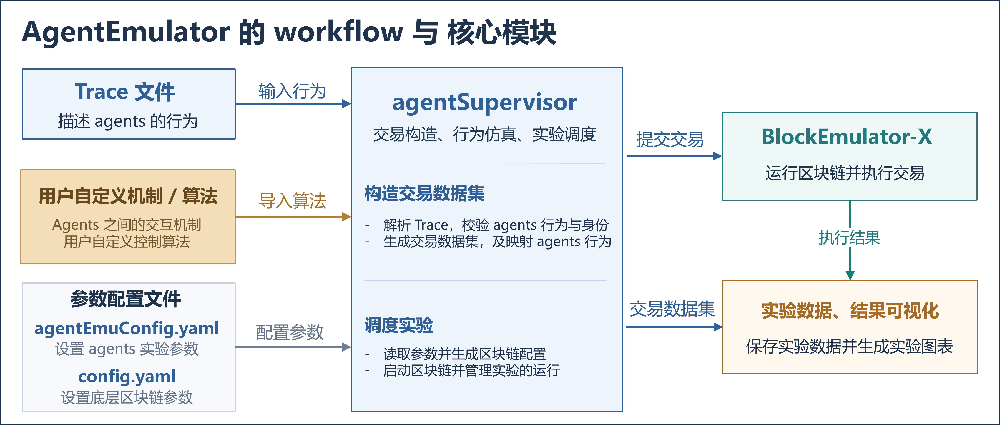
  <br>
  图 2：AgentEmulator 的 workflow 与核心模块架构
</p>

在 AgentEmulator v2.0 中，如图 3 所示，LLM-driven Agent 的运行流程包含“观察（Observation）”、“推理（Reasoning）”和“决策（Decision Making）”三个阶段，即 Observation–Reasoning–Decision（ORD）。在观察（O）阶段，LLM-driven Agent 接收最新区块及账户状态快照，获取相关账户的余额、状态等信息。在推理（R）阶段，LLM 将这些观察结果与用户设置的智能体行为策略相结合，判断当前是否具备进入下一步操作的条件。在决策（D）阶段，LLM 输出“支付”、“等待”或“退出”等结构化动作。agentSupervisor 对这些结构化动作进行校验，将通过校验且需要上链的动作转换为“交易（transaction, Tx）”，添加到需要实际执行的动作序列中。LLM 后续的决策将依据更新后的链上状态进行，从而形成持续的“观察、推理和决策（ORD）”循环迭代流程。

<p align="center">
  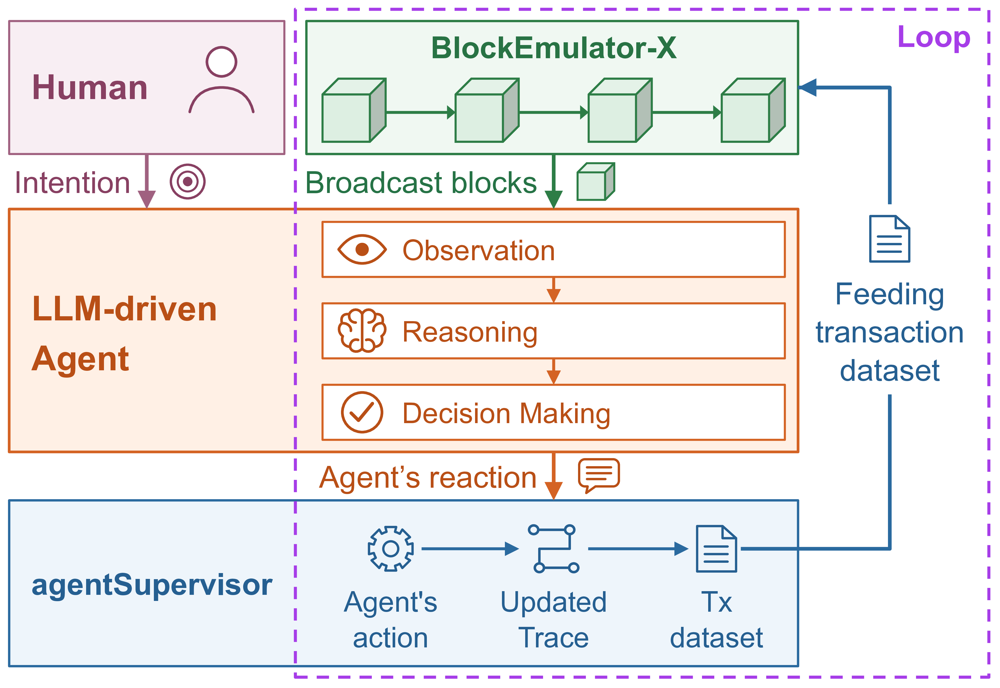
  <br>
  图 3：LLM-driven Agent 根据最新区块信息做出实时决策的 3 个操作步骤：观察（Observation）、推理（Reasoning）、决策（Decision Making）；agentSupervisor 对 Trace 的更新以及新交易集合（Tx dataset）的生成与提交到区块链，形成一个 Loop 回环。
</p>

实现说明见 `docs/hybrid-agent-api.md`。

---

---

# 开始使用 AgentEmulator 做实验

## 环境准备

AgentEmulator 支持在 MacOS、Linux 和 Windows 操作系统上运行，环境依赖如下表所示。

|依赖|版本要求|验证命令|用途|
|---|---|---|---|
|Go|≥ 1.25.7|`go version`|编译运行仿真器|
|Python 3|≥ 3.8|`python3 --version`（Windows：`python --version` 或 `py -3 --version`）|实验后自动绘图|
|matplotlib / numpy / pandas|—|`python3 -c "import matplotlib, numpy, pandas"`|绘图库|

```bash
# Python 绘图库缺失时安装（Windows 系统直接使用 pip 命令）
pip3 install matplotlib numpy pandas
```

```bash
git clone https://github.com/HuangLab-SYSU/agent-emulator.git
cd agent-emulator
go build ./...      # 首次编译，验证环境正常
```

## 五分钟上手：使用 AgentEmulator 的操作流程

在 Windows 系统中，实验人员可以通过 cmd 执行 `.bat` 批处理脚本，也可以在文件资源管理器中双击运行 `run_agentemu.bat`。具体命令如下：

```batch
rem 运行示例脚本
run_agentemu.bat
```

```batch
rem 使用自定义配置运行示例脚本
run_agentemu.bat my-config.yaml
```

`run_agentemu.bat` 与 `.sh` 版本所做的行为完全一致：编译 → 清理旧结果 → 运行实验 → 自动绘图 → 在默认浏览器打开 HTML 图册。若 `python` 命令不可用，脚本会自动改用 `py -3`。

实验人员可随时按下 `Ctrl-C` 安全终止实验，随后 BlockEmulator-X 启动的共识节点子进程将一并被清理。

> **注意**：实验失败时不会执行绘图步骤；另外，每次实验结束，进行绘图前，脚本文件会先清空 `figs/figs_results/` 路径中的旧实验图，绘制的实验图永远只反映**最近一次成功的实验结果**。

使用 **MacOS** 和 **Linux** 系统的实验人员可使用 bash 运行脚本，示例如下：

```bash
# 运行示例脚本
bash run_agentemu.sh
```

实验人员运行以上命令后，脚本会依次自动完成以下操作：

1. **编译**：`go build ./...`
2. **清理旧的实验数据**：删除 `./exp` 目录。
3. **实验运行步骤**：
   - **“回放 Agent 行为模式”**：读取 `agentEmuConfig.yaml` → 编译 Trace 为交易数据集 → 自动启动 BlockEmulator-X 区块链（默认 4 分片，每分片 4 节点）→ 交易数据全部上链 → 实验完成，区块链自动停止。
   - **“接入 LLM API 模式”**：读取 `agentEmuConfig.yaml` 并选定 LLM-driven Agent → 自动启动 BlockEmulator-X 区块链 → 其余 Agent 按 Trace 注入预设动作，LLM-driven Agent 根据链上快照调用大模型作出决策 → agentSupervisor 校验决策，并将通过校验的交易提交到链上 → 到达实验时限后停止注入新动作，等待已提交交易确认，记录结果并关闭区块链。
4. **自动绘制实验图**：读取最新一轮的数据记录表，生成 PNG 格式的实验图，并保存到 `figs/figs_results/` 目录中
5. **将 PNG 实验图嵌入 HTML 页面中并自动在浏览器中打开。**

实验人员也可使用以下命令自定义配置运行：

```bash
# 使用自定义配置运行示例脚本
bash run_agentemu.sh my-config.yaml
```

## 编写 Trace 文件

Trace 文件采用 JSONL 格式记录 Agent 的行为序列，作为 AgentEmulator 的实验输入数据，用于模拟 Agent 行为和区块链常规交易。文件中的每条记录通过 `agent_id` 标识执行行为的 Agent，通过 `ts` 确定行为的执行顺序，并指定具体的行为类型，包括 `join`、`pay` 和 `leave`。AgentEmulator 基于该文件，以确定顺序生成仿真实验结果：

```text
Trace 文件（实验的全部意图）
    │  编译：意图 → 真实区块链交易（DID 生成、nonce、数据字段）
    ▼
交易数据集 → 仿真回放 → Agent 账本 / 链上测量 → 绘图展示效果
```

### 注意事项

使用 Trace 文件时，实验人员应注意以下事项：

1. **描述 Agent 的行为，并生成对应的链上交易。**实验人员通过 Trace 文件描述 Agent 的行为，无需手动构造区块链交易。AgentEmulator 根据行为记录和 `seed`，以确定性方式生成 Agent 身份标识（DID）、交易的 nonce 以及相关数据字段。
2. **在“回放 Agent 行为模式”下，agentSupervisor 将 Trace 文件编译为唯一确定的区块链交易数据集。**在 Trace 文件、`seed` 和代码版本均相同的条件下，agentSupervisor 会将一份 Trace 文件编译成唯一确定的区块链交易数据集，具体说明见 FAQ Q10。Trace 文件中的 `ts` 用于确定行为的逻辑执行顺序；对于 `ts` 相同的记录，agentSupervisor 按照其在文件中的出现顺序进行编译。`ts` 不表示交易的实际上链时间，调整其数值间隔也不等同于调整交易的上链时间。
3. **在“接入 LLM API 模式”下，agentSupervisor 对 Trace 文件编译和更新的方式。**实验开始时，agentSupervisor 将初始 Trace 文件编译成区块链交易数据集。随着实验持续进行，agentSupervisor 按照 LLM 应答的时间先后顺序，参照 LLM 应答内容，在原有 Trace 的基础上进行更新。agentSupervisor 以保留的首条 Trace 动作为时间基准，将各动作的 `ts` 与基准的差值除以 `trace_time_scale`，得到相对于实验开始的计划注入时间，单位为毫秒。同一时间的记录仍按文件中的出现顺序处理。受注入速率和链上快照采集等因素影响，动作可能晚于计划时间注入，延迟的动作仍按原顺序处理。LLM-driven Agent 的后续动作由大模型根据链上观察实时决定，经校验后提交。`ts` 给出的是 Trace 动作的计划注入时间，实际确认时间取决于交易执行和出块进度。
4. **Agent 的行为。**Trace 文件中的 `join`、`leave` 和 `pay` 记录分别描述 Agent 的“加入”、“退出”和“支付”行为。AgentEmulator 按顺序执行 Agent 行为，并调整 `agent_registry.json` 文件中各 Agent 的状态，使其处于 active 状态。AgentEmulator 执行 `pay` 操作时，付款方和收款方均须处于 active 状态。
5. **数据记录中的关键索引参数。**`request_id` 用于关联支付行为、链上交易和 Agent 账本记录，建议实验人员为其设置全局唯一值。`params_hash` 用于标记行为参数的版本，系统将该字段原样写入映射文件，以支持多轮实验的数据管理。
6. **普通区块链转账交易。**Trace 文件支持包含 `sender`、`recipient` 和 `value` 字段的普通转账记录。实验人员可以将此类记录与 Agent 行为记录组合使用，从而构造包含不同交易类型的实验负载。

Trace 文件以 JSONL 格式组织，每一行表示一个 Agent 执行的某个行为或普通转账交易，按 `ts`（TimeStamp）排序（`ts` 相同则按文件中的行序执行）。GitHub 代码仓库自带的一个示范性 Trace 文件，它包括：`traces/minimal.jsonl`（只包含 2 个 agents“加入”/“转账”的最小实验规模示例）与 `traces/agent=100_txs=10000.jsonl`（AgentEmulator v1.0 示例 Trace 文件，包含 100 个 agents，10,000 笔交易）。以下展示该 Trace 文件的一个小规模案例。

```json
{"agent_id":"agent-alice","action":"join","params_hash":"doc-alice-v1","ts":1}
{"agent_id":"agent-bob","action":"join","params_hash":"doc-bob-v1","ts":2}
{"agent_id":"agent-alice","action":"pay","target":"agent-bob","amount":12,"request_id":"payment-1","ts":3}
{"agent_id":"agent-bob","action":"leave","params_hash":"exit-bob","ts":5}
```

提示：实验人员可以借助 AI，根据自定义的实验场景生成所需的 Trace 文件。

### Trace 文件支持的行为类型

|类型|含义|编译成的交易|
|---|---|---|
|`join`|Agent 注册“加入”|DID `register` 智能合约调用|
|`pay`|向另一个 Agent 转账|普通转账交易|
|`leave`|Agent 注销“退出”|DID `revoke` 智能合约调用|
|普通转账交易|由区块链账户而非 Agent 发起的转账交易|普通转账交易|

普通转账交易行中不包含 `action` 字段，靠 Trace 文件中的结构（`sender` 字段中使用的是账户地址）自动识别，只有三个输入字段，该普通转账交易的执行顺序严格按照 Trace 文件中的行序执行，示例如下：

```json
{"sender":"0xabc...","recipient":"0xdef...","value":"12345"}
```

### 编写 Trace 文件时应该遵守的规则

1. `pay` 行为的 payer Agents（对应 Trace 文件 `agent_id` 字段）和 payee Agent（对应 Trace 文件 `target` 字段）必须处于 active 状态（已 join 且未 leave）。
2. `leave` 操作只能作用于处于 active 状态的 agent；已经 leave 的 agent 再次 join 需要重新注册。
3. `amount` 字段的填写必须为正整数。链上新账户地址会自动获得 10^36 wei 的初始余额，正常实验无需担心账户余额不足。
4. Trace 文件中不需要写 DID。Agent 的身份由 `seed + agent_id` 确定性生成，同 seed、同 ID 永远得到同一 DID。
5. `request_id` 建议全局唯一，因为后续需要使用它来检索每个 agent 的“支付意图”数据。

### “接入 LLM API 模式”下的 Trace 文件

**LLM API 驱动下的 Trace 文件编写逻辑。**如图 3 所示，“接入 LLM API 模式”下的 Trace 文件会在原始 Trace 的基础上，由 agentSupervisor 根据 LLM 应答内容进行动态更新。

原始 Trace 文件是实验初始输入，用于定义 Agent 身份和预设行为。启用“接入 LLM API 模式”后，BlockEmulator-X 的 Supervisor 保留 LLM-driven Agent 在原始 Trace 中的首次 join 行为。LLM-driven Agent 的后续动作由大模型根据链上观察结果来决定。其余 agents 的预设动作仍按原始 Trace 的时间顺序，由 agentSupervisor 编译并执行。

实验中被 agentSupervisor 实际采用的行为动作（input actions）按处理顺序写入结果目录下的 `round_001/input_actions.jsonl`。该文件包含原始 Trace 中预定义的行为动作，以及由 LLM-driven Agent 决策、经过校验并提交的“动态行为”动作。

特别地，wait 行为不会产生链上交易，也不会写入会被实际执行的 Trace 文件（即 `input_actions.jsonl`）。被跳过的“无效行为动作（invalid actions）”会被单独记录在 `round_001/invalid_trace_actions.jsonl` 文档中。

**LLM 应答格式的要求。**LLM 应答需满足特定的格式要求，才能被 agentSupervisor 用于更新 Trace 文件。每轮调用，LLM 应返回一个 JSON 对象，通过 action 字段指定动作，取值为 pay、wait 或 leave。pay 表示向指定 Agent 支付，须同时提供收款方标识 target 和付款金额 amount。wait 表示本轮等待，不填写收款方或金额，也不产生链上交易。leave 表示退出实验，不填写收款方或金额，通过校验后由 agentSupervisor 转换为退出交易。

**LLM 应答使用有别于原有 Trace 文件的格式。**大模型每轮只返回一个决策对象，由运行环境确定执行该动作的 agent 身份。原有 Trace 文件则采用 JSONL 格式，每行记录一个预设动作或一笔普通转账。对于“支付”行为，LLM 应答中的 amount 字段必须是 uint64 范围内的十进制正整数字符串，例如 `"160"`。Trace 文件中 Agent 支付记录的同名字段使用 JSON 整数，例如 `160`。LLM 应答的 JSON 示例如下：

```json
{"action":"pay","target":"agent-gold-supplier","amount":"160","summary":"Pay 160 wei for gold."}
```

**agentSupervisor 对 LLM 应答的校验和编译方法。**在“接入 LLM API 模式”下，agentSupervisor 校验 LLM 应答的格式和动作类型，然后将 LLM API 的应答用于更新 Trace 文件。

对于 pay 动作，agentSupervisor 会根据最新状态检查收款方是否活跃、是否为自转账，以及 payer 账户的可用余额是否足够。wait 和 leave 动作不应携带收款方或金额。其中，wait 动作不产生链上交易。格式错误或校验未通过的大模型决策记入决策日志，本轮不提交交易，实验继续运行。对于其他未接入 LLM API 的 agents，若某条动作违反运行时规则，例如付款方或收款方不活跃、重复退出，或 Agent 支付金额为零，agentSupervisor 会跳过该动作，并在 `invalid_trace_actions.jsonl` 中记录原始行号、请求标识、失败时间和原因。被跳过的动作不改变 agent 状态、不消耗交易 nonce，也不产生链上交易，后续动作仍按原顺序处理。agentSupervisor 沿用“回放 Agent 行为模式”的严格校验规则，遇到无效动作时直接报错终止。Trace 文件格式错误、普通转账试图直接从 LLM-driven Agent 的账户支出，以及交易编译、结果写入、链上快照采集或区块链运行错误，agentSupervisor 都会终止实验。

```json
{"agent_id":"agent-metal-buyer","action":"join","ts":1794363490779,"request_id":"metals-join-agent-metal-buyer","params_hash":""}
{"agent_id":"agent-gold-supplier","action":"join","ts":1794363490779,"request_id":"metals-join-agent-gold-supplier","params_hash":""}
{"agent_id":"agent-funder-a","action":"pay","target":"agent-metal-buyer","amount":55,"ts":1794363610783,"request_id":"metals-funding-03","params_hash":""}
{"agent_id":"agent-metal-buyer","action":"pay","target":"agent-gold-supplier","amount":160,"ts":1794363625783,"request_id":"api-agent-metal-buyer-1794363490779374000-000009","params_hash":""}
```

**LLM 应答中的付款金额使用字符串表示**，例如 `"160"`。写入实验结果目录下的 `round_001/input_actions.jsonl` 文件时，金额会被转换为 JSON 整数 `160`。原始 Trace 的 ts 字段用于计算该条 Trace 的注入时间，而在实验结果目录下 `round_001/input_actions.jsonl` 文件中的 ts 字段则是处理该动作时记录的 Unix 格式的毫秒时间戳。核对一条交易是否最终上链，可用 request_id 在 `agent_action_txs.jsonl` 中查找对应的交易哈希，再到链上交易记录中查询最终确认时间即可。

**agentSupervisor 根据 LLM 应答内容来更新 Trace 文件。**实验开始时，agentSupervisor 将初始 Trace 文件编译成区块链交易数据集。随着实验持续进行，agentSupervisor 按照 LLM 应答时间先后顺序，并参照 LLM 应答内容，在原有 Trace 的基础上进行更新。agentSupervisor 在更新 Trace 文件时，不会直接修改用户原始输入的 Trace 文件，而是复制一份当前最新的 Trace 文件，并在该文件上进行修改。agentSupervisor 以保留的首条 Trace 动作为时间基准，将各动作的 ts 与基准的差值除以 trace_time_scale，得到相对于实验开始时刻的该动作注入时间，单位为毫秒。同一时间的记录仍按文件中的出现顺序处理。受注入速率和链上快照采集等因素的影响，动作可能晚于计划时间注入，延迟的动作仍按原顺序处理。LLM-driven Agent 的后续动作由大模型根据链上观察实时决定，并在校验后提交。ts 给出的是 Trace 动作的预计注入时间，实际确认时间取决于交易执行和出块进度。

## 实验参数配置说明

AgentEmulator 的参数配置涉及两个层面：1）Agent 侧的参数配置：由 agentEmuConfig.yaml 配置文档体现；2）底层区块链的参数配置：由 config.yaml 负责对 BlockEmulator-X 中区块链相关的参数进行配置。

### Agent 侧的参数配置：agentEmuConfig.yaml

```yaml
base:
  blockemulator_config: ./config.yaml   # BlockEmulator-X 配置模板，包含分片数、节点数和共识类型
  result_dir: ./exp/metals-savings-22000-deepseek   # 实验结果目录。再次运行时请指定新的空目录
  module_root: "."                      # 包含 go.mod 和 cmd/ 的仓库根目录，用于构建区块链程序
experiment:
  seed: 20260903                        # Agent 身份的确定性生成种子
  trace: ./traces/metals_savings_22000.jsonl   # “交易贵金属”的场景：包含背景支付、投资者账户余额增加和 gold supplier Agent 上线和离线行为
chain:
  enabled: true                         # 启动 BlockEmulator-X 执行交易
  run_timeout_seconds: 900              # 整场实验超时，包含启动、运行和收尾
  node_exit_grace_seconds: 15           # Supervisor 退出后等待节点退出的时间
loop:
  max_rounds: 1                         # “回放 Agent 行为模式”的轮次上限。“接入 LLM API 模式”按运行时限结束
protocols:
  pay:
    plugin: direct-pay                  # 逐笔直接支付
  identity:
    plugin: did-simple                  # 基础 DID 身份插件
    contract_address: "0x0000000000000000000000000000000000000030"
agent_api:
  enabled: true                         # true：“接入 LLM API 模式”；false：“回放 Agent 行为模式”
  agent_id: agent-metal-buyer           # 该标识必须在 Trace 中有 join 记录
  initial_balance: "15"                 # LLM-driven Agent 的初始余额，单位 wei，使用字符串
  adapter: chat-completions             # 接口前缀，适配器会自动追加 /chat/completions
  base_url: https://api.deepseek.com
  model: deepseek-flash                 # 填写服务商提供的大模型标识
  api_key_file: ./.secrets/deepseek_api_key   # 文件中只填写 LLM API Key。相对路径以本 YAML 所在目录为准
  # 如需改用环境变量，删除上面的 api_key_file，再启用下面一行
  # api_key_env: DEEPSEEK_API_KEY
  # 任务目标将随链上观察提供给大模型
  goal: >-
    提供给 LLM API 的目标。
  max_blocks_during_decision: 5         # 大模型思考期间所有分片共享的出块配额，设为 0 时暂停新提议
  decision_timeout_seconds: 60          # 单轮大模型决策的超时
  decision_interval_seconds: 10         # 从上一轮处理结束起计算的决策间隔
  run_duration_seconds: 600             # 实验活跃期，到时停止注入新动作
  drain_timeout_seconds: 120            # 活跃期结束后等待已提交交易结算的上限
  trace_time_scale: 1                   # 1 按原时间间隔注入，2 按两倍速度注入
```

### 接入 LLM API 的方法

1. **Chat Completions 调用规则。**将 `agent_api.enabled` 设为 `true`，并将 `adapter` 设为 `chat-completions`。`base_url` 填写服务商的 LLM API 前缀，适配器会自动追加 `/chat/completions`。若服务商的前缀包含 `/v1`，应保留该部分。每轮请求将任务目标与当前链上观察发送给指定的大模型。相关文档见：https://developers.openai.com/api/reference/chat-completions/overview/ 。
2. **LLM 应答规则。**大模型应返回一个 JSON 对象，`action` 可取 `pay`、`wait` 或 `leave`。`pay` 须提供收款方 `target` 和金额 `amount`。金额使用正十进制整数字符串，例如 `"160"`。`wait` 和 `leave` 均不填写收款方或金额，其中 `wait` 不产生链上交易。
3. **接入 LLM API。**可接入兼容 Chat Completions 调用方式、并能按照上述规则返回决策 JSON 的 LLM API。配置时需填写服务商的接口前缀、账户中可用的模型标识以及认证 API Key。以下以 DeepSeek 与 Qwen 为例展示接入 LLM API 的两个样例：
   - **接入 DeepSeek**：在 `agent_api` 中，将 `base_url` 设为 `https://api.deepseek.com`，并填写账户可用的大模型标识。后文“贵金属交易”实验中的 DeepSeek 运行使用 `deepseek-flash`，API Key 通过 `api_key_file` 指向本地密钥文件。
   - **接入 Qwen**：将 `base_url` 设为所用 Qwen 服务的 Chat Completions 兼容接口前缀，将 `model` 设为该服务提供的大模型标识，并配置对应的 API Key。后文“贵金属交易”实验中的 Qwen 运行记录，其大模型标识为 `qwen3.8-max`。
4. **更换大模型与 API Key。**在同一服务商下切换大模型时，修改 `model` 即可。更换服务商时，同时核对 `base_url`、`model` 和 API Key。API Key 可使用 `api_key_file` 指定本地文件，或使用 `api_key_env` 指定环境变量名，两种方式选其一。

### LLM API 密钥的两种保存方式

**方式 A：保存到本地文件。**在 MacOS 或 Linux 上执行以下命令创建密钥文件。

```bash
umask 077
mkdir -p .secrets
touch .secrets/deepseek_api_key .secrets/dashscope_api_key
chmod 600 .secrets/deepseek_api_key .secrets/dashscope_api_key
```

用编辑器打开对应文件，只粘贴 LLM API Key 本身，并保存为纯文本。Windows 用户可创建同名文件，确认文件名没有附加 `.txt`。在 `agent_api` 下通过 `api_key_file` 指定文件路径。相对路径以配置 YAML 所在目录为基准。仓库通过 `.gitignore` 忽略根目录下的 `.secrets/`。

**方式 B：在环境变量中设置。**删除 `agent_api` 中的 `api_key_file`，改用 `api_key_env`，并将实际 LLM API Key 设置到运行 AgentEmulator 的进程环境中。以下为 DeepSeek 的配置示例。

```yaml
api_key_env: DEEPSEEK_API_KEY
```

当使用阿里云“百炼”AI 服务平台时，则需将字段值改为 `DASHSCOPE_API_KEY`。`api_key_env` 中填写环境变量名，实际密钥保存在对应的环境变量中。

### 对底层区块链的配置：config.yaml（默认使用 BlockEmulator-X 的原生配置）

agentSupervisor 以 `config.yaml` 文件为模板，为每次实验生成独立的 BlockEmulator-X 区块链配置。系统自动调整数据存储路径和日志路径，将交易源设置为 `trace_source_JSONL`，并将 `tx_number` 设置为 Trace 文件对应的交易数量。实验人员可根据需要修改以下常用配置项：

- `system.shard_num` / `system.node_num`：区块链分片数量，以及每个分片中共识节点的数量
- `consensus_node.block_interval`：出块间隔（ms）
- `system.log.log_level`：`debug` / `info` / `warn` / `error` 四种日志等级

```yaml
system:
  shard_num: 4                        # 分片数量
  node_num: 4                         # 每个分片的节点数量
  limit: 2000                         # 单块容量上限，单位由交易池类型决定
  consensus_type: "static_relay"      # 静态分片与中继转账，“接入 LLM API 模式”要求此项
  log:
    log_dir: "./exp/"                 # 日志输出目录
    log_level: "info"                 # 日志级别，可选 debug、info、warn、error
consensus_node:
  block_interval: 2000                # 出块间隔，单位为毫秒
  blockchain:
    bloom_filter:
      bitset_len: 4096                # 布隆过滤器的位数组长度
      filter_hash_func: [sha256, sha512, sha1]   # 布隆过滤器使用的哈希函数
    storage:
      block_storage_type: "bolt"      # 使用 BoltDB 存储区块
      trie_storage_type: "eth_level_db"   # 使用以太坊 LevelDB 后端存储状态树
  bolt:
    file_path_dir: "./exp/boltdb/"    # 区块数据库目录
  eth_storage:
    is_memory_db: false               # false 表示使用磁盘数据库
    level_file_path_dir: "./exp/trie_db/"   # 状态数据库目录
    old_state_root: ""                # 旧状态根，留空表示不指定
tx_pool:
  type: "number"                      # 按交易笔数计量，设为 byte 时按字节数计量
  block_record_dir: "./exp/block_record/"   # 区块记录输出目录
supervisor:
  tx_number: 100000                   # 模板配置的交易总数
  tx_injection_speed: 20000           # 每秒处理的交易注入上限
  result_output_dir: "./exp/results/"   # 链上交易统计结果目录
  epoch_duration: 50.0                # 每个统计周期的时长，单位为秒
tx_source:
  tx_source_type: "random_source"     # 模板默认使用随机交易源
  tx_source_file: ""                  # CSV 或 JSONL 交易源的文件路径
  exclude_contract_txs: true          # 读取 CSV 时排除智能合约相关交易
broker_module:
  broker_file_path: "./pkg/broker/broker"   # Broker 列表文件
  broker_num: 50                      # Broker 数量
network:
  bandwidth: 1000000                  # 模拟网络的带宽限制
  latency: 0                          # 模拟网络的附加延迟
  communication_mode: "direct"        # 节点直连，也可设为 libp2p
  libp2p:
    bootstrap_key_fp: "./pkg/network/connlibp2p/bootstrap.key"   # 引导节点密钥文件
    bootstrap_peer: "12D3KooWR6siPMZ2sMFKbgwaJFwQfnKczuPZnxHfyy1dHTzZSAUY"   # 引导节点 ID
    bootstrap_ip: "127.0.0.1"         # 引导节点 IP 地址
    bootstrap_port: 12345             # 引导节点监听端口
```

“接入 LLM API 模式”要求 config.yaml 中的共识类型为 `static_relay`。整场实验只会启动一条 BlockEmulator-X 链，Trace 中的预设动作与 LLM-driven Agent 实时生成的动作均提交到这条链上。agentEmuConfig.yaml 是实验人员编辑的输入配置，用于指定 Trace、LLM-driven Agent、大模型及运行参数。hybrid_config.yaml 则由 AgentEmulator 在启动时根据输入配置生成，保存在本次实验的结果目录中，供本轮链上运行时读取。而用于协调大模型决策的临时通信地址也由系统在启动时生成，无需在输入 YAML 中手动填写。

## 启动运行实验

实验人员可通过以下命令启动实验（具体操作步骤也可参考章节「五分钟上手：使用 AgentEmulator 的操作流程」）：

```bash
bash run_agentemu.sh            # 或 bash run_agentemu.sh <配置文件>
```

一些注意事项如下：

- **BlockEmulator-X 区块链运行过程中的日志会实时在控制台中输出。**同时，完整的实验日志会保存在 `exp/agentemu-results/round_001/chain/logs/` 目录中。
- 如果实验人员只想预览编译出的交易数据集，而不启动 BlockEmulator-X 运行区块链进行实验，请在 agentEmuConfig.yaml 配置文件中先将 `agent_api.enabled` 设为 `false`，再把 `chain.enabled` 改为 `false` 即可（该配置下，agentSupervisor 仅将 Trace 文件编译成交易数据集，而不会启动 BlockEmulator-X 运行区块链）。
- 实验结束时，实验运行脚本文件会在控制台中打印实验运行结果的输出路径，以及使用 python 脚本绘制的实验图的存储路径。

## LLM-driven Agent 的决策日志

### 生成决策日志

在“接入 LLM API 模式”下，由 LLM API 驱动的 Agent 在注册交易结算后，根据链上状态和用户设定的任务目标持续作出决策。每轮决策流程包括“观察”、“推理”和“执行决策”三个步骤：

1. **观察（Observation）：采集链上状态。**BlockEmulator-X 的 Supervisor 暂停发放新的出块许可，等待已发放许可对应的提案完成，再向各分片采集链上快照，获取账户余额、可用余额和其他 Agent 的活跃状态等信息。运行时将快照交给外层的 agentSupervisor 进程，作为本轮决策的观察结果。
2. **推理（Reasoning）：调用 LLM API。**agentSupervisor 将链上观察结果与用户设置的任务目标发送给 LLM API，由大模型判断应执行支付、等待还是退出。大模型调用期间，Supervisor 按照 `max_blocks_during_decision` 管理所有分片共享的出块配额，空块也占用额度；额度耗尽后，Supervisor 暂停发放新的出块许可，等待本轮大模型调用结束。
3. **执行决策（Decision Making）：校验 LLM 返回的动作并提交“交易”到区块链。**系统对大模型返回的动作进行校验。对于支付决策，Supervisor 再次采集快照，检查收款方是否活跃、付款方可用余额是否充足，并将通过校验且需要上链的动作提交到交易流程。只有达到配置的决策间隔，且上一笔已提交的 Agent 交易完成结算，运行时才会启动下一轮决策。达到 `run_duration_seconds` 后，Supervisor 停止注入剩余 Trace，取消正在进行的大模型调用并解除出块限制，随后在 `drain_timeout_seconds` 内等待未处理完成的交易结算，采集最终快照并结束本轮链运行；若交易未能在规定时间内结算，实验将报错。外层的 `chain.run_timeout_seconds` 限制链启动、活跃运行和收尾三个阶段的总时长。

### 查看 LLM-driven Agent 的决策日志

实验人员可在 `base.result_dir` 指定的实验结果目录中找到 `agent_thinking.log`。若需实时查看决策过程，可另开终端执行以下命令，并将示例中的目录替换为实际结果目录。

```bash
tail -f exp/treasury-stress-22000/agent_thinking.log
```

日志中的 `thinking_started` 记录本轮观察时刻、余额、可用余额、分片高度和出块配额；`thinking_finished` 记录 LLM API 调用耗时及返回动作或调用错误；`decision_result` 记录动作校验结果以及已提交交易的哈希。实验人员可据此检查 Agent 依据何种状态作出决策、大模型调用是否成功，以及动作是否通过校验并提交。

## 实验结束后输出的文件一览

### 实验结束后生成的 results 文件

```text
exp/agentemu-results/                 # 示例目录，实际路径由 base.result_dir 指定
├── agent_registry.json               # agent_id ↔ DID 映射及 active 状态
├── rounds_summary.json               # 各实验轮次的记录数和交易数
├── hybrid_config.yaml                # “接入 LLM API 模式”：启动时生成的运行配置
├── hybrid_summary.json               # “接入 LLM API 模式”：逐轮观察、决策结果及实验最终状态
├── agent_thinking.log                # “接入 LLM API 模式”：大模型调用起止、决策摘要和校验结果
└── round_001/                        # “接入 LLM API 模式”下包含整场实验的交易结果
    ├── input_actions.jsonl           # 实际采用的动作，含“接入 LLM API 模式”下新增的大模型动作
    ├── invalid_trace_actions.jsonl   # “接入 LLM API 模式”：跳过的背景 Trace 动作及原因
    ├── agent_transactions.jsonl      # 交易数据集（哈希、双方、金额、nonce、data）
    ├── agent_action_txs.jsonl        # ★ 动作→交易映射（request_id ↔ 交易哈希）
    ├── Agent_Events.csv              # Agent 行为事件流
    ├── agents/                       # ★ 有账本记录的 Agent 各占一个 CSV，供绘图使用
    │   └── agent-metal-buyer.csv     # “贵金属交易”场景中投资者的收支与余额
    └── chain/                        # 本次实验的区块链运行结果
        ├── config.yaml               # 本轮实际采用的链配置
        ├── ip_table.json             # 本轮节点地址表
        ├── logs/                     # BlockEmulator-X 节点和 Supervisor 日志
        └── results/
            ├── relay_stats_detail_tx_info.csv   # ★ 逐笔交易记录，含最终确认时间
            └── relay_stats_brief_info.csv       # 按 epoch 汇总的 TPS/TCL
```

### 数据记录表 CSV（`agents/agent-XXX.csv`）格式说明

该数据记录表中的一行对应 Agent 的一次操作，数据记录表的格式如下：

```text
block_height, tx_hash, sender, recipient, value, balance, block_time_ms
```

该数据记录表表头中的一些字段说明如下：

- `balance` 为该交易执行后对应 Agent 的余额，采用默认初始余额时，数值约 10^36（**超出 int64 数据类型可表示的范围，需按字符串读入**）；
- `block_time_ms` 为打包该交易的区块出块时间；
- 数据记录表中的行序按区块出块时间排序，同一时间内以“分片/高度/块内”的序号决定最终顺序。

完整的数据记录表示例见图 4。

<p align="center">
  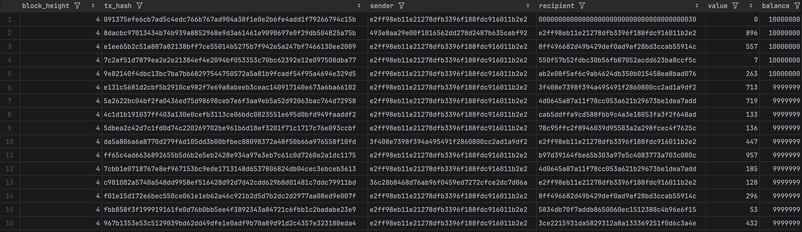
  <br>
  图 4：Agent 数据记录表
</p>

`agent_action_txs.jsonl` 文件的示例如图 5 所示。其中，每个 Agent 的动作分别用一行 JSON 来表示：

```json
{"seq":3,"action":"pay","agent_id":"agent-alice","target":"agent-bob","amount":12,"ts":3,"request_id":"payment-1","params_hash":"","tx_hashes":["f58c994e..."]}
```

<p align="center">
  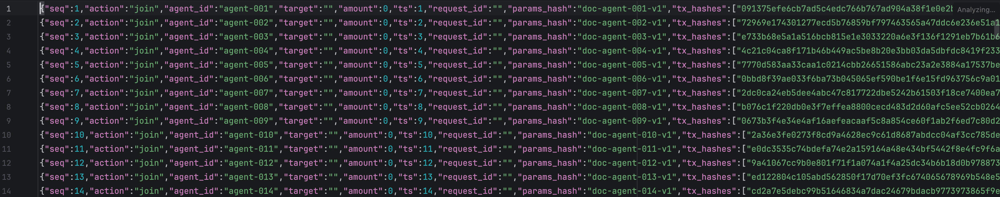
  <br>
  图 5：Agent 操作记录文件示例
</p>

## 实验结果的展示

通过启动脚本成功完成实验后，AgentEmulator 自动读取本轮实验的 Agent 账本 CSV 文件，生成论文排版风格的余额变化图，并以 PNG 格式保存至 `figs/figs_results/` 目录。随后，系统将图表整合为支持中英文切换的静态 HTML 图册页面（`figs/figs_results/index.html`），并在默认浏览器中自动打开该页面。

以下各小节依次介绍自动绘图流程、四张实验图表的展示内容、图册页面的使用方法，以及无需重新运行实验的手动绘图方法。

### 实验结束后，模拟器自动执行的操作步骤

脚本文件 `run_agentemu.sh`（Windows 用 `run_agentemu.bat`）在实验结束后自动执行以下操作：

1. 定位 `exp/agentemu-results/` 路径下 round 编号最大一轮的 `agents/` 目录；
2. 清空 `figs/figs_results/` 里的旧实验图与旧 `index.html` 文件；
3. 运行 `figs/python_code/plot_agent_balance.py` 生成全部实验图的 PNG 格式图片；
4. 运行 `figs/python_code/build_fig_html.py` 生成展示实验结果图表的 html 页面；
5. 模拟器调用网页打开命令在实验人员的计算机的默认浏览器中打开 `figs/figs_results/index.html` 页面，展示绘图结果。根据实验人员设备的操作系统类型不同，网页打开命令具体如下：MacOS 使用 `open` 命令，Linux 使用 `xdg-open` 命令，Windows 使用 `start` 命令。

### 绘制实验图

|实验结果图表的 HTML 页面中实验图编号|实验图的描述|对应的 PNG 文件|
|---|---|---|
|图 1（即图 6）|全部 Agent 期末余额变化总览：按 Agent ID 排序的柱状图，每根柱子代表一个 Agent，绿色柱表示余额增加、红色柱表示余额减少|`fig1_all_agents_overview.png`|
|图 2（即图 7）|按照全局交易顺序统计所有 Agent 的余额分布：先按 tx_hash 去重、再按确定性顺序回放各 Agent 的余额变化；图中以阴影带展示最小–最大包络与 P25–P75 四分位带，并叠加全体均值线（均值恒为 0）|`fig2_global_tx_order.png`|
|图 3（即图 8）|按各 Agent 的交易进度归一化对齐：各 Agent 自身交易序号拉伸到 0–1 后叠加，每条灰色曲线代表一个 Agent；均值曲线在中间阶段低于 0、终点回到 0|`fig3_normalized_progress.png`|
|图 4（即图 9）|分组展示各个 Agent 的余额变化：每 5 个 Agent 一张子图，横轴为各 Agent 自身的交易序号|`fig4_agents_001-005.png` … `fig4_agents_096-100.png`|

请注意，实验图绘制的是**相对初始余额的变化量 Δbalance = balance − 初始余额**。

以下展示的实验是在一台 Mac mini（MacOS 15.6）上完成的。该 Mac mini 的硬件为 Apple M4 Pro 芯片（12 核：8 个性能核 + 4 个能效核）、24 GB 内存。区块链环境基于黄华威研究组自研的 BlockEmulator-X（Go 语言版本为 1.25.7，GitHub 代码地址为 `github.com/HuangLab-SYSU/block-emulator-x`）。

本次实验采用单机多进程模拟部署，实验相关设置如下：

- 本次实验共模拟 4 个分片、每分片 4 个共识节点（合计 16 个共识节点）外加 1 个 supervisor 节点，均以 127.0.0.1 IP 下的不同端口（32217–32547，BlockEmulator-X 中的 supervisor 节点端口号为 38800）通过 direct 模式通信；
- 共识与跨分片协议为 `static_relay`（账户分布静态、跨片交易由 Relay 处理），出块间隔设置为 2000 ms，交易池按交易数量打包，每块上限 5000 笔；
- 区块存储采用 BoltDB，世界状态采用以太坊式 LevelDB，布隆过滤器位图长度 4096；
- 在 AgentEmulator 实验层以随机种子 20260903 回放包含 100 个 Agent、10,000 笔交易的 Trace（`trace_source_JSONL` 方式），每轮实验自动编译并重新启动 BlockEmulator-X 区块链模拟实验。

<p align="center">
  
  <br>
  图 6：100 个 agents 相对初始余额的最终变化，按 agent ID 排序。每根柱子对应一个 agent：绿色表示余额增加，红色表示余额减少。
</p>

<p align="center">
  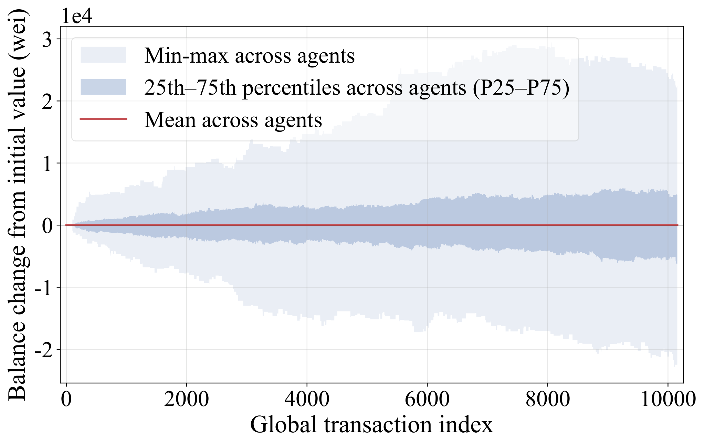
  <br>
  图 7：按全局交易顺序回放时的 agent 账户余额变化。
</p>

<p align="center">
  
  <br>
  图 8：账户余额随各 agent 相关交易的变化（交易上链确认的进度被归一化表示）。每条灰色曲线对应一个 agent。
</p>

<p align="center">
  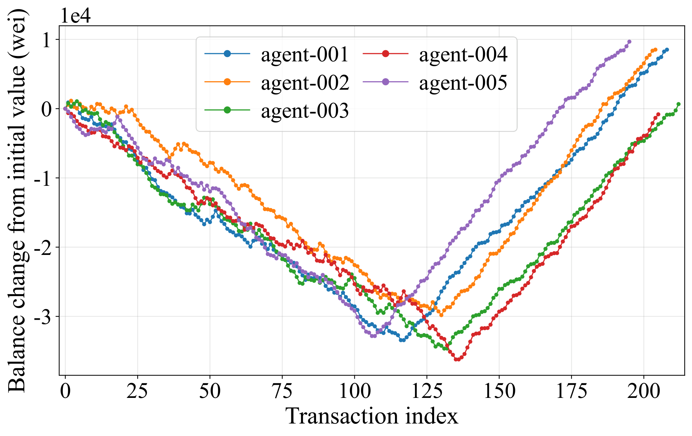
  <br>
  图 9：#001 至 #005 号 agents 相对初始余额的变化过程，按各 agent 的相关交易序号依次展示。
</p>

### 用于展示实验结果的 HTML 页面 UI 设计

HTML 页面总览见图 10。

- 顶部深色页眉：标题、生成时间、图表数量、数据来源目录与 agent 数。
- 绘制出的实验图中，图 1/2/3 整幅展示，图 4 为所有 agents 按照每 5 个 agents 为一组绘制的 agent 账户余额变化图；实验人员可**点击任意图片即可打开对应的原图**。
- **中英文切换**：右上角按钮（当前中文时显示 "EN"，英文时显示“中文”），或按键盘 `L` 键；切换作用于页面标题、章节标题、元信息与页脚，语言偏好自动记忆，下次打开该 HTML 页面时保持上一次的设置。
- 实验图内文字由绘图脚本生成，不随页面语言切换变化。

<p align="center">
  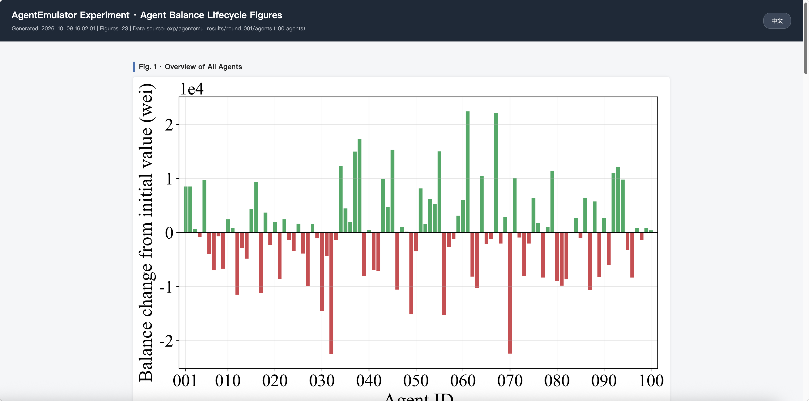
  <br>
  图 10：HTML 实验结果页面
</p>

### 手动 / 独立运行绘图脚本

实验人员无需重跑整个实验，也可以随时使用以下命令重新绘图。绘图脚本路径按 `figs/python_code/` 相对路径进行定位，在 AgentEmulator 项目根目录下运行以下命令均可：

```bash
# 默认：自动选取最新一轮实验结果，输出到 figs/figs_results/
python3 figs/python_code/plot_agent_balance.py
python3 figs/python_code/build_fig_html.py

# 指定数据目录与输出目录（例如用历史快照重新绘制）
python3 figs/python_code/plot_agent_balance.py \
    --data-dir exp/agentemu-results/round_001/agents \
    --fig-dir figs/figs_results
python3 figs/python_code/build_fig_html.py \
    --data-dir exp/agentemu-results/round_001/agents

# 只生成页面不重新画图
python3 figs/python_code/build_fig_html.py

# 打开图册
open figs/figs_results/index.html        # MacOS
```

Windows 下等价命令（实验人员可通过 cmd 运行以下命令，路径使用反斜杠；`python` 不可用时改用 `py -3`）：

```batch
python figs\python_code\plot_agent_balance.py
python figs\python_code\build_fig_html.py

python figs\python_code\plot_agent_balance.py --data-dir exp\agentemu-results\round_001\agents --fig-dir figs\figs_results
python figs\python_code\build_fig_html.py --data-dir exp\agentemu-results\round_001\agents

rem 打开图册
start "" figs\figs_results\index.html
```

两个绘图脚本的参数说明如下表：

|脚本|参数|默认值|说明|
|---|---|---|---|
|`plot_agent_balance.py`|`--data-dir`|自动选最新一轮 `agents/`|Agent CSV 所在目录|
||`--fig-dir`|`figs/figs_results/`|绘图结果的 PNG 图片输出目录|
|`build_fig_html.py`|`--fig-dir`|`figs/figs_results/`|扫描 PNG 并在此生成 `index.html` 页面|
||`--data-dir`|无|仅用于页面显示数据来源与 Agent 数量|

## 实验案例：“接入 LLM API 模式”下的一组实验（以智能体交易贵金属为场景）

### 实验场景的设定

<p align="center">
  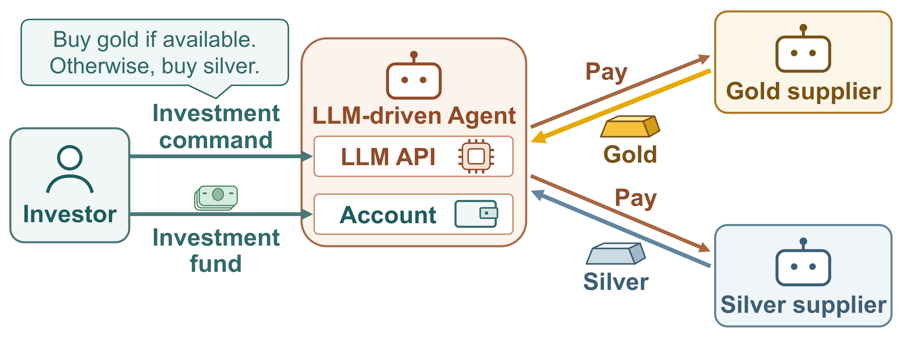
  <br>
  图 11：黄金-白银投资场景
</p>

本节以“购买贵金属”为场景，展示“接入 LLM API 模式”下的一个实验案例。该案例中包含一个由投资者控制的、由 LLM 驱动的“LLM-driven agent”，以及一个黄金供应商“Gold supplier”和一个白银供应商“Silver supplier”。如图 11 所示，LLM-driven agent 账户初始余额为 15 wei，随后按 Trace 中的安排分批收到共 835 wei 的转账；黄金和白银的单价分别为 160 wei 和 100 wei。供应商的上线和离线由初始 Trace 决定，LLM-driven agent 则根据运行期间观察到的账户余额和供应商状态决定是否购买。本实验中，LLM-driven agent 先后两次购买黄金、两次购买白银，再购买两次黄金。本节实验结果图由独立的 Python 绘图代码生成，不在 HTML 图册中展示。

根据图 12 所示流程，LLM-driven agent 的运行过程包含“观察（Observation）”、“推理（Reasoning）”和“决策（Decision Making）”三个阶段，即 Observation–Reasoning–Decision（ORD）。在观察阶段，LLM-driven agent 接收最新区块及账户状态快照，获取所有能观测的账户余额、供应商活跃状态等信息；在推理阶段，LLM 将这些观察结果与用户设置的购买策略结合，判断当前是否具备付款条件；在决策阶段，LLM 给出“付款”、“等待”或“退出”等结构化动作。agentSupervisor 对这些动作进行校验，将通过校验且需要上链的动作编译为“交易（Transaction, TX）”。LLM 后续的决策依据更新后的链上状态，形成持续的 ORD 流程。

<p align="center">
  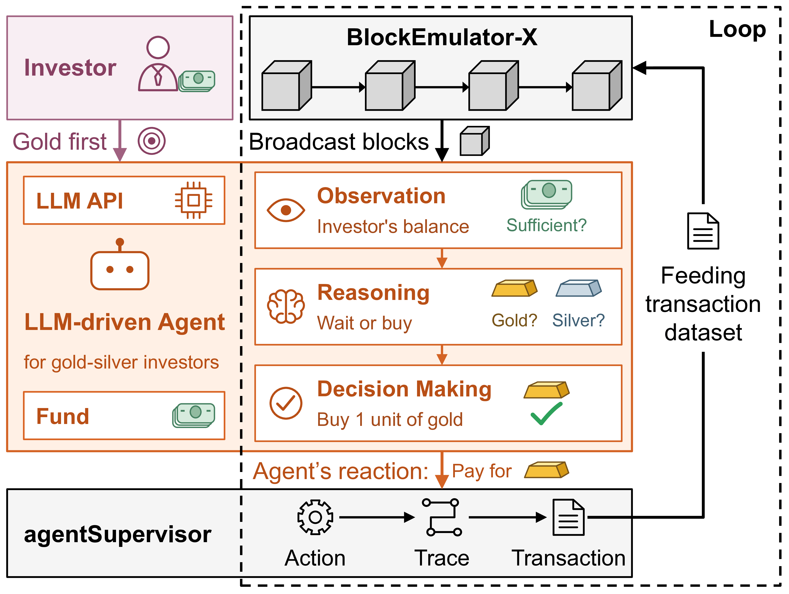
  <br>
  图 12：Agent 投资决策的产生和执行过程
</p>

投资者用户向 LLM 设置的购买策略。LLM-driven agent 优先购买黄金。gold supplier 在线且 LLM-driven agent 账户可用余额不少于 160 wei 时，支付 160 wei 购买一份黄金；gold supplier 在线但 LLM-driven agent 账户余额不足时，则继续等待，即使账户余额已足够购买白银，也不购买白银。当 gold supplier 离线、Silver supplier 在线且账户可用余额不少于 100 wei 时，才支付 100 wei 购买一份白银。LLM-driven agent 每轮决策最多购买一份黄金或白银。

#### 实验参数的配置

1. **LLM API 模型参数。**DeepSeek 使用官方 API，模型标识为 `deepseek-flash`；Qwen 使用阿里云百炼的兼容接口，模型标识为 `qwen3.8-max`。两者均通过 Chat Completions 接口调用，各独立运行一次。
2. **LLM-API 推理参数。**两次请求均未显式设置推理强度（reasoning_effort）、思考模式、采样温度（temperature）、核采样阈值（top_p）或最大输出 token 数。这些参数由各服务端按当时的默认行为处理。
3. **Trace 相关参数。**使用的 Trace 文件为 `metals_savings_22000.jsonl`，身份生成种子（seed）为 20260903，LLM API 驱动的 Agent 为 `agent-metal-buyer`。
4. **区块链参数。**BlockEmulator-X 采用 `static_relay`，配置为 4 个分片、每分片 4 个节点，出块间隔设为 2 秒。模型决策期间的出块上限（`max_blocks_during_decision`）为每轮决策 5 个区块，由所有分片共享。

#### DeepSeek-driven Agent 的区块链账户余额变化图和 Agent 动作时间线

图 13 展示了一次实验中 DeepSeek-driven Agent 的区块链账户余额变化图以及 Agent 动作时间线。上下实验图共享同一横轴，表示实验运行时长（秒）。图 13 上半部分展示 DeepSeek-driven Agent 账户余额变化，下半部分展示 LLM-driven agent 的“观察”、“推理”和“决策”三个阶段和 agentSupervisor 更新 Trace 文件阶段的时刻。

<p align="center">
  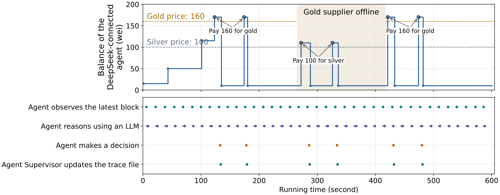
  <br>
  图 13：DeepSeek-driven Agent 的区块链账户余额变化图和 Agent 动作时间线
</p>

图 13 上半部分的纵轴展示的是 DeepSeek-driven Agent 的区块链账户余额，以 wei 为单位。余额增加表示 DeepSeek-driven Agent 收到转账，余额下降表示执行支付。金色虚线标出一份黄金价格 160 wei，灰色虚线标出一份白银价格 100 wei。金色虚线在 Gold supplier 离线期间断开，表示该时段内无法购买黄金。DeepSeek-driven Agent 的区块链账户余额达到 115 wei 时，虽然已经买得起白银，但 Gold supplier Agent 仍在线，因此 DeepSeek-driven Agent 继续等待，直到账户余额达到 170 wei 才发起第一次 Pay 支付用于购买一份黄金。

图 13 下半部分沿同一时间轴标出四个步骤的开始和结束时刻：

- **Agent observes the latest block**：对应 BlockEmulator-X 的 Supervisor 从各分片取得区块与账户状态，并发送到 LLM API。
- **Agent reasons using an LLM**：对应 LLM API 决策（Reasoning）。
- **Agent makes a decision**：LLM API 生成应答。
- **agentSupervisor updates the Trace file**：校验 LLM 应答，更新 Trace 文件，并提交到 BlockEmulator-X。

#### DeepSeek-driven Agent 与 Qwen-driven Agent 的区块链账户余额的时间线对比

图 14 对比了 DeepSeek-driven Agent 和 Qwen-driven Agent 各运行一次实验的 LLM-driven Agent 账户余额变化。两次实验以各自的开始时刻为零点对齐。蓝实线表示 LLM API 为 `deepseek-flash`，紫色虚线表示 LLM API 为 `qwen3.8-max`。

<p align="center">
  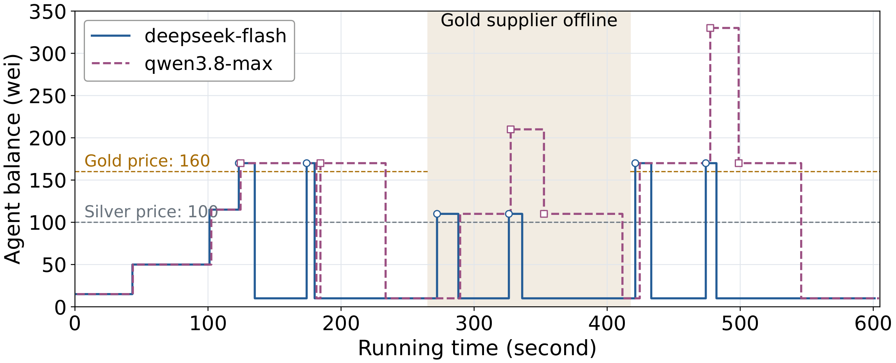
  <br>
  图 14：DeepSeek-driven Agent 与 Qwen-driven Agent 的区块链账户余额的时间线对比
</p>

**余额变化原因分析。**两次实验使用相同的初始 Trace，但 LLM-driven Agent 账户余额变化不同。DeepSeek-driven Agent 通常在余额增加后的较短时间内完成 pay 操作，余额在每笔付款后回到 10 wei。Qwen-driven Agent 有时在下一笔转账到账之后才完成前一笔购买，因此在白银购买阶段，账户余额积累到 210 wei，即两份白银的金额加上剩余的 10 wei。恢复购买黄金后，账户余额达到 330 wei，即两份黄金的金额加上 10 wei。

#### DeepSeek-driven Agent 与 Qwen-driven Agent 的单次 Reasoning 阶段耗时对比

图 15 的 Reasoning 操作耗时统计取自上一小节描述的 LLM-driven Agent 的对比实验。横轴列出两种 LLM API，纵轴表示 LLM-driven Agent 运行时 Agent reasons using an LLM 阶段的耗时（秒）。计时从大模型本轮决策开始，到收到应答或处理失败为止，包括 LLM API 请求等待及应答解析等开销。

<p align="center">
  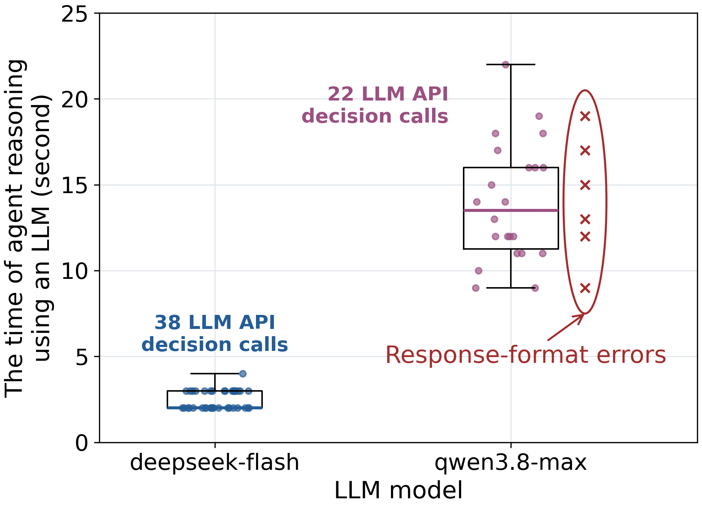
  <br>
  图 15：DeepSeek 与 Qwen 的单轮 LLM API Reasoning 阶段耗时分布
</p>

**散点与箱线的含义。**每个彩色散点对应一次 LLM API 调用，散点的横向偏移仅用于区分重叠的样本。箱体的下缘和上缘分别表示第 25 和第 75 百分位，箱内横线表示中位数。

**Reasoning 阶段耗时分析。**LLM API decision calls 表示实验记录的 LLM API 调用轮数。在实验中，DeepSeek 共发起 38 轮调用，Qwen 发起 22 轮调用。DeepSeek 的 Reasoning 阶段耗时中位数约为 2.0 秒，Qwen 的 Reasoning 阶段耗时中位数约为 13.5 秒。

**LLM 应答格式错误。**红色椭圆内的叉号标出 Qwen 的六次应答格式错误。Qwen 的应答中，`amount` 参数返回值为数值，例如 `160`，而当前接口要求参数返回值使用字符串，例如 `"160"`。这些轮次未通过应答解析，因此未完成 Pay 操作，但对应的耗时仍计入统计。

## 对实验数据进行分析

实验人员可通过实验产生的部分结果进行联合解析，即可回答“某笔支付是否确认、何时确认”的问题。解析路径为：`agent_action_txs.jsonl`（request_id → tx hashes）→ `relay_stats_detail_tx_info.csv`（hash → 提交时间）。具体的代码如下：

```python
import json, csv

chain = {}
with open('exp/agentemu-results/round_001/chain/results/relay_stats_detail_tx_info.csv') as f:
    for row in csv.DictReader(f):
        chain[row['OriginalHash']] = row

total = confirmed = 0
for line in open('exp/agentemu-results/round_001/agent_action_txs.jsonl'):
    a = json.loads(line)
    if a['action'] != 'pay':
        continue
    total += 1
    if all(h in chain for h in a['tx_hashes']):
        confirmed += 1
        # 例：查某笔的确认时间
        # print(a['request_id'], chain[a['tx_hashes'][0]]['Tx finally commit time'])

print(f'支付意图 {confirmed}/{total} 全部确认')
```

每笔交易的延迟统计口径为：`Tx finally commit time − Tx create time`；对于跨片交易，在实验结束生成的 CSV 结果表格中使用提议（Relay1）和提交（Relay2）两个时间点对跨片交易的处理进行细分。

实验人员也可以直接使用 pandas 库对 Agent 账本进行分析，相关代码如下：

```python
import pandas as pd
df = pd.read_csv('exp/agentemu-results/round_001/agents/agent-001.csv',
                 dtype={'balance': str, 'value': str})
```

# 常见问题（FAQ）

**Q1：实验人员重新启动 AgentEmulator 运行实验时，报 `file already exists: .../block_record.csv` 错误？**
出现这个问题表示上一次使用 AgentEmulator 进行实验的 results 文件没有清理，而这些 results 文件都是独占创建的。实验人员可使用 `run_agentemu.sh` 脚本文件启动实验则不会出现该问题。如果实验人员想通过手动运行 `go run cmd/agentemu/main.go` 命令启动 AgentEmulator，则需要先执行 `rm -rf exp/agentemu-results` 命令清理旧实验产生的 results 文件。

**Q2：为什么有时 join 操作没有生成注册交易？**
join 操作只有在 Agent **首次加入或离开后重新加入**时才会生成对应的注册交易。出现这个问题，实验人员可在 `agent_registry.json` 文件中查找到该 Agent 是否已是 active 状态。如果实验人员想复现所有 agents 在 join 时生成对应的注册交易，则需要将旧的 results 文件删除。

**Q3：Agent 之间的互相转账是通过调用智能合约实现的吗？**
不是。Agent 之间的 `pay` 操作会被 agentSupervisor 编译为**普通转账交易**；只有 Agent 的 `join`/`leave` 操作是通过调用智能合约实现的。不过，相关的智能合约当前暂未部署，调用相关的智能合约目前只是在 EVM 层做了一个记录，而非真实调用智能合约的状态。但 Agent 之间的 `pay` 转账操作是真实有效的。

**Q4：控制台日志输出太多，无法查看到关键信息怎么办？**
实验人员可在 `config.yaml` 配置文件中，修改 `system.log.log_level` 部分的配置为 `warn`，或在运行脚本文件时使用 `bash run_agentemu.sh > run.log 2>&1` 命令进行重定向，即可减少控制台输出的日志内容。

**Q5：实验人员如何运行单分片的小规模实验？**
实验人员可将 `config.yaml` 中的 `system.shard_num` 设置为 `1`，使区块链以单分片模式运行，并根据实验需求调整 Trace 文件中的行为记录和交易数量，以控制实验的输入规模。

**Q6：实验运行结束但是没有弹出 HTML 页面是为什么？**
实验人员可先查看控制台末尾是否有输出 `figures & gallery: ./figs/figs_results/index.html`：

- 没有输出这行且出现 `warn: no agent CSVs ...`：表示本次实验没有生成 Agent 相关的数据记录（例如实验人员在 `agentEmuConfig.yaml` 文件中将配置设置为 `chain.enabled: false`，表示只通过 agentSupervisor 将 Trace 文件编译成对应的交易数据，而不启动 BlockEmulator-X 模拟区块链运行），属于正常现象；
- 有这行但 HTML 页面没有弹出：实验人员可手动使用以下命令 `open figs/figs_results/index.html` 打开该 HTML 页面。

**Q7：绘图脚本提示 `ModuleNotFoundError: matplotlib`，应如何处理？**
该错误表示当前运行绘图脚本的 Python 环境缺少 `matplotlib` 库。实验人员应在该环境中执行 `pip3 install matplotlib numpy pandas` 命令，安装绘图所需的依赖库；也可以使用已安装上述依赖库的 Python 解释器运行脚本。

**Q8：实验人员如何使用历史数据重新绘制实验图？**
实验人员可将 `--data-dir` 参数设置为目标实验轮次的 `round_XXX/agents/` 目录，并手动执行绘图脚本。由于 `run_agentemu.sh` 每次实验运行前都会清空 `exp/` 目录，并在实验结束后、开始绘图前删除 `figs/figs_results/` 目录，实验人员应在运行前备份需要保留的历史数据和图表。

**Q9：实验图 4 包含较多子图，实验人员如何调整 Agent 的展示范围或分组方式？**
当前绘图脚本按照每组 5 个 Agent 的规则生成实验图图 4 的子图。实验人员可修改 `figs/python_code/plot_agent_balance.py` 文件中图 4 对应的绘图代码，筛选需要展示的 Agent，或调整分组大小。其中，`range(0, len(dfs), 5)` 中的 `5` 表示每组包含的 Agent 数量。

**Q10：AgentEmulator 的实验结果是否具有可复现性？**
对于“回放 Agent 行为模式”，在 `seed`、Trace 文件和代码版本均相同的条件下，AgentEmulator 生成的交易数据集文件和 Agent 行为 CSV 文件逐字节一致，Agent 数据记录也按照确定性的全局顺序生成。链上交易的打包时序受运行时条件影响，这一特性与 BlockEmulator-X 一致。

**Q11：Windows 系统提示“python 不是内部或外部命令”，或执行 `python` 后打开 Microsoft Store，应如何处理？**
上述情况通常表示系统尚未安装可用的 Python，或 Python 的安装路径未加入 `PATH` 环境变量。实验人员可从 [Python 官方网站](https://www.python.org/downloads/windows/)下载安装程序，并在安装时勾选“Add python.exe to PATH”。

如果系统已安装 Python 启动器，实验人员也可以使用 `py -3` 调用 Python 3；`run_agentemu.bat` 脚本中已提供自动回退至该启动器的逻辑。安装完成后，实验人员应使用所选解释器安装绘图依赖库：使用 `python` 时，执行 `python -m pip install matplotlib numpy pandas`；使用 `py -3` 时，执行 `py -3 -m pip install matplotlib numpy pandas`。

**Q12：为什么“接入 LLM API 的模式”目前只能使用 static_relay？**
AgentEmulator v2.0 的区块同步机制是基于 static_relay 机制实现的。“接入 LLM API 模式”在实验运行期间需要从各分片获取区块与账户快照，协调大模型调用期间的出块许可，并根据链上提交记录判断上一笔付款是否已结算。目前，这些机制接入了 BlockEmulator-X 的 static_relay 运行流程。对于跨分片付款，Supervisor 根据两个 relay 阶段的提交记录判断交易是否完成结算，再安排后续决策。其他共识或跨分片交易模式需要适配各自的快照采集、出块协调和交易确认流程。使用“接入 LLM API 模式”时，请在 config.yaml 中将 `system.consensus_type` 设为 `static_relay`。如果需要使用其他已支持的链配置，可以在 agentEmuConfig.yaml 中将 `agent_api.enabled` 设为 `false`，使用“回放 Agent 行为模式”。

**Q13：为什么大模型返回了支付决策，但链上没有对应的付款记录？**
先查看 `agent_thinking.log` 中该轮的 `thinking_finished` 和 `decision_result`。收到 pay 决策后，Supervisor 还要检查应答格式、收款方是否活跃以及可用余额是否充足。例如，LLM 应答中的 `amount` 必须是 JSON 字符串 `"160"`。若大模型返回 JSON 数字 160，该轮应答无法通过解析，因此不会提交付款。若校验未通过，日志会记录失败原因，实验会继续处理后续动作。

如果该轮支付决策显示 accepted 并附有交易哈希，说明交易已提交。此时可用该哈希在 `relay_stats_detail_tx_info.csv` 中查找对应记录，通过 `Tx finally commit time` 核对交易是否已最终确认。

# 研究团队

**本文由中山大学软件工程学院黄华威教授研究组（HuangLab）主导完成。研究组长期专注于区块链系统与协议、共识协议、区块链金融、AI 与区块链交叉等方向的研究，已在 IEEE/ACM ToN、TSC、TC、TPDS、TDSC、INFOCOM、WWW、ICDCS 等期刊与会议发表多篇论文。**

研究组代表性开源项目如下：

**智能体实验平台 AgentEmulator**

- 主页：https://xintelligence.pro/agentemulator
- GitHub 仓库：https://github.com/HuangLab-SYSU/agent-emulator

**区块链分片实验平台 BlockEmulator**

- 主页：https://www.blockemulator.com
- GitHub 仓库：https://github.com/HuangLab-SYSU/block-emulator

欢迎关注 HuangLab 公众号（ID: Huang-Lab）。
欢迎访问 HuangLab 学术主页：http://xintelligence.pro

## 参与贡献

欢迎通过标准 GitHub PR 流程贡献基准场景、插件、trace 与文档。见 [CONTRIBUTING.md](CONTRIBUTING.md)。

## 许可证

本项目采用 PolyForm Noncommercial License 1.0.0 授权，不允许商用。见 [LICENSE](LICENSE)。
