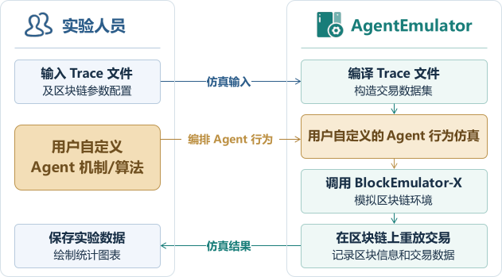
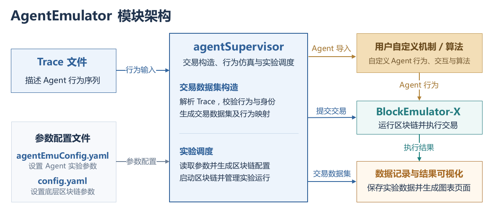
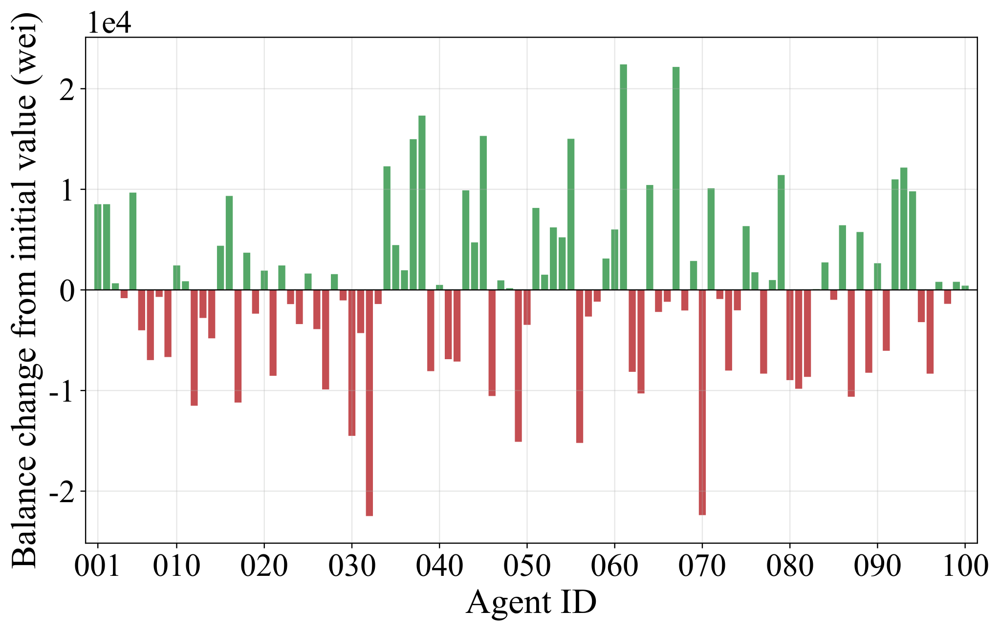
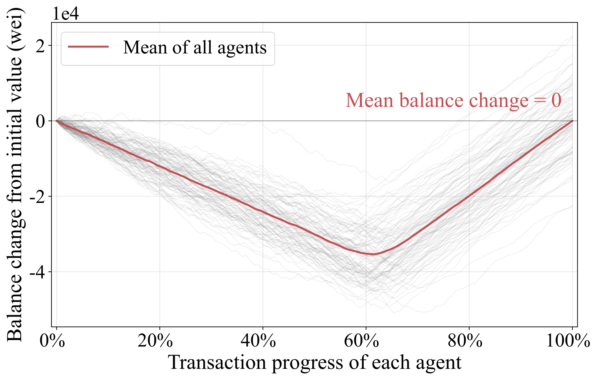
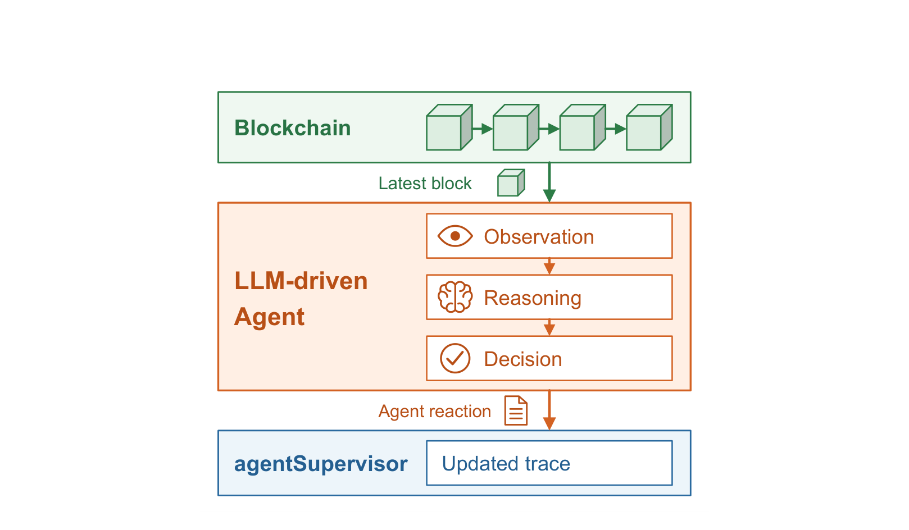

# AgentEmulator

<p align="right"><a href="README.md">英文</a> | <b>中文</b></p>

## 简介 / Overview

AgentEmulator 是由**中山大学·软件工程学院·黄华威研究组（**[**HuangLab**](http://www.xintelligence.pro/)**）发起的、面向 AI 智能体可信基础设施的仿真与实验平台**。平台以区块链作为可信记录与结算的基础，**旨在帮助研究者和学生**围绕智能体的身份、行为审计、支付结算、激励与治理机制开展实验，逐步形成支持 AI 智能体可信交互与协作的**研究工具**。

AgentEmulator 是面向 AI 智能体行为与区块链相结合的场景、基于 BlockEmulator-X（即 BlockEmulator 2.0 版本） 构建的**实验工具**。其中，BlockEmulator-X（BlockEmulator 2.0 版本） 是 HuangLab **于2026年5月开源的区块链仿真实验工具**，是初代 BlockEmulator 1.0 的升级迭代版本，其 GitHub 代码仓库地址为 https://github.com/HuangLab-SYSU/block-emulator-x 。

### 演示视频

[**AgentEmulator 演示视频**](https://www.bilibili.com/video/BV1d54g6oEST/)（Bilibili）

### 论文

[**AgentEmulator: A Blockchain-Empowered Testbed for Trustworthy AI Agent Infrastructure（HAL）**](https://hal.science/hal-05774794)

[**AgentEmulator: A Blockchain-Empowered Testbed for Trustworthy AI Agent Infrastructure（ResearchGate）**](https://www.researchgate.net/publication/415363728_AgentEmulator_A_Blockchain-Empowered_Testbed_for_Trustworthy_AI_Agent_Infrastructure)

Jian Zheng, Jianbo Xiong, Feihong Hu, and Huawei Huang（通讯作者）。2026 年 10 月。Preprint。

论文形式化了 trace 到交易的映射、三种执行顺序（逻辑 trace 顺序、后端执行顺序、可视化顺序）、可复现性要求，以及支付完成度与执行开销的评估方法论。

研究中使用 AgentEmulator 请引用本论文（见 [CITATION.cff](CITATION.cff)）：

```Plaintext
@misc{zheng2026agentemulator,
  author = {Zheng, Jian and Xiong, Jianbo and Hu, Feihong and Huang, Huawei},
  title = {{AgentEmulator}: A Blockchain-Empowered Testbed for Trustworthy {AI} Agent Infrastructure},
  year = {2026},
  month = oct,
  doi = {10.13140/RG.2.2.23825.60000},
  url = {https://hal.science/hal-05774794},
}
```

### 为什么需要可信智能体基础设施

AI 智能体正在走出对话框，进入真实工作流：调用 API、持有身份、为服务付费、代表人和机构行动。当智能体彼此交易时，会出现三个「更好的模型」解决不了的信任缺口：

|信任缺口|实际含义|
|---|---|
|行为不可审计|智能体做了什么、为什么这么做，没有中立、防篡改的记录。|
|权责不可追溯|智能体出错、越权、造成损失时，无法定位「哪个智能体、受谁授权、在哪一步」。|
|结算不可信|智能体之间、智能体与 API 服务之间的价值交换缺少中立账本。|

补上这些缺口需要一层独立的基础设施：与模型本身无关的审计与结算层。AgentEmulator 就是构建和评估这一层的实验平台。在这里，区块链承担一个具体角色——可信记录与结算的中立基座，而不是万能解药。

### AgentEmulator 是什么、不是什么

AgentEmulator 度量的是基础设施层，不是智能体能力。能力基准（AgentBench、WebArena、OSWorld、SWE-bench）问的是：智能体能不能完成任务？AgentEmulator 问的是：智能体加入、支付、离开时，身份、支付、记录、结算是否正确，代价多大，换一种机制会怎样？两个问题是互补的：一笔支付成功只证明支付发生了，不证明任务完成得好。AgentEmulator 提供交易记录与账户视图，让「基础设施」这个问题可回答、可复现。

**AgentEmulator 能做什么：**

AgentEmulator 目前支持两种运行模式。

**Trace 回放模式**：支持基于 Trace（实验输入数据）的基础行为回放、身份注册与注销留痕、逐笔直接支付，以及实验数据记录和可视化。实验人员使用 JSONL 格式的 Trace 文件描述 Agent 的“**加入**”、“**转账**”和“**退出**”行为；AgentEmulator 中的 agentSupervisor 模块将 Trace 文件编译为交易数据集，并调用 BlockEmulator-X 启动区块链环境、执行交易、并将交易执行结果上链记录。实验完成后，AgentEmulator 系统会记录交易与 Agent 账户的相关数据，自动绘制余额变化图集，并生成支持中英文切换的 HTML 实验结果页面（由启动脚本在默认浏览器中打开展示）。

Trace 回放模式下，Agent 行为由 Trace 文件预先定义，采用“用户原始指定顺序”（User-specified Original Sequence）策略，按照实验输入中指定的交易顺序执行交易，尚未集成额外的交易编排机制或调度算法。实验人员可在此基础上探索和实现自定义机制，例如调整交易的执行顺序，或根据交易优先级、Agent 权重等规则编排交易。

**LLM API 接入模式**：从 Trace 中选出一个身份交给模型 API 在线控制，其余身份仍按照 Trace 文件中的操作来行动。模型从链上的区块快照获取全局数据，经过思考后做出付款、等待或退出等等具体的决策，经校验后转换为链上交易；实验记录每一轮的决策日志，并支持导出时间线图与多模型对比图。该模式仅支持 `static_relay` 共识。需要提醒的一点是，调用大模型可能会消耗用户的 API 额度。

AgentEmulator 后续版本将持续升级迭代，逐步扩展协议、实验场景和评测能力。欢迎实验人员结合具体研究需求扩展示例代码，设计并验证不同机制或算法对实验结果的影响。

**不关心的事：**

不内置任何交易调度算法——遵循 User-specified Original Sequence 策略，把交易重排、优先级规则、智能体权重留给研究者作为扩展点。

### 五层技术栈

AgentEmulator 对应可信智能体基础设施的五层分类法。五层定义研究议程，工具逐层落地。

|层|要回答的问题|AgentEmulator 现状|
|---|---|---|
|L1 身份|这个智能体是谁，谁授权它？|`did-simple` 派生确定性标识；DID 注册合约在路线图中|
|L2 审计|它做了什么，事后能验证吗？|可验证日志结构（如 Merkle 累积器）在路线图中；当前记录动作流与逐轮决策日志|
|L3 结算|智能体之间如何高频支付？|当前为 `direct-pay`；支付通道与批量结算在路线图中|
|L4 激励|好行为如何在链上得到回报？|路线图（声誉、积分、预测市场）|
|L5 治理|谁来仲裁纠纷，监管如何接入？|路线图|

### 一次演示工作流

论文演示了完整工作流：100 个智能体、1 万笔支付交易，跑在 4 分片 × 4 节点的区块链上（单机，Mac mini / Apple M4 Pro / 24 GB，Go 1.25.7，seed 20260903），产出 23 张图、四种余额视图。

这次演示验证的是工作流——Trace 进去，账本和视图出来。它不构成性能或扩展性结论；吞吐量、时延、资源开销需要独立的计时测量，这部分评估方法论在论文中有定义。



**图 1. AgentEmulator 的通用工作流** (并不只是对应于当前版本) 展示了用户与 AgentEmulator 之间的交互关系。其中，“用户自定义 机制/算法” 具有非常大的自由发挥空间，是用户二次开发、自由创新之地。

### 可复现性

可复现实验要求输入固定：同一份 Trace 文件、同一个 seed、同一份配置、同一组源码版本、干净的初始注册表。AgentEmulator 自动化了这些准备步骤；论文附录 A 给出记录清单、核对项与图表重生成命令，让一次运行可被验证。

Trace 回放模式下，相同的 seed、Trace 文件和代码版本生成逐字节一致的交易数据集。LLM API 接入模式中，模型响应与并发出块按实际时间推进，同一 seed 的重复实验可能得到不同的决策和确认时间；不过用户可以根据已捕获的动作进行实验流程的回放。

### HuangLab 项目家族

AgentEmulator 是中山大学 HuangLab 区块链实验技术栈的一部分：

|项目|角色|链接|
|---|---|---|
|BlockEmulator|区块链分片协议仿真器（IEEE TSC 2025） BlockEmulator v1.0 版本，2023 年开源|https://github.com/HuangLab-SYSU/block-emulator|
|BlockEmulator-X|支持 EVM 执行的继任版本，AgentEmulator 的后端。 BlockEmulator v2.0 版本，2026 年 5 月开源|https://github.com/HuangLab-SYSU/block-emulator-x|
|AgentEmulator|本项目——分片区块链上的智能体行为仿真。BlockEmulator v3.0 版本，2026 年 9 月开源|https://github.com/HuangLab-SYSU/agent-emulator|
|BrokerChain|分片区块链测试网-学术版本（约 400 个外部节点），起源于 "BrokerChain: A Cross-Shard Blockchain Protocol for Account/Balance-based State Sharding"（INFOCOM 2022）|https://github.com/HuangLab-SYSU/BrokerChain|
|brokerchain-mcp|MCP server（`register_agent` / `append_log` / `open_channel` / `pay`），双后端：AgentEmulator 仿真 + BrokerChain 测试网|开发中|

### AgentEmulator 有什么用？

**AgentEmulator 实验平台**的**设计目标是简化 AI Agent 相关的实验环境搭建配置、机制验证和数据分析**，**使实验人员**能够轻松地配置底层区块链环境、观察 AI 智能体的行为，并通过实验数据分析在不同机制控制时的运行效果。

下图展示了 AgentEmulator 用户视角的工作流程图。

### 发展路线 / Roadmap

AgentEmulator 将围绕 AI Agent 的“身份”“结算”“审计”“激励”“治理”五个方向逐步扩展。

以下为拟推进的发展完善路线，具体安排将随相关研究与开发进展进行微调。

|阶段|主要内容|
|---|---|
|**v1.0：基础行为仿真（已发布）**|支持 Trace 文档驱动的“加入 (Join)”、“支付 (pay)”和“退出 (leave)”行为回放，提供交易执行、行为与交易映射、账户数据记录及结果可视化。|
|**v2.0：单 Agent 在线决策（当前版本）**|在 Trace 回放的基础上新增 LLM API 接入模式：把 Trace 文件中的一个身份交给模型 API，模型定期观察链上数据，思考后做出决策，决策内容经校验后转换为链上交易，并提供决策日志、时间线与多模型对比图。|
|**近期：完善身份与审计能力**|逐步实现 DID 注册与注销的智能合约状态管理，扩展权限声明、可验证行为日志和行为追溯能力。|
|**中期：扩展支付与交互机制**|引入微支付、支付通道和批量结算等机制，扩展多轮反馈实验，支持更丰富的 Agent 服务交互场景。|
|**后续：支持激励与协作治理实验**|研究多 Agent 协作中的任务分配、行为协调与责任追溯机制，支持不同协作策略的仿真与效果评估。|
|**长期：建设基准评测平台**|积累标准化 Agent 相关的实验场景、数据集与评测指标，支持不同可信基础设施方案的比较和可复现实验。|

---

### GitHub 代码仓库地址

GitHub 代码仓库地址为：https://github.com/HuangLab-SYSU/agent-emulator

### 术语解释

本节介绍 AgentEmulator 中的主要术语，帮助实验人员理解系统组成、输入文件和配置文件之间的关系。AgentEmulator 基本工作流程是：**实验人员通过 Trace 文件描述 Agent 行为，并为选定的 Agent 配置 LLM API 与任务目标；agentSupervisor 读取 Trace，并调用 BlockEmulator-X 启动区块链环境；实验运行期间，系统根据链上状态调用 LLM API 生成决策，对返回的动作进行校验，并将需要上链的有效动作更新至实际执行的 Trace 中（Agent 行为回放模式不包含 LLM API 调用与 Trace 动态更新步骤，全部 Agent 均按原始 Trace 执行预设行为）；系统将待执行动作转换为交易并提交至区块链，随后记录实验数据并展示实验结果。**

|术语|说明|
|---|---|
|AgentEmulator|基于 BlockEmulator-X 构建的 Agent 行为仿真模拟器，将输入的 Agent 行为转换为区块链交易并记录上链，自动记录实验日志并展示实验结果。|
|Agent|实验中执行行为的主体，可按照 Trace 文件中的描述执行“加入”、“支付”和“退出”操作。|
|BlockEmulator-X|AgentEmulator 的底层区块链仿真平台，负责节点运行、共识出块、交易执行和链上数据记录。（GitHub 代码仓库地址为 github.com/HuangLab-SYSU/block-emulator-x）|
|Trace 文件|描述 Agent 行为序列的实验输入文件，采用 JSONL 格式，每行记录一次 Agent 行为或一笔普通转账。|
|agentEmuConfig.yaml 文件|AgentEmulator 的实验配置文件，用于指定 Trace 文件、身份派生seed、结果目录，以及是否启动区块链等参数。|
|config.yaml 文件|BlockEmulator-X 的区块链配置模板，用于设置区块链的分片数量、节点数量、出块间隔等底层参数。|
|agentSupervisor|AgentEmulator 的实验调度模块，负责读取配置和 Trace 文件、将行为编译为交易数据集，并组织底层区块链运行及实验数据输出。|
|agent_id|实验人员在 Trace 文件中为 Agent 指定的唯一标识（例如 agent-alice），用于区分不同 Agent 并关联其行为记录。|
|seed|在 agentEmuConfig.yaml 中设置的身份派生种子，系统将其与 agent_id 结合生成 DID。相同的种子与 Agent 标识会生成相同的 DID。|
|DID|去中心化 ID（Decentralized Identifier），用于标识 Agent 的身份，由系统根据 seed 和 agent_id 自动生成，无需在 Trace 文件中手动填写。|
|LLM API|AgentEmulator 调用外部大语言模型（Large Language Model，LLM）的接口。当前支持兼容 Chat Completions 的服务，实验人员可在 agentEmuConfig.yaml 中配置接口地址、大模型名称和认证方式。|
|API Agent|由 LLM API 控制的 Agent。通过 agent_api.agent_id 选定 Trace 中已有的身份。系统保留该身份首次加入的动作，后续行为由大模型决策接管。|

### AgentEmulator 的系统架构

下图展示了 AgentEmulator 的模块架构。



图 2：AgentEmulator 的模块架构

LLM API 接入模式在架构上增加一个模型决策环节：链上 Supervisor 从各分片收集快照，交给 AgentSupervisor 调用外部模型 API 并校验决策，再提交通过校验。实现说明见 `docs/hybrid-agent-api.md`。

---

# 开始使用 AgentEmulator 做实验

## 环境准备

AgentEmulator 支持在 macOS、Linux 和 Windows 操作系统上运行，环境依赖如下表所示。

|依赖|版本要求|验证命令|用途|
|---|---|---|---|
|Go|≥ 1.25.7|`go version`|编译运行仿真器|
|Python 3|≥ 3.8|`python3 --version`（Windows：`python --version` 或 `py -3 --version`）|实验后自动绘图|
|matplotlib / numpy / pandas|—|`python3 -c "import matplotlib, numpy, pandas"`|绘图库|

```bash
# Python 绘图库缺失时安装（Windows 系统直接使用 pip 命令）
pip3 install matplotlib numpy pandas
```

```bash
git clone https://github.com/HuangLab-SYSU/agent-emulator.git
cd agent-emulator
go build ./...      # 首次编译，验证环境正常
```

## 五分钟上手：使用 AgentEmulator 的操作流程

在 Windows 系统中，实验人员可以通过 cmd 执行 `.bat` 批处理脚本，也可以在文件资源管理器中双击运行 `run_agentemu.bat`。具体命令如下：

```text
run_agentemu.bat
```

```text
run_agentemu.bat my-config.yaml
```

`run_agentemu.bat` 与 `.sh` 版本所做的行为完全一致：编译 → 清理旧结果 → 运行实验 → 自动绘图 → 在默认浏览器打开 HTML 图册。若 `python` 命令不可用，脚本会自动改用 `py -3`。

实验人员可随时按下 `Ctrl-C` 安全终止实验，随后 BlockEmulator-X 启动的共识节点子进程将一并被清理。

> **注意**：实验失败时不会执行绘图步骤；另外，每次运行前，脚本文件会先清空 `figs/figs_results/` 路径中的旧实验图，绘制的实验图永远只反映**最近一次成功的实验结果**。

使用 **MacOS** 和 **Linux** 系统的实验人员可使用 bash 运行脚本，示例如下：

```bash
bash run_agentemu.sh
```

实验人员运行以上命令后，脚本会依次自动完成以下操作：

1. **编译**：`go build ./...`
2. **清理旧的实验数据**：删除 `./exp` 目录
3. **实验运行步骤**：
   - **Agent 行为回放模式**：读取 `agentEmuConfig.yaml` → 编译 trace 为交易数据集 → 自动启动 BlockEmulator-X 区块链（默认 4 分片，每分片 4 节点）→ 交易数据全部上链 → 实验完成，区块链自动停止
   - **LLM API 接入模式**：读取 `agentEmuConfig.yaml` 并选定 API Agent → 自动启动 BlockEmulator-X 区块链 → 其余 Agent 按 Trace 注入预设动作，API Agent 根据链上快照调用大模型作出决策 → agentSupervisor 校验决策，并将通过校验的交易提交到链上 → 到达实验时限后停止注入新动作，等待已提交交易确认，记录结果并关闭区块链
4. **自动绘制实验图**：读取最新一轮的数据记录表，生成 PNG 格式的数据图到 `figs/figs_results/` 目录中
5. **将 PNG 数据图嵌入 HTML 页面中并自动在浏览器中打开**

实验人员也可使用以下命令自定义配置运行：

```bash
bash run_agentemu.sh my-config.yaml
```

## 编写 Trace 文件

Trace 文件采用 JSONL 格式记录 Agent 的行为序列，作为 AgentEmulator 的实验输入数据，用于模拟 Agent 行为和区块链常规交易。文件中的每条记录通过 `agent_id` 标识执行行为的 Agent，通过 `ts` 确定行为的执行顺序，并指定具体的行为类型，包括 `join`、`pay` 和 `leave`。AgentEmulator 基于该文件，以确定性方式生成仿真实验的全部后续产物：

```text
trace 文件（实验的全部意图）
    │  编译：意图 → 真实区块链交易（DID 派生、nonce、数据字段）
    ▼
交易数据集 → 仿真回放 → Agent 账本 / 链上测量 → 绘图展示效果
```

### 注意事项

使用 Trace 文件时，实验人员应注意以下事项：

1. **行为描述与交易生成。** 实验人员通过 Trace 文件描述 Agent 的行为，无需手动构造区块链交易。AgentEmulator 根据行为记录和 `seed`，以确定性方式生成 Agent 身份标识（DID）、交易 nonce 以及相关数据字段。
2. **Agent 行为回放模式的可复现条件与执行顺序。** 在 Trace 文件、`seed` 和代码版本均相同的条件下，AgentEmulator 生成一致的交易计划，具体说明见 FAQ Q10。Trace 文件中的 `ts` 用于确定行为的逻辑执行顺序；对于 `ts` 相同的记录，系统按照其在文件中的出现顺序执行。`ts` 不表示交易的实际上链时间，调整其数值间隔也不等同于调整交易的上链时间。
3. **LLM API 接入模式下的 Trace 时间调度。** agentSupervisor 以保留的首条 Trace 动作为时间基准，将各动作的 `ts` 与基准的差值除以 `trace_time_scale`，得到相对于实验开始的计划注入时间，单位为毫秒。同一时间的记录仍按文件中的出现顺序处理。受注入速率和链上快照采集等因素影响，动作可能晚于计划时间注入，延迟的动作仍按原顺序处理。API Agent 的后续动作由大模型根据链上观察实时决定，经校验后提交。`ts` 给出的是 Trace 动作的计划注入时间，实际确认时间取决于交易执行和出块进度。
4. **Agent 生命周期与支付约束。** Trace 文件中的 `join`、`leave` 和 `pay` 记录分别描述 Agent 的“加入”、“退出”和“支付”行为。AgentEmulator 按顺序处理这些记录，并更新 `agent_registry.json` 中各 Agent 的 `active` 状态。执行 `pay` 操作时，付款方和收款方均须处于 `active` 状态。
5. **实验数据关联与版本标记。** `request_id` 用于关联支付行为、链上交易和 Agent 账本记录，建议实验人员为其设置全局唯一值。`params_hash` 用于标记行为参数的版本，系统将该字段原样写入映射文件，以支持多轮实验的数据管理。
6. **普通区块链转账交易。** Trace 文件支持包含 `sender`、`recipient` 和 `value` 字段的普通转账记录。实验人员可以将此类记录与 Agent 行为记录组合使用，从而构造包含不同交易类型的实验负载。

Trace 文件以 JSONL 格式给出，每一行表示一个 Agent 执行的某个行为或者是普通转账交易，按 `ts`（TimeStamp）排序（`ts` 相同则按照文件中的行序进行执行）。仓库自带的基础示例包括：`traces/minimal.jsonl`（只包含 2 个 Agent 加入 / 转账的最小实验规模示例）、`traces/agent=100_txs=10000.jsonl`（v1.0 基础示例使用的 trace 文件，包含 100 个 Agent，10000 笔交易），以下展示一份 trace 文件的示例。

```json
{"agent_id":"agent-alice","action":"join","params_hash":"doc-alice-v1","ts":1}
{"agent_id":"agent-bob","action":"join","params_hash":"doc-bob-v1","ts":2}
{"agent_id":"agent-alice","action":"pay","target":"agent-bob","amount":12,"request_id":"payment-1","ts":3}
{"agent_id":"agent-bob","action":"leave","params_hash":"exit-bob","ts":5}
```

### Trace 文件支持的行为类型

|类型|含义|编译成的交易|
|---|---|---|
|`join`|Agent 注册“加入”|DID `register` 智能合约调用|
|`pay`|向另一个 Agent 转账|普通转账交易|
|`leave`|Agent 注销“退出”|DID `revoke` 智能合约调用|
|普通转账交易|由区块链账户而非 Agent 发起的转账交易|普通转账交易|

普通转账交易行中不包含 `action` 字段，靠 trace 文件中的结构（`sender` 字段中使用的是账户地址）自动识别，只有三个输入字段，该普通转账交易的执行顺序严格按照 trace 文件中的行序执行，示例如下：

```json
{"sender":"0xabc...","recipient":"0xdef...","value":"12345"}
```

**LLM API 回复规则。**每轮大模型调用应返回一个 JSON 对象，通过 `action` 字段指定动作，取值为 `pay`、`wait` 或 `leave`。`pay` 表示向指定 Agent 支付，须同时提供收款方标识 `target` 和付款金额 `amount`。`wait` 表示本轮等待，不填写收款方或金额，也不产生链上交易。`leave` 表示退出实验，不填写收款方或金额，通过校验后由 agentSupervisor 转换为退出交易。

大模型回复与原有 Trace 使用不同的输入格式。大模型每轮只返回一个决策对象，由运行环境确定执行该动作的 Agent 身份。原有 Trace 则采用 JSONL 格式，每行记录一个预设动作或一笔普通转账。对于支付，大模型回复中的 `amount` 必须是 `uint64` 范围内的正十进制整数字符串，例如 `"160"`。Trace 中 Agent 支付记录的同名字段使用 JSON 整数，例如 `160`。LLM API 回复的 JSON 示例如下。

```json
{"action":"pay","target":"agent-gold-supplier","amount":"160","summary":"Pay 160 wei for gold."}
```

### Trace 文件编写时应该遵守的规则

1. **`pay` 行为的双方 Agent（`agent_id` 和 `target`）当时必须处于 active 状态**（已 join 且未 leave），否则整场仿真实验将报错终止。
2. `leave` 操作只能作用于处于 `active` 状态的 Agent；已经 `leave` 的 Agent 再次 `join` 需要重新注册。
3. `amount` 字段的填写必须为正整数。链上新账户地址会自动获得 10^36 wei 的初始余额，正常实验无需担心账户余额不足。
4. **trace 文件中不需要写 DID**——Agent 的身份由 `seed + agent_id` 确定性派生，同 seed、同 ID 永远得到同一 DID。
5. `request_id` 建议全局唯一，因为后续需要使用它来检索每个 Agent 的“支付意图”数据。

### LLM API 所回复内容的校验规则

**LLM API 校验与无效动作。**在 LLM API 接入模式下，由 agentSupervisor 校验大模型回复的格式和动作类型。对于 `pay`，还会根据最新状态检查收款方是否活跃、是否为自转账，以及可用余额是否足够。`wait` 和 `leave` 不应携带收款方或金额，其中 `wait` 不产生链上交易。格式错误或校验未通过的大模型决策记入决策日志，本轮不提交交易，实验继续运行。

对于其它未接入 LLM API 的 Agent，若某条动作违反运行时规则，例如付款方或收款方不活跃、重复退出，或 Agent 支付金额为零，agentSupervisor 会跳过该动作，并在 `trace_failures.jsonl` 中记录原始行号、请求标识、失败时间和原因。被跳过的动作不改变 Agent 状态、不消耗交易 nonce，也不产生链上交易，后续动作仍按原顺序处理。

Trace 文件格式错误、普通转账试图直接从 API Agent 的账户支出，以及交易编译、结果写入、链上快照采集或区块链运行错误，仍会终止实验。Agent 行为回放模式沿用严格校验规则，遇到无效背景动作时直接报错终止。

### LLM API 接入模式下的 Trace 文件

原始 Trace 文件是实验输入，用于定义 Agent 身份和预设行为。启用 LLM API 接入模式后，BlockEmulator-X 的 Supervisor 保留 API Agent 在原始 Trace 中的首次 `join`，该 Agent 的后续动作由大模型根据链上观察决定。其余 Agent 的预设动作仍按原始 Trace 的时间和顺序调度。

实验实际采用的动作按处理顺序写入结果目录下的 `round_001/input_actions.jsonl`。该文件包含原始 Trace 中定义动作，以及通过校验并提交的 API Agent 决策产生的动作。原始 Trace 文件本身不变。`wait` 不产生链上交易，也不写入实际动作文件。被跳过的无效动作单独记录在 `round_001/trace_failures.jsonl` 中。

以下为贵金属交易场景中的示例节选，省略了中间的其他记录。前两行是原始 Trace 中的加入动作，第三行是预设的拨款动作，最后一行是 API Agent 生成并通过校验的黄金付款动作。每行是一个独立的 JSON 对象。

```json
{"agent_id":"agent-metal-buyer","action":"join","ts":1794363490779,"request_id":"metals-join-agent-metal-buyer","params_hash":""}
{"agent_id":"agent-gold-supplier","action":"join","ts":1794363490779,"request_id":"metals-join-agent-gold-supplier","params_hash":""}
{"agent_id":"agent-funder-a","action":"pay","target":"agent-metal-buyer","amount":55,"ts":1794363610783,"request_id":"metals-funding-03","params_hash":""}
{"agent_id":"agent-metal-buyer","action":"pay","target":"agent-gold-supplier","amount":160,"ts":1794363625783,"request_id":"api-agent-metal-buyer-1794363490779374000-000009","params_hash":""}
```

大模型回复中的付款金额使用字符串，例如 `"160"`。写入实际动作文件时，金额转换为 JSON 整数 `160`。原始 Trace 的 `ts` 用于计算计划注入时间，实际动作文件的 `ts` 则是处理该动作时记录的 Unix 毫秒时间戳。若要核对交易是否最终上链，可用 `request_id` 在 `agent_action_txs.jsonl` 中查找对应的交易哈希，再到链上交易记录中查询最终确认时间。

## 实验参数配置说明

AgentEmulator 包含两层参数配置：1）Agent 侧的参数配置，由 agentEmuConfig.yaml 配置文档体现；2）底层区块链的参数配置，由 config.yaml 负责对 BlockEmulator-X 中区块链相关的参数进行配置。

### 对 Agent 侧的配置：agentEmuConfig.yaml

```yaml
base:
  blockemulator_config: ./config.yaml   # BlockEmulator-X 配置模板，包含分片数、节点数和共识类型
  result_dir: ./exp/metals-savings-22000-deepseek   # 实验结果目录。再次运行时请指定新的空目录
  module_root: "."                      # 包含 go.mod 和 cmd/ 的仓库根目录，用于构建区块链程序
experiment:
  seed: 20260903                        # Agent 身份的确定性派生种子
  trace: ./traces/metals_savings_22000.jsonl   # 贵金属场景：包含背景支付、买家拨款和黄金供应商上下线
chain:
  enabled: true                         # 启动 BlockEmulator-X 执行交易
  run_timeout_seconds: 900              # 整场实验超时，包含启动、运行和收尾
  node_exit_grace_seconds: 15           # Supervisor 退出后等待节点退出的时间
loop:
  max_rounds: 1                         # Agent 行为回放模式的轮次上限。LLM API 接入模式按运行时限结束
protocols:
  pay:
    plugin: direct-pay                  # 逐笔直接支付
  identity:
    plugin: did-simple                  # 基础 DID 身份插件
    contract_address: "0x0000000000000000000000000000000000000030"
agent_api:
  enabled: true                         # true：LLM API 接入模式；false：Agent 行为回放模式
  agent_id: agent-metal-buyer           # 该标识必须在 Trace 中有 join 记录
  initial_balance: "15"                 # API Agent 的初始余额，单位 wei，使用字符串
  adapter: chat-completions             # 接口前缀，适配器会自动追加 /chat/completions
  base_url: https://api.deepseek.com
  model: deepseek-flash                 # 填写服务商提供的大模型标识
  api_key_file: ./.secrets/deepseek_api_key   # 文件中只填写 LLM API Key。相对路径以本 YAML 所在目录为准
  # 如需改用环境变量，删除上面的 api_key_file，再启用下面一行
  # api_key_env: DEEPSEEK_API_KEY
  # 任务目标将随链上观察提供给大模型
  goal: >-
    提供给 LLM API 的目标。
  max_blocks_during_decision: 5         # 大模型思考期间所有分片共享的出块配额，设为 0 时暂停新提议
  decision_timeout_seconds: 60          # 单轮大模型决策的超时
  decision_interval_seconds: 10         # 从上一轮处理结束起计算的决策间隔
  run_duration_seconds: 600             # 实验活跃期，到时停止注入新动作
  drain_timeout_seconds: 120            # 活跃期结束后等待已提交交易结算的上限
  trace_time_scale: 1                   # 1 按原时间间隔注入，2 按两倍速度注入
```

### LLM API 调用规则与接入方法

1. **Chat Completions 调用规则。**将 `agent_api.enabled` 设为 `true`，并将 `adapter` 设为 `chat-completions`。`base_url` 填写服务商的 LLM API 前缀，适配器会自动追加 `/chat/completions`。若服务商的前缀包含 `/v1`，应保留该部分。每轮请求将任务目标与当前链上观察发送给指定大模型。
2. **大模型回复规则。**大模型应返回一个 JSON 对象，`action` 可取 `pay`、`wait` 或 `leave`。`pay` 须提供收款方 `target` 和金额 `amount`。金额使用正十进制整数字符串，例如 `"160"`。`wait` 和 `leave` 均不填写收款方或金额，其中 `wait` 不产生链上交易。
3. **接入 LLM API。**可接入兼容 Chat Completions 调用方式、且能够按照上述规则返回决策 JSON 的 LLM API。配置时需填写服务商的接口前缀、账户可用的大模型标识和认证凭证。以下给出两个接入样例。
   - **接入 DeepSeek**：在 `agent_api` 中，将 `base_url` 设为 `https://api.deepseek.com`，并填写账户可用的大模型标识。贵金属实验中的 DeepSeek 运行使用 `deepseek-flash`，凭证通过 `api_key_file` 指向本地密钥文件。
   - **接入 Qwen**：将 `base_url` 设为所用 Qwen 服务的 Chat Completions 兼容接口前缀，将 `model` 设为该服务提供的大模型标识，并配置对应的 API Key。贵金属对比实验中的 Qwen 运行记录的大模型标识为 `qwen3.8-max`。具体可用标识以所用服务为准。
4. **更换大模型与凭证。**在同一服务商下切换大模型时，修改 `model` 即可。更换服务商时，同时核对 `base_url`、`model` 和凭证。凭证可使用 `api_key_file` 指定本地文件，或使用 `api_key_env` 指定环境变量名，两者选其一。

### LLM API 密钥的保存方式

**方式 A：本地文件**

在 macOS 或 Linux 上执行以下命令创建密钥文件。

```bash
umask 077
mkdir -p .secrets
touch .secrets/deepseek_api_key .secrets/dashscope_api_key
chmod 600 .secrets/deepseek_api_key .secrets/dashscope_api_key
```

用编辑器打开对应文件，只粘贴 LLM API Key 本身，并保存为纯文本。Windows 用户可创建同名文件，确认文件名没有附加 `.txt`。在 `agent_api` 下通过 `api_key_file` 指定文件路径。相对路径以配置 YAML 所在目录为基准。仓库通过 `.gitignore` 忽略根目录下的 `.secrets/`。

**方式 B：环境变量**

删除 `agent_api` 中的 `api_key_file`，改用 `api_key_env`，并将实际 LLM API Key 设置到运行 AgentEmulator 的进程环境中。以下为 DeepSeek 的配置示例。

```yaml
api_key_env: DEEPSEEK_API_KEY
```

使用阿里云百炼时，将字段值改为 `DASHSCOPE_API_KEY`。`api_key_env` 中填写环境变量名，实际密钥保存在对应的环境变量中。

### 对 BlockEmulator-X 侧的配置：config.yaml（默认使用 BlockEmulator-X 的原生配置）

agentSupervisor 以 `config.yaml` 文件为模板，用于为每次实验生成独立的 BlockEmulator-X 区块链配置。系统自动调整数据存储路径和日志路径，将交易源设置为 `trace_source_JSONL`，并将 `tx_number` 设置为 Trace 文件对应的交易数量。实验人员可根据需要修改以下常用配置项：

- `system.shard_num` / `system.node_num`：区块链分片数量，以及每个分片中共识节点的数量
- `consensus_node.block_interval`：出块间隔（ms）
- `system.log.log_level`：`debug` / `info` / `warn` / `error` 4 种日志等级

```yaml
system:
  shard_num: 4                        # 分片数量
  node_num: 4                         # 每个分片的节点数量
  limit: 2000                         # 单块容量上限，单位由交易池类型决定
  consensus_type: "static_relay"      # 静态分片与中继转账，LLM API 接入模式要求此项
  log:
    log_dir: "./exp/"                 # 日志输出目录
    log_level: "info"                 # 日志级别，可选 debug、info、warn、error
consensus_node:
  block_interval: 2000                # 出块间隔，单位为毫秒
  blockchain:
    bloom_filter:
      bitset_len: 4096                # 布隆过滤器的位数组长度
      filter_hash_func: [sha256, sha512, sha1]   # 布隆过滤器使用的哈希函数
    storage:
      block_storage_type: "bolt"      # 使用 BoltDB 存储区块
      trie_storage_type: "eth_level_db"   # 使用以太坊 LevelDB 后端存储状态树
  bolt:
    file_path_dir: "./exp/boltdb/"    # 区块数据库目录
  eth_storage:
    is_memory_db: false               # false 表示使用磁盘数据库
    level_file_path_dir: "./exp/trie_db/"   # 状态数据库目录
    old_state_root: ""                # 旧状态根，留空表示不指定
tx_pool:
  type: "number"                      # 按交易笔数计量，设为 byte 时按字节数计量
  block_record_dir: "./exp/block_record/"   # 区块记录输出目录
supervisor:
  tx_number: 100000                   # 模板配置的交易总数
  tx_injection_speed: 20000           # 每秒处理的交易注入上限
  result_output_dir: "./exp/results/"   # 链上交易统计结果目录
  epoch_duration: 50.0                # 每个统计周期的时长，单位为秒
tx_source:
  tx_source_type: "random_source"     # 模板默认使用随机交易源
  tx_source_file: ""                  # CSV 或 JSONL 交易源的文件路径
  exclude_contract_txs: true          # 读取 CSV 时排除智能合约相关交易
broker_module:
  broker_file_path: "./pkg/broker/broker"   # Broker 列表文件
  broker_num: 50                      # Broker 数量
network:
  bandwidth: 1000000                  # 模拟网络的带宽限制
  latency: 0                          # 模拟网络的附加延迟
  communication_mode: "direct"        # 节点直连，也可设为 libp2p
  libp2p:
    bootstrap_key_fp: "./pkg/network/connlibp2p/bootstrap.key"   # 引导节点密钥文件
    bootstrap_peer: "12D3KooWR6siPMZ2sMFKbgwaJFwQfnKczuPZnxHfyy1dHTzZSAUY"   # 引导节点 ID
    bootstrap_ip: "127.0.0.1"         # 引导节点 IP 地址
    bootstrap_port: 12345             # 引导节点监听端口
```

LLM API 接入模式要求 config.yaml 中的共识类型为 `static_relay`。整场实验只会启动一条 BlockEmulator-X 链，Trace 中的预设动作与 API Agent 实时生成的动作均提交到这条链上。agentEmuConfig.yaml 是实验人员编辑的输入配置，用于指定 Trace、API Agent、大模型及运行参数。hybrid_config.yaml 则由 AgentEmulator 在启动时根据输入配置生成，保存在本次实验的结果目录中，供本轮链上运行时读取。而用于协调大模型决策的临时通信地址也由系统在启动时生成，无需在输入 YAML 中手动填写。

## 启动运行实验

实验人员可通过以下命令启动实验，具体详情见「五分钟上手：使用 AgentEmulator 的操作流程」章节。

```bash
bash run_agentemu.sh            # 或 bash run_agentemu.sh <配置文件>
```

- **BlockEmulator-X 区块链运行过程中的日志会实时镜像到控制台中输出。**同时，完整的实验日志会保存在 `exp/agentemu-results/round_001/chain/logs/` 目录中。
- 如果实验人员只想预览编译出的交易数据集，而不启动 BlockEmulator-X 运行区块链进行实验，请在 agentEmuConfig.yaml 配置文件中先将 `agent_api.enabled` 设为 `false`，再把 `chain.enabled` 改为 `false` 即可（该配置下，agentSupervisor 仅将 trace 文件编译成交易数据集，而不会启动 BlockEmulator-X 运行区块链）
- 实验结束时，实验运行脚本文件会在控制台中打印实验运行结果的输出路径，与使用 python 脚本绘制的实验图的存储路径

## Agent 决策过程与用户查看决策日志的命令

在 LLM API 接入模式下，由 LLM API 驱动的 Agent 在注册交易结算后，根据链上状态和用户设定的任务目标持续作出决策。每轮决策包括观察、推理和决策执行三个步骤：

1. **观察：采集链上状态。**BlockEmulator-X 的 Supervisor 暂停发放新的出块许可，等待已发放许可对应的提案完成，再向各分片采集链上快照，获取账户余额、可用余额和其他 Agent 的活跃状态等信息。运行时将快照交给外层的 agentSupervisor 进程，作为本轮决策的观察结果。
2. **推理：调用 LLM API。**agentSupervisor 将链上观察结果与用户设置的任务目标发送给 LLM API，由大模型判断应执行支付、等待还是退出。大模型调用期间，Supervisor 按照 `max_blocks_during_decision` 管理所有分片共享的出块配额，空块也占用额度；额度耗尽后，Supervisor 暂停发放新的出块许可，等待本轮大模型调用结束。
3. **决策执行：校验动作并提交交易。**系统对大模型返回的动作进行校验。对于支付决策，Supervisor 再次采集快照，检查收款方是否活跃、付款方可用余额是否充足，并将通过校验且需要上链的动作提交到交易流程。只有达到配置的决策间隔，且上一笔已提交的 Agent 交易完成结算，运行时才会启动下一轮决策。达到 `run_duration_seconds` 后，Supervisor 停止注入剩余 Trace，取消正在进行的大模型调用并解除出块限制，随后在 `drain_timeout_seconds` 内等待未处理完成的交易结算，采集最终快照并结束本轮链运行；若交易未能在规定时间内结算，实验将报错。外层的 `chain.run_timeout_seconds` 限制链启动、活跃运行和收尾三个阶段的总时长。

查看决策日志。实验人员可在 `base.result_dir` 指定的实验结果目录中找到 `agent_thinking.log`。若需实时查看决策过程，可另开终端执行以下命令，并将示例中的目录替换为实际结果目录。

```bash
tail -f exp/treasury-stress-22000/agent_thinking.log
```

日志中的 `thinking_started` 记录本轮观察时刻、余额、可用余额、分片高度和出块配额；`thinking_finished` 记录 LLM API 调用耗时及返回动作或调用错误；`decision_result` 记录动作校验结果以及已提交交易的哈希。实验人员可据此检查 Agent 依据何种状态作出决策、大模型调用是否成功，以及动作是否通过校验并提交。

## 实验结束后输出的文件一览

### 实验结束后生成的 results 文件

```text
exp/agentemu-results/                 # 示例目录，实际路径由 base.result_dir 指定
├── agent_registry.json               # agent_id ↔ DID 映射及 active 状态
├── rounds_summary.json               # 各实验轮次的记录数和交易数
├── hybrid_config.yaml                # LLM API 接入模式：启动时生成的运行配置
├── hybrid_summary.json               # LLM API 接入模式：逐轮观察、决策结果及实验最终状态
├── agent_thinking.log                # LLM API 接入模式：大模型调用起止、决策摘要和校验结果
└── round_001/                        # LLM API 接入模式下包含整场实验的交易结果
    ├── input_actions.jsonl           # 实际采用的动作，含 LLM API 接入模式下新增的大模型动作
    ├── trace_failures.jsonl          # LLM API 接入模式：跳过的背景 Trace 动作及原因
    ├── agent_transactions.jsonl      # 交易数据集（哈希、双方、金额、nonce、data）
    ├── agent_action_txs.jsonl        # ★ 动作→交易映射（request_id ↔ 交易哈希）
    ├── Agent_Events.csv              # Agent 行为事件流
    ├── agents/                       # ★ 有账本记录的 Agent 各占一个 CSV，供绘图使用
    │   └── agent-metal-buyer.csv     # 贵金属场景中买家的收支与余额
    └── chain/                        # 本次实验的区块链运行结果
        ├── config.yaml               # 本轮实际采用的链配置
        ├── ip_table.json             # 本轮节点地址表
        ├── logs/                     # BlockEmulator-X 节点和 Supervisor 日志
        └── results/
            ├── relay_stats_detail_tx_info.csv   # ★ 逐笔交易记录，含最终确认时间
            └── relay_stats_brief_info.csv       # 按 epoch 汇总的 TPS/TCL
```

### 数据记录表 CSV（`agents/agent-XXX.csv`）格式说明

该数据记录表中的一行对应 Agent 的一次操作，数据格式如下：

```text
block_height, tx_hash, sender, recipient, value, balance, block_time_ms
```

- `balance` 为该交易执行后对应 Agent 的余额，采用默认初始余额时，数值约 10^36（**超出 int64 数据类型可表示的范围，需按字符串读入**）
- `block_time_ms` 为打包该交易的区块出块时间
- 数据记录表中的行序按照区块出块时间排序，同一时间内以“分片/高度/块内”的序号决定最后的顺序


图 3：Agent 数据记录表

`agent_action_txs.jsonl` 文件的示例如下（每个 Agent 动作用一行来表示）：

```json
{"seq":3,"action":"pay","agent_id":"agent-alice","target":"agent-bob","amount":12,"ts":3,"request_id":"payment-1","params_hash":"","tx_hashes":["f58c994e..."]}
```


图 4：Agent 操作记录文件示例

## 实验结果的展示

通过启动脚本成功完成实验后，AgentEmulator 自动读取本轮实验的 Agent 账本 CSV 文件，生成论文排版风格的余额变化图，并以 PNG 格式保存至 `figs/figs_results/` 目录。随后，系统将图表整合为支持中英文切换的静态 HTML 图册页面（`figs/figs_results/index.html`），并在默认浏览器中自动打开该页面。

以下各小节依次介绍自动绘图流程、四张实验图表的展示内容、图册页面的使用方法、无需重新运行实验的手动绘图方法，以及 LLM API 接入模式的实验结果与大模型对比。

### 实验结束后，模拟器自动执行如下操作

`run_agentemu.sh`（Windows 下为 `run_agentemu.bat`）脚本文件在实验成功结束后将自动执行以下操作：

1. 定位 `exp/agentemu-results/` 路径下 round 编号最大一轮的 `agents/` 目录
2. 清空 `figs/figs_results/` 里的旧实验图与旧 `index.html` 文件
3. 运行 `figs/python_code/plot_agent_balance.py` 生成全部实验图的 PNG 格式图片
4. 运行 `figs/python_code/build_fig_html.py` 生成展示实验结果图表的 html 页面
5. 模拟器调用网页打开命令在实验人员计算机的默认浏览器中打开 `figs/figs_results/index.html` 页面，展示绘图结果。根据实验人员设备的操作系统类型不同，网页打开命令具体如下：macOS 使用 `open` 命令，Linux 使用 `xdg-open` 命令，Windows 使用 `start` 命令。

### 实验图绘制的内容

|实验结果图表的 HTML 页面中实验图编号|内容|对应的 PNG 文件|
|---|---|---|
|图 1|全部 Agent 期末余额变化总览：按 Agent ID 排序的柱状图，每根柱子代表一个 Agent，绿色柱表示余额增加、红色柱表示余额减少|`fig1_all_agents_overview.png`|
|图 2|按照全局交易顺序统计所有 Agent 的余额分布：先按 tx_hash 去重、再按确定性顺序回放各 Agent 的余额变化；图中以阴影带展示最小–最大包络与 P25–P75 四分位带，并叠加全体均值线（均值恒为 0）|`fig2_global_tx_order.png`|
|图 3|按各 Agent 的交易进度归一化对齐：各 Agent 自身交易序号拉伸到 0–1 后叠加，每条灰色曲线代表一个 Agent；均值曲线在中间阶段低于 0、终点回到 0|`fig3_normalized_progress.png`|
|图 4|分组展示各个 Agent 的余额变化：每 5 个 Agent 一张子图，横轴为各 Agent 自身的交易序号|`fig4_agents_001-005.png` … `fig4_agents_096-100.png`|

请注意，实验图绘制的是**相对初始余额的变化量 Δbalance = balance − 初始余额**。

以下展示的实验结果是在一台 Mac mini（macOS 15.6）上运行的。该 Mac mini 的硬件为 Apple M4 Pro 芯片（12 核：8 个性能核 + 4 个能效核）、24 GB 内存。区块链环境基于黄华威研究组自研的 BlockEmulator-X（Go 语言版本为 1.25.7，GitHub 代码仓库地址为 `github.com/HuangLab-SYSU/block-emulator-x`）。

本次实验采用单机多进程模拟部署，实验相关设置如下：

1. 本次实验共模拟 4 个分片、每分片 4 个共识节点（合计 16 个共识节点）外加 1 个 supervisor 节点，均以 127.0.0.1 IP 下的不同端口（32217–32547，BlockEmulator-X 中的 supervisor 节点端口号为 38800）通过 direct 模式通信；
2. 共识与跨分片协议为 `static_relay`（账户分布静态、跨片交易由 Relay 处理），出块间隔设置为 2000 ms，交易池按交易数量打包，每块上限 5000 笔；
3. 区块存储采用 BoltDB，世界状态采用以太坊式 LevelDB，布隆过滤器位图长度 4096；
4. 在 AgentEmulator 实验层以随机种子 20260903 回放包含 100 个 Agent、10,000 笔交易的 trace（`trace_source_JSONL` 方式），每轮实验自动编译并重新启动 BlockEmulator-X 区块链模拟实验。



图 5：100 个 Agent 相对初始余额的最终变化，按 Agent ID 排序。每根柱子代表一个 Agent。绿色表示余额增加，红色表示余额减少。


图 6：按全局交易顺序回放时的账户余额变化。



图 7：账户余额随各 Agent 相关交易的归一化确认进度变化。每条灰色曲线代表一个 Agent。


图 8：#001 至 #005 号 Agent 相对初始余额的变化，按各 Agent 的相关交易序号展示。

### 用于展示实验的 HTML 页面的 UI 设计

- 顶部深色页眉：标题、生成时间、图表数量、数据来源目录与 Agent 数
- 绘制出的实验图中，图 1/2/3 整幅展示，图 4 为所有 Agents 按照每 5 个 Agent 为一组绘制的 Agent 余额变化图；实验人员可**点击任意图片即可打开对应的原图**
- **中英文切换**：右上角按钮（当前中文时显示 "EN"，英文时显示“中文”），或按键盘 `L` 键；切换作用于页面标题、章节标题、元信息与页脚，语言偏好自动记忆，下次打开该 html 页面时保持上一次的设置
- 实验图内文字由绘图脚本生成，不随页面语言切换变化


图 9：HTML 实验结果页面界面总览

### 手动 / 独立运行绘图脚本

实验人员不重跑整个实验也可以随时使用以下命令重新画图。绘图脚本路径按 `figs/python_code/` 相对路径进行定位，在 AgentEmulator 项目根目录下运行以下命令均可：

```bash
# 默认：自动选取最新一轮实验结果，输出到 figs/figs_results/
python3 figs/python_code/plot_agent_balance.py
python3 figs/python_code/build_fig_html.py

# 指定数据目录与输出目录（例如用历史快照重新绘制）
python3 figs/python_code/plot_agent_balance.py \
    --data-dir exp/agentemu-results/round_001/agents \
    --fig-dir figs/figs_results
python3 figs/python_code/build_fig_html.py \
    --data-dir exp/agentemu-results/round_001/agents

# 只生成页面不重新画图
python3 figs/python_code/build_fig_html.py

# 打开图册
open figs/figs_results/index.html        # macOS
```

Windows 下等价命令（实验人员可通过 cmd 运行以下命令，路径使用反斜杠；`python` 不可用时改用 `py -3`）：

```text
python figs\python_code\plot_agent_balance.py
python figs\python_code\build_fig_html.py

python figs\python_code\plot_agent_balance.py --data-dir exp\agentemu-results\round_001\agents --fig-dir figs\figs_results
python figs\python_code\build_fig_html.py --data-dir exp\agentemu-results\round_001\agents

rem 打开图册
start "" figs\figs_results\index.html
```

两个绘图脚本的参数说明如下表：

|脚本|参数|默认值|说明|
|---|---|---|---|
|`plot_agent_balance.py`|`--data-dir`|自动选最新一轮 `agents/`|Agent CSV 所在目录|
||`--fig-dir`|`figs/figs_results/`|绘图结果的 PNG 图片输出目录|
|`build_fig_html.py`|`--fig-dir`|`figs/figs_results/`|扫描 PNG 并在此生成 `index.html` 页面|
||`--data-dir`|无|仅用于页面显示数据来源与 Agent 数量|

### LLM API 接入模式的实验结果与大模型对比

本节以贵金属购买场景展示 LLM API 接入模式的实验结果。场景中包含一个由 LLM 控制的买家 Agent，以及黄金和白银供应商。买家初始余额为 15 wei，随后按 Trace 中的安排分批收到共 835 wei 的拨款；黄金和白银的单价分别为 160 wei 和 100 wei。供应商的上下线与拨款由预设 Trace 驱动，买家则根据运行期间观察到的账户余额和供应商状态决定是否购买。

如图 10 所示，Agent 的运行过程包含观察、推理和决策三个阶段，即 Observation–Reasoning–Decision（ORD）。在观察阶段，Agent 接收最新区块及账户状态快照，获取余额、供应商活跃状态等信息；在推理阶段，LLM 将这些观察结果与用户设置的购买策略结合，判断当前是否具备付款条件；在决策阶段，LLM 输出付款、等待或退出等结构化动作。agentSupervisor 对动作进行校验，将通过校验且需要上链的动作转换为交易，并合并到实际执行的动作序列中。后续决策继续依据更新后的链上状态进行，从而形成持续的观察、推理和决策过程。



图 10：LLM API 接入模式下的 Agent 根据区块信息做出实施决策的 3 个步骤：观察（Observation）、推理（Reasoning）与决策（Decision）

用户向 LLM 设置的购买策略是：“优先购买黄金。黄金供应商在线且可用余额不少于 160 wei 时，支付 160 wei 购买一份黄金；黄金供应商在线但余额不足时，继续等待拨款，即使余额已足够购买白银，也不改买白银。只有在黄金供应商离线、白银供应商在线且可用余额不少于 100 wei 时，才支付 100 wei 购买一份白银。黄金供应商恢复在线后，重新优先购买黄金。每轮最多购买一份商品，不满足购买条件时返回等待。”

在给定的拨款与供应商上下线安排下，本场景预期依次完成两笔黄金、两笔白银和两笔黄金购买。下面先说明实验配置，再依次介绍单 Agent 的运行时间线、不同大模型的余额变化，以及单轮决策耗时，以观察上述策略如何转化为实际付款行为。本节实验结果图由独立的 Python 绘图代码生成，不在 HTML 图册中展示。

#### 实验配置

1. **模型与调用接口。**DeepSeek 使用官方 API，模型标识为 `deepseek-flash`；Qwen 使用阿里云百炼的兼容接口，模型标识为 `qwen3.8-max`。两者均通过 Chat Completions 接口调用，在相同的仿真配置下各独立运行一次。
2. **推理与生成参数。**两次请求均未显式设置推理强度（reasoning_effort）、思考模式、采样温度（temperature）、核采样阈值（top_p）或最大输出 token 数。这些参数由各服务端按当时的默认行为处理，因此两种模型的推理强度未做统一设置。
3. **Trace 与身份配置。**使用的 Trace 文件为 `metals_savings_22000.jsonl`，身份派生种子（seed）为 20260903，LLM API 控制的 Agent 为 `agent-metal-buyer`。
4. **区块链与出块配置。**BlockEmulator-X 采用 `static_relay`，配置为 4 个分片、每分片 4 个节点，出块间隔设为 2 秒。模型决策期间的出块上限（`max_blocks_during_decision`）为每轮 5 个块，由所有分片共享，空块也计入。
5. **决策与实验时限。**LLM API 单轮决策思考时间上限（`decision_timeout_seconds`）为 60 秒，决策间隔（`decision_interval_seconds`）为 10 秒。链活跃运行时长（`run_duration_seconds`）为 600 秒，收尾结算耗时上限（`drain_timeout_seconds`）为 120 秒，整场链运行的耗时上限（`chain.run_timeout_seconds`）为 900 秒。

#### 单 Agent 运行时间线

图 11 展示了一次 DeepSeek 单大模型实验。上下两部分共享同一横轴，从实验开始计时，以秒为单位。上半部分展示买家的账面余额与商品价格，下半部分展示链上快照采集、大模型思考、决策产生和动作注入的时间关系。


图 11：DeepSeek 控制的买家在贵金属场景中的余额变化与决策时间线

**余额变化与购买过程。**上半部分的纵轴是买家的账面余额，以 wei 为单位。阶梯线上升表示拨款入账，下降表示付款扣款，水平段表示两次余额变动之间的等待时间。买家余额达到 115 wei 时，虽然已经买得起白银，但黄金供应商仍在线，因此买家继续攒钱，直到余额达到 170 wei 才发起第一笔黄金付款。扣除 160 wei 后剩余 10 wei，后续每次新拨款会与这一余额相加，因此黄金购买前常出现 170 wei 的高点，白银购买前则出现 110 wei 的高点。

**价格、供应商状态与付款标记。**金色虚线标出黄金价格 160 wei，灰色虚线标出白银价格 100 wei。金色虚线在黄金供应商离线期间断开，并在供应商重新上线后恢复，表示黄金在该时段无法购买。圆圈标出各笔采购前的余额高点，箭头将相应的付款说明指向这些高点。一条说明连到两个圆圈时，表示两笔金额相同的独立付款。圆圈标示的是购买前的资金状态，实际扣款对应后续的阶梯下降，交易的最终确认可能晚于扣款。

**快照采集、大模型决策与动作注入。**下半部分沿同一时间轴标出四个环节：

- **Agent observes the latest block**：对应本轮决策前的链上快照采集，即 BlockEmulator-X 的 Supervisor 从各分片取得区块与账户状态，并通过 LLM API 发送到对应的大模型进行决策。
- **Agent reasons using an LLM**：对应 LLM API 调用的起止区间。较短的区间在整场实验的时间尺度下可能看起来像一个点。
- **Agent makes a decision**：标出大模型返回可提交动作的时刻。等待决策不会产生新的付款动作。
- **agentSupervisor updates the trace file**：对应通过校验的大模型动作进入实际执行的动作序列，并提交到交易流程的时刻。

将这四条轨道与余额阶梯线对照，可以区分资金到位、大模型返回付款决策、动作注入和链上扣款，从而观察一次购买在各个环节中的推进过程。

#### DeepSeek 与 Qwen 的余额时间线对比

图 12 对比了 DeepSeek 和 Qwen 在同一贵金属场景下各自运行一轮的结果。两轮实验以各自的开始时刻为零点对齐。蓝色实线表示 `deepseek-flash`，紫色虚线表示 `qwen3.8-max`。两条阶梯线使用相同的时间与余额刻度，在余额相同的时段可能重叠。


图 12：DeepSeek 与 Qwen 在贵金属场景中的买家余额变化

**供应商状态与余额标记。**浅色区域表示黄金供应商的离线窗口，这里以 DeepSeek 一轮的上下线确认时刻作为共同标记，两轮实际边界相差约 0.4 秒。各大模型曲线上的空心标记表示对应付款前的余额位置，曲线随后下降的位置表示账面扣款。

**余额高峰与付款节奏。**两轮遵循相同的拨款安排，但扣款时刻不同。DeepSeek 本轮通常在资金到位后的较短时间内付款，余额在每笔付款后回到 10 wei。Qwen 有时在下一笔拨款到账之后才完成前一笔购买，因此在白银阶段一度积累到 210 wei，即两份白银的金额加上剩余的 10 wei。恢复购买黄金后，余额一度达到 330 wei，即两份黄金的金额加上 10 wei。每笔仍只购买一份，因此这些高点之后会出现两次分别扣款的阶梯下降。余额峰值较高反映资金在账户中停留得更久。

**最终结果与确认时间。**两轮均在各自的供应商状态区间内按顺序完成六笔采购，累计支出为四笔黄金的 640 wei 与两笔白银的 200 wei，期末余额均为 10 wei。其中，DeepSeek 的最后一笔黄金付款约在第 481 秒最终确认，Qwen 约在第 545 秒最终确认，二者相差约 64 秒。这一差值包含资金到账后的等待、大模型调用、校验和链上结算等环节，体现的是整场实验中购买进度的差异。

#### DeepSeek 与 Qwen 的单轮决策耗时对比

图 13 的决策耗时统计取自前述两轮大模型对比实验。横轴列出两个大模型，纵轴表示单 Agent 运行时间线中 Agent reasons using an LLM 阶段的耗时，以秒为单位。计时从发起本轮大模型决策开始，到收到回复或处理失败为止，包括 LLM API 请求等待及回复解析等开销。


图 13：DeepSeek 与 Qwen 的单轮 LLM API 决策耗时分布

**散点与箱线的含义。**每个彩色散点对应一轮决策，散点的横向偏移仅便于区分重叠的样本。箱体的下缘和上缘分别表示第 25 和第 75 百分位，箱内横线表示中位数。

**决策轮数与耗时差异。**LLM API decision calls 表示实验记录的大模型决策轮数，包括付款、等待和返回错误的轮次。600 秒活跃期内，DeepSeek 发起 38 轮决策，Qwen 发起 22 轮。DeepSeek 的决策耗时中位数约为 2.0 秒，Qwen 约为 13.5 秒。每轮耗时、轮间等待以及上一笔交易的结算进度，都会影响同一活跃期内能完成的决策轮数。

**回复格式错误。**红色椭圆内的叉号标出 Qwen 的六次回复格式错误。大模型将 `amount` 返回为 JSON 数字，而当前接口要求使用十进制字符串，例如 `"160"`。这些轮次未通过回复解析，因此没有提交付款，对应的耗时仍计入统计。Qwen 随后通过其他有效轮次完成了六笔采购。

结合余额变化与决策耗时可以看到，在这两轮实测中，DeepSeek 的单轮决策耗时较短，六笔付款也均较早确认；两个大模型最终都完成了场景要求的购买顺序。每个大模型各运行一轮，这些数值描述的是本次场景与配置下观察到的表现。

## 对实验结果进行分析

实验人员可通过实验产生的部分结果进行联合解析，即可回答“某笔支付是否确认、何时确认”的问题。解析路径为：`agent_action_txs.jsonl`（request_id → tx hashes）→ `relay_stats_detail_tx_info.csv`（hash → 提交时间）。具体的代码如下：

```python
import json, csv

chain = {}
with open('exp/agentemu-results/round_001/chain/results/relay_stats_detail_tx_info.csv') as f:
    for row in csv.DictReader(f):
        chain[row['OriginalHash']] = row

total = confirmed = 0
for line in open('exp/agentemu-results/round_001/agent_action_txs.jsonl'):
    a = json.loads(line)
    if a['action'] != 'pay':
        continue
    total += 1
    if all(h in chain for h in a['tx_hashes']):
        confirmed += 1
        # 例：查某笔的确认时间
        # print(a['request_id'], chain[a['tx_hashes'][0]]['Tx finally commit time'])

print(f'支付意图 {confirmed}/{total} 全部确认')
```

每笔交易的延迟统计口径为：`Tx finally commit time − Tx create time`；对于跨片交易，在实验结束生成的 CSV 结果表格中使用了 Relay1/Relay2 两段提议/提交时间对跨片交易的处理进行细分。

实验人员也可以直接使用 pandas 库对 Agent 账本进行分析，相关代码如下：

```python
import pandas as pd
df = pd.read_csv('exp/agentemu-results/round_001/agents/agent-001.csv',
                 dtype={'balance': str, 'value': str})
```

# 常见问题（FAQ）

**Q1：实验人员重新启动 AgentEmulator 运行实验时，报 `file already exists: .../block_record.csv` 错误？**
出现这个问题表示上一次使用 AgentEmulator 进行实验的 results 文件没有清理，而这些 results 文件都是独占创建的。实验人员可使用 `run_agentemu.sh` 脚本文件启动实验则不会出现该问题。如果实验人员想通过手动运行 `go run cmd/agentemu/main.go` 命令启动 AgentEmulator，则需要先执行 `rm -rf exp/agentemu-results` 命令清理旧实验产生的 results 文件。

**Q2：为什么有时 join 操作没有生成注册交易？**
join 操作只有在 Agent **首次加入或离开后重新加入**时才会生成对应的注册交易。出现这个问题，实验人员可在 `agent_registry.json` 文件中查找到该 Agent 是否已是 active 状态。如果实验人员想复现所有 agents 在 join 时生成对应的注册交易，则需要将旧的 results 文件删除。

**Q3：Agent 之间的互相转账是通过调用智能合约实现的吗？**
不是。Agent 之间的 `pay` 操作会被 agentSupervisor 编译为**普通转账交易**；只有 Agent 的 `join`/`leave` 操作是通过调用智能合约实现的。不过，相关的智能合约当前暂未部署，调用相关的智能合约目前只是在 EVM 层做了一个记录，而非真实调用智能合约的状态。但 Agent 之间的 `pay` 操作的转账操作是真实有效的。

**Q4：控制台日志输出太多，无法查看到关键信息怎么办？**
实验人员可在 `config.yaml` 配置文件中，修改 `system.log.log_level` 部分的配置为 `warn`，或在运行脚本文件时使用 `bash run_agentemu.sh > run.log 2>&1` 命令进行重定向，即可减少控制台输出的日志内容。

**Q5：实验人员如何运行单分片的小规模实验？**
实验人员可将 `config.yaml` 中的 `system.shard_num` 设置为 `1`，使区块链以单分片模式运行，并根据实验需求调整 Trace 文件中的行为记录和交易数量，以控制实验的输入规模。

**Q6：实验运行结束但是没有弹出 HTML 页面是为什么？**
实验人员可先查看控制台末尾是否有输出 `figures & gallery: ./figs/figs_results/index.html`：

- 没有输出这行且出现 `warn: no agent CSVs ...`：表示本次实验没有生成 Agent 相关的数据记录（例如实验人员在 `agentEmuConfig.yaml` 文件中将配置设置为 `chain.enabled: false`，表示只通过 agentSupervisor 将 trace 文件编译成对应的交易数据，而不启动 BlockEmulator-X 模拟区块链运行），属于正常现象；
- 有这行但 HTML 页面没有弹出：实验人员可手动使用以下命令 `open figs/figs_results/index.html` 打开该 HTML 页面。

**Q7：绘图脚本提示 `ModuleNotFoundError: matplotlib`，应如何处理？**
该错误表示当前运行绘图脚本的 Python 环境缺少 `matplotlib` 库。实验人员应在该环境中执行 `pip3 install matplotlib numpy pandas` 命令，安装绘图所需的依赖库；也可以使用已安装上述依赖库的 Python 解释器运行脚本。

**Q8：实验人员如何使用历史数据重新绘制实验图？**
实验人员可将 `--data-dir` 参数设置为目标实验轮次的 `round_XXX/agents/` 目录，并手动执行绘图脚本。由于 `run_agentemu.sh` 每次运行时都会清空 `exp/` 和 `figs/figs_results/` 目录，实验人员应在运行前备份需要保留的历史数据和图表。

**Q9：实验图图 4 包含较多子图，实验人员如何调整 Agent 的展示范围或分组方式？**
当前绘图脚本按照每组 5 个 Agent 的规则生成实验图图 4 的子图。实验人员可修改 `figs/python_code/plot_agent_balance.py` 文件中图 4 对应的绘图代码，筛选需要展示的 Agent，或调整分组大小。其中，`range(0, len(dfs), 5)` 中的 `5` 表示每组包含的 Agent 数量。

**Q10：AgentEmulator 的实验结果是否具有可复现性？**
对于 Agent 行为回放模式，在 `seed`、Trace 文件和代码版本均相同的条件下，AgentEmulator 生成的交易数据集文件和 Agent 行为 CSV 文件逐字节一致，Agent 数据记录也按照确定性的全局顺序生成。链上交易的打包时序受运行时条件影响，这一特性与 BlockEmulator-X 一致。

**Q11：Windows 系统提示“python 不是内部或外部命令”，或执行 `python` 后打开 Microsoft Store，应如何处理？**
上述情况通常表示系统尚未安装可用的 Python，或 Python 的安装路径未加入 `PATH` 环境变量。实验人员可从 [Python 官方网站](https://www.python.org/downloads/windows/)下载安装程序，并在安装时勾选“Add python.exe to PATH”。

如果系统已安装 Python 启动器，实验人员也可以使用 `py -3` 调用 Python 3；`run_agentemu.bat` 脚本中已提供自动回退至该启动器的逻辑。安装完成后，实验人员应使用所选解释器安装绘图依赖库：使用 `python` 时，执行 `python -m pip install matplotlib numpy pandas`；使用 `py -3` 时，执行 `py -3 -m pip install matplotlib numpy pandas`。

**Q12：为什么 LLM API 接入模式目前只能使用 static_relay？**
这是 AgentEmulator v2.0 的实现范围。LLM API 接入模式在实验运行期间需要从各分片获取区块与账户快照，协调大模型调用期间的出块许可，并根据链上提交记录判断上一笔付款是否已结算。目前，这些机制接入了 BlockEmulator-X 的 static_relay 运行流程。对于跨分片付款，Supervisor 根据两个 relay 阶段的提交记录判断交易是否完成结算，再安排后续决策。其他共识或跨分片交易模式需要适配各自的快照采集、出块协调和交易确认流程。使用 LLM API 接入模式时，请在 config.yaml 中将 `system.consensus_type` 设为 `static_relay`。如果需要使用其他已支持的链配置，可以在 agentEmuConfig.yaml 中将 `agent_api.enabled` 设为 `false`，使用 Agent 行为回放模式。

**Q13：为什么大模型返回了支付决策，但链上没有对应的付款记录？**
先查看 `agent_thinking.log` 中该轮的 `thinking_finished` 和 `decision_result`。收到 pay 决策后，Supervisor 还要检查回复格式、收款方是否活跃以及可用余额是否充足。例如，大模型回复中的 `amount` 必须是 JSON 字符串 `"160"`。若大模型返回 JSON 数字 160，该轮回复无法通过解析，因此不会提交付款。若校验未通过，日志会记录失败原因，实验会继续处理后续动作。

如果该轮支付决策显示 accepted 并附有交易哈希，说明交易已提交。此时可用该哈希在 `relay_stats_detail_tx_info.csv` 中查找对应记录，通过 `Tx finally commit time` 核对交易是否已最终确认。

# 研究团队

**本文由中山大学软件工程学院黄华威教授研究组（HuangLab）主导完成。研究组长期专注于区块链分片、共识协议、链上金融、AI 与区块链交叉等方向的研究，已在 IEEE/ACM ToN、TSC、TC、TPDS、TDSC、INFOCOM、WWW、ICDCS、SRDS 等期刊与会议发表多篇区块链论文。**

- AI 智能体可信基础设施的仿真与实验平台 AgentEmulator 的 GitHub 仓库：https://github.com/HuangLab-SYSU/agent-emulator
- 开源区块链分片实验平台 BlockEmulator 主页：https://www.blockemulator.com
- BlockEmulator 的 GitHub 仓库：https://github.com/HuangLab-SYSU/block-emulator

HuangLab 近 7 年专注于区块链分片（Blockchain Sharding）理论与技术架构。若您对区块链分片、共识协议、DeFi 协议等方向感兴趣，欢迎关注 HuangLab 公众号（ID: Huang-Lab），或访问 HuangLab 学术主页：http://xintelligence.pro

## 参与贡献

欢迎通过标准 GitHub PR 流程贡献基准场景、插件、trace 与文档。见 [CONTRIBUTING.md](CONTRIBUTING.md)。

## 许可证

本项目采用 PolyForm Noncommercial License 1.0.0 授权，不允许商用。见 [LICENSE](LICENSE)。
